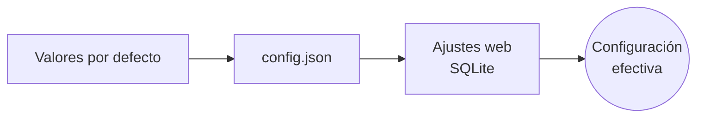

# Configuración

## Dos niveles de configuración



| Nivel | Dónde | Qué | Cuándo se aplica |
|---|---|---|---|
| **`config.json`** | `/etc/storageweb/config.json` (paquetes), `/data/config.json` (Docker) | Todo. Lo de arranque (`server`, `data_dir`, `database`, `secret_key`, `session`) **solo** se puede configurar aquí | Al reiniciar el servicio |
| **Ajustes web** | *Administración → Ajustes*, guardados en la base de datos | `app_name`, `default_locale`, `storage`, `permissions`, `auth` y `security` | Al momento, sin reiniciar |

- **Prioridad:** los ajustes web ganan sobre `config.json`, sección por sección.
- **Vuelta atrás:** *Restablecer a config.json* (en la web) o `storageweb-admin settings-reset` descartan los ajustes web.
- **Secretos:** el `client_secret` de Entra ID nunca se muestra. Si dejas el campo vacío, se conserva el actual o el de `config.json`.

!!! note "¿Cuál uso?"
    Para un servidor gestionado con Ansible, Puppet o similares, usa `config.json` y no toques los ajustes web. Para una instalación administrada desde el navegador, usa los ajustes web. Mezclar ambos funciona, pero la web gana.

## Dónde se busca `config.json`

Por este orden:

1. `--config RUTA`;
2. la variable `STORAGEWEB_CONFIG`;
3. `/etc/storageweb/config.json`, si existe (Linux y macOS);
4. `./config/config.json` en el directorio actual.

Las **rutas relativas** del fichero se resuelven respecto a la carpeta donde está el propio `config.json`.

## Validar

```bash
sudo storageweb-admin check-config
```

El comando muestra:

- las rutas efectivas;
- los métodos de inicio de sesión activos;
- si cada carpeta compartida existe;
- un aviso si no hay ningún administrador.

## Ejemplos

### Idioma

```json
"default_locale": "en"
```

La interfaz y la CLI están en inglés (`en`, por defecto) y español (`es`). El idioma de cada petición se elige por este orden:

1. la preferencia del usuario, guardada al pulsar ES/EN (o con `storageweb-admin user-set <usuario> --locale en`);
2. el idioma elegido en la sesión;
3. el `Accept-Language` del navegador;
4. `default_locale`.

La CLI usa `STORAGEWEB_LANG`, o `LC_ALL`/`LANG` (por ejemplo `STORAGEWEB_LANG=en storageweb-admin check-config`). Los logs siempre están en inglés.

### Carpetas compartidas

```json
"storage": {
  "home_template": "/srv/storageweb/homes/{username}",
  "max_file_size_mb": 0,
  "shares": [
    {"name": "comun", "label": "Común", "path": "/srv/storageweb/shared", "users": ["*"]},
    {"name": "rrhh", "label": "RR. HH.", "path": "/srv/rrhh", "groups": ["rrhh"]},
    {"name": "manuales", "label": "Manuales", "path": "/srv/manuales", "read_only": true, "users": ["*"]}
  ]
}
```

El acceso se concede si el usuario aparece en `users` (`*` = todos) **o** pertenece a uno de los `groups`. Las rutas deben existir y ser accesibles para el usuario del servicio, salvo que actives `create_shares`.

### Permisos del rol `user`

```json
"permissions": {"user": {"upload": true, "download": true, "mkdir": true, "rename": true, "delete": false}}
```

### Límites

```json
"server":  {"max_upload_mb": 2048},
"storage": {"max_file_size_mb": 10240},
"security": {"max_login_failures": 5, "lockout_minutes": 15}
```

`server.max_upload_mb` limita cada **petición** (y requiere reinicio). `storage.max_file_size_mb` limita cada **archivo**.

La lista completa de opciones está en la [referencia de configuración](../referencia/configuracion.md).
