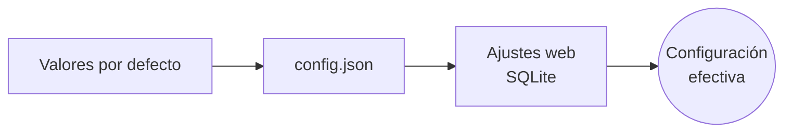

# Configuración

## Dos niveles de configuración



| Nivel | Dónde | Qué | Cuándo se aplica |
|---|---|---|---|
| **`config.json`** | `/etc/storageweb/config.json` (paquetes), `/data/config.json` (Docker) | Todo. Lo de arranque (`server`, `data_dir`, `database`, `secret_key`, `session`) **solo** se puede configurar aquí | Al reiniciar el servicio |
| **Ajustes web** | Páginas de la administración, guardados en la base de datos | `app_name`, `default_locale`, `branding`, `network`, `storage`, `permissions`, `auth`, `security` y `maintenance` | Al momento, sin reiniciar |

- **Prioridad:** los ajustes web ganan sobre `config.json`, **campo a campo**. Solo se guarda lo que cambias en la web; lo demás sigue saliendo de `config.json`, también si lo cambias después en el fichero.
- **Origen de cada valor:** los valores cambiados en la web llevan la etiqueta **web** y un botón *Restablecer* que vuelve al de `config.json`; el submenú de cada zona cuenta cuántos hay por página. *Sistema → Información* los lista todos.
- **Vuelta atrás completa:** *Sistema → Información → Restablecer todo a config.json* (en la web) o `storageweb-admin settings-reset` descartan los ajustes web.
- **Secretos:** el `client_secret` de Entra ID nunca se muestra. Si dejas el campo vacío, se conserva el actual o el de `config.json`.

!!! note "¿Cuál uso?"
    Para un servidor gestionado con Ansible, Puppet o similares, usa `config.json` y no toques los ajustes web. Para una instalación administrada desde el navegador, usa los ajustes web. Mezclar ambos funciona, pero la web gana.

## La administración

La barra lateral tiene *Archivos* y, para los administradores, el **Resumen** y cuatro zonas. Cada zona tiene un submenú a la izquierda (arriba en pantallas estrechas):

| Zona | Páginas |
|---|---|
| **Resumen** | Avisos que necesitan atención (secreto de Entra ID a punto de caducar, carpetas que no existen, copias automáticas que no se hacen, problemas de red), una tarjeta por zona, tareas frecuentes y la actividad reciente. El número rojo de la barra lateral cuenta los avisos |
| **Personas** | Usuarios · Grupos · Sesiones y tokens |
| **Acceso** | Carpetas compartidas · Matriz de accesos · Permisos del rol · Carpetas personales |
| **Seguridad** | Inicio de sesión · Reglas de bloqueo · IPs bloqueadas · Auditoría |
| **Sistema** | General y marca · Red y HTTPS · Mantenimiento · Copias y base de datos · Información |

Cada página dice de qué tipo es:

- **Configuración · se aplica al guardar:** un formulario. La barra de guardar aparece al cambiar algo y dice cuántos cambios hay; el navegador avisa si sales sin guardar. Si un valor no es válido, el error sale junto al campo y no se guarda nada.
- **Operación · se aplica al momento:** acciones que se hacen al pulsar (cerrar sesiones, bloquear una IP, crear una copia…).
- **Solo lectura:** *Información* y *Auditoría*.

Las direcciones de las secciones de ajustes no cambian (`/admin/settings/auth`, `/admin/settings/ips`…); `/admin/settings/shares` redirige a *Acceso → Carpetas compartidas*.

### Buscador

**Ctrl+K** (o la tecla `/`) abre el buscador desde cualquier página. Encuentra páginas, ajustes, acciones frecuentes, usuarios, grupos y carpetas compartidas, sin distinguir mayúsculas ni tildes. Un ajuste lleva a su página, abre la pestaña que lo contiene y resalta el campo. Sin JavaScript, el cuadro del Resumen lleva a una página de resultados (`/admin/search?q=…`).

### Carpetas compartidas

*Acceso → Carpetas compartidas* muestra cada carpeta con quién entra y con qué permiso, y avisa si la ruta no existe en el servidor. En la ficha de cada carpeta se cambian el nombre, la etiqueta, la ruta y *Solo lectura para todos*, y se da o se quita el acceso a **todos los usuarios**, a un **usuario** o a un **grupo**, cada uno con *Lectura y escritura* o *Solo lectura*. Quitar una carpeta no borra sus archivos. La *Matriz de accesos* es la misma información vista por grupos.

## Dónde se busca `config.json`

Por este orden:

1. `--config RUTA`;
2. la variable `STORAGEWEB_CONFIG`;
3. `/etc/storageweb/config.json`, si existe (Linux y macOS);
4. `./config/config.json` en el directorio actual.

Las **rutas relativas** del fichero se resuelven respecto a la carpeta donde está el propio `config.json`.

## Validar

```bash
sudo storageweb-admin check-config
```

El comando muestra:

- las rutas efectivas;
- los métodos de inicio de sesión activos;
- si cada carpeta compartida existe;
- un aviso si no hay ningún administrador.

## Ejemplos

### Idioma

```json
"default_locale": "en"
```

La interfaz y la CLI están en inglés (`en`, por defecto) y español (`es`). El idioma de cada petición se elige por este orden:

1. la preferencia del usuario, guardada al pulsar ES/EN (o con `storageweb-admin user-set <usuario> --locale en`);
2. el idioma elegido en la sesión;
3. el `Accept-Language` del navegador;
4. `default_locale`.

La CLI usa `STORAGEWEB_LANG`, o `LC_ALL`/`LANG` (por ejemplo `STORAGEWEB_LANG=en storageweb-admin check-config`). Los logs siempre están en inglés.

### Carpetas compartidas

```json
"storage": {
  "home_template": "/srv/storageweb/homes/{username}",
  "max_file_size_mb": 0,
  "shares": [
    {"name": "comun", "label": "Común", "path": "/srv/storageweb/shared", "users": ["*"]},
    {"name": "rrhh", "label": "RR. HH.", "path": "/srv/rrhh", "groups": ["rrhh"]},
    {"name": "manuales", "label": "Manuales", "path": "/srv/manuales", "read_only": true, "users": ["*"]}
  ]
}
```

El acceso se concede si el usuario aparece en `users` (`*` = todos) **o** pertenece a uno de los `groups`. Cada vía puede ser de solo lectura: `read_only_users` (usuarios de `users`, o `*`) y `read_only_groups` (grupos de `groups`). Se puede escribir si **alguna** de las vías por las que entra el usuario lo permite; `read_only: true` deja la carpeta en solo lectura para todos.

```json
{"name": "software", "path": "/srv/software", "users": ["*", "ana"], "read_only_users": ["*"],
 "groups": ["sistemas"]}
```

Aquí todos leen, y `ana` y el grupo `sistemas` además escriben. Las rutas deben existir y ser accesibles para el usuario del servicio, salvo que actives `create_shares`.

### Permisos del rol `user`

```json
"permissions": {"user": {"upload": true, "download": true, "mkdir": true, "rename": true, "delete": false}}
```

### Límites

```json
"server":  {"max_upload_mb": 2048},
"storage": {"max_file_size_mb": 10240},
"security": {"max_login_failures": 5, "lockout_minutes": 15}
```

`server.max_upload_mb` limita cada **petición** (y requiere reinicio). `storage.max_file_size_mb` limita cada **archivo**.

La lista completa de opciones está en la [referencia de configuración](../referencia/configuracion.md).
