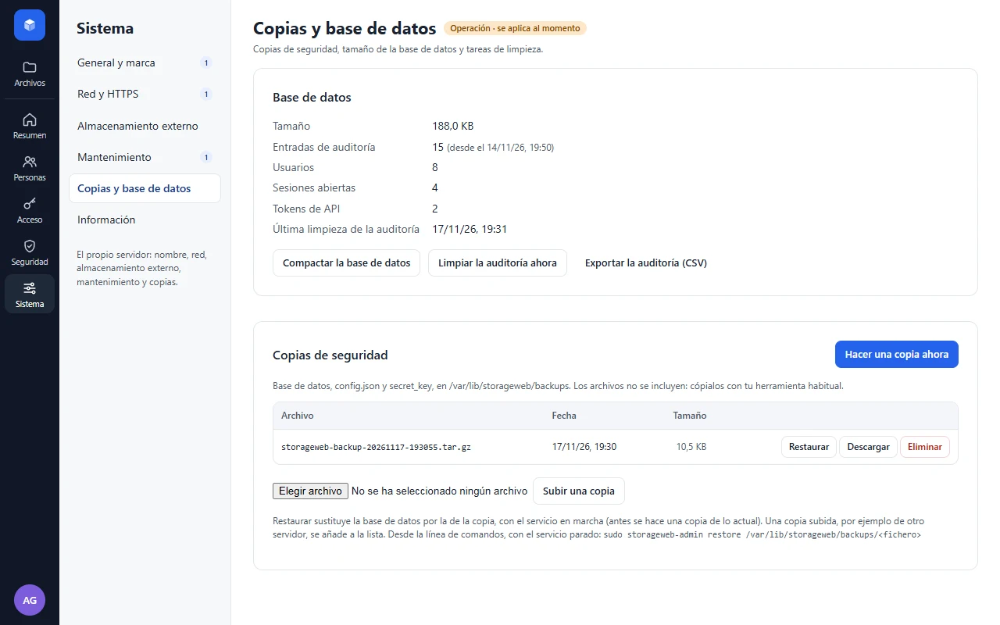
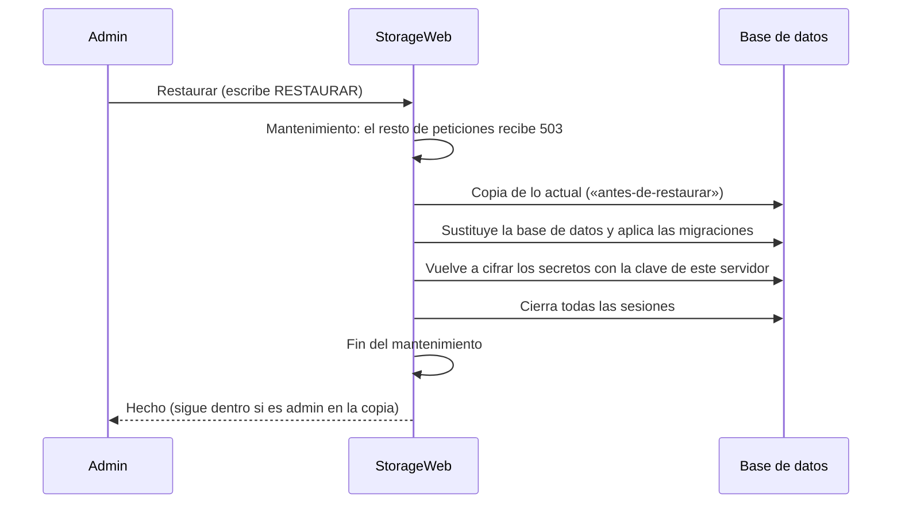

# Copias de seguridad

Hay que proteger dos cosas, y cada una se copia de forma distinta:

| Qué | Contiene | Cómo |
|---|---|---|
| **Estado del servicio** | Base de datos (usuarios, ajustes web, auditoría), `config.json`, `secret_key`, `secrets.key` | `storageweb backup` |
| **Archivos de los usuarios** | `/srv/storageweb` (homes y carpetas compartidas) | Herramientas incrementales: rsync, borg, restic o snapshots |

## `storageweb backup`

```bash
sudo storageweb-admin backup --keep 14
# /var/lib/storageweb/backups/storageweb-backup-20261112-031500.tar.gz
sudo storageweb-admin backup-list
```

- **Copia consistente** con el servicio en marcha: usa la API de backup en línea de SQLite y comprueba la integridad de la copia. Copiar el fichero `.db` a mano mientras el servicio escribe puede dar una copia dañada.
- **Contenido:** `manifest.json` (versión y esquema), `storageweb.db`, `config.json`, `secret_key` y `secrets.key` (la [clave de los secretos](seguridad.md#secretos-guardados) de los ajustes).
- **Permisos `0600`:** contiene hashes de contraseñas y, con la clave, los secretos de los ajustes (el `client_secret`, contraseñas de ubicaciones), así que guárdala cifrada fuera del servidor.
- **Rotación:** `--keep N` conserva las N más recientes de la carpeta. Con `--output DIR` eliges otra carpeta.

## Desde la web

*Sistema → Copias y base de datos* lista las copias de `<data_dir>/backups`, crea una al momento, las descarga, las borra, **las restaura** y permite **subir** una copia (de este u otro servidor) para restaurarla; también compacta la base de datos y limpia la auditoría antigua.

En *Sistema → Copias automáticas* se configuran la **copia automática** cada N horas (`maintenance.backup_interval_hours`) hecha por el propio servicio, conservando `backup_keep` (una alternativa al timer de systemd: no actives los dos), y la [copia fuera del servidor](#copia-fuera-del-servidor). La retención de la auditoría está en *Seguridad → Registro de auditoría*.



### Restaurar desde la web

El botón **Restaurar** de cada copia lleva a una página con lo que contiene la copia (fecha, versión) y lo que va a pasar. Hay que escribir **RESTAURAR** para confirmarlo. Entonces, con el servicio en marcha:



1. El servicio se pone **en mantenimiento**: el resto de peticiones (web, unidad de red, API) reciben `503` con `Retry-After` durante el momento que dura.
2. Se hace una **copia de lo actual**, `storageweb-backup-antes-de-restaurar-<fecha>.tar.gz`, para poder volver atrás (restaurándola igual).
3. La base de datos se sustituye por la de la copia con la API de copia de SQLite, que no deja nunca un fichero a medias, y se aplican las migraciones si la copia es de una versión anterior. Las de una versión **más nueva** se rechazan.
4. Se **cierran todas las sesiones**, para que no revivan las que había cuando se hizo la copia. Quien restaura sigue dentro si su cuenta es un administrador activo en la copia; si no, vuelve a la página de inicio de sesión.
5. Queda en la auditoría (de la base de datos restaurada) como `backup_restored`.

Desde la web **no** se restauran `config.json` ni la `secret_key` (las sesiones firmadas seguirían valiendo), ni, claro, los archivos de los usuarios. Los secretos de la copia se vuelven a cifrar con la clave de este servidor (con la de la copia, que va dentro), así que también funciona con una copia de otro servidor. Si varias instancias comparten la base de datos (`settings_profile`), para las demás antes de restaurar: solo la que restaura se pone en mantenimiento.

Las copias de antes de restaurar y las subidas no entran en la rotación (`backup_keep`): se quedan hasta que las borres.

## Programar las copias

=== "systemd (deb, rpm, Gentoo)"

    El timer viene instalado pero desactivado: hace una copia diaria a las 03:15 y conserva 14.

    ```bash
    sudo systemctl enable --now storageweb-backup.timer
    systemctl list-timers storageweb-backup.timer
    journalctl -u storageweb-backup.service
    ```

    Para cambiar la hora o la retención, usa `sudo systemctl edit storageweb-backup.timer` o `storageweb-backup.service`.

=== "cron (OpenRC)"

    ```cron
    # /etc/cron.d/storageweb
    15 3 * * *  root  storageweb-admin backup --keep 14 >/dev/null
    ```

=== "Docker"

    ```bash
    docker exec storageweb storageweb backup --keep 14     # queda en el volumen: /data/db/backups
    ```

Después, sácalas del servidor: con la [copia fuera del servidor](#copia-fuera-del-servidor) de StorageWeb o con rsync, restic o similar. Una copia que solo está en el mismo disco no protege frente a la pérdida del disco.

## Copia fuera del servidor

StorageWeb puede enviar cada copia, además, a una [ubicación de almacenamiento](almacenamiento.md) (un bucket S3, un NAS por SMB, un servidor SFTP…). Se configura en *Sistema → Copias automáticas → Copia fuera del servidor*:

- **Enviar también las copias a** (`maintenance.offsite_location`): la ubicación; vacío = solo en este servidor.
- **Carpeta en la ubicación** (`maintenance.offsite_path`, `storageweb-backups` por defecto): se crea si no existe.
- **Copias que se conservan en la ubicación** (`maintenance.offsite_keep`, 14): las más antiguas se borran allí al enviar otra. Las de *antes de restaurar* y las subidas a mano no se borran solas.

Se envían todas: la automática del servicio, la de *Crear una copia ahora* y la de `storageweb backup` (también la del timer de systemd o de cron, que lee la ubicación aunque se haya elegido desde la web; `--no-offsite` para no enviarla). Si el envío falla, la copia del servidor se queda igualmente, el *Resumen* lo avisa y en *Copias y base de datos* cada copia tiene **Enviar fuera** para reintentarlo. En la auditoría quedan `backup_offsite` y `backup_offsite_failed`.

!!! warning "Llevan la base de datos y las claves"
    Una copia contiene los hashes de las contraseñas, `secret_key` y `secrets.key` (con la que se descifran los secretos de los ajustes). Usa una ubicación a la que solo lleguen los administradores, con su propio usuario y, si el servicio lo permite, cifrado en reposo y versiones (S3 *Object Lock*, instantáneas del NAS) para que un atacante que entre en el servidor no pueda borrarlas.

**Recuperar un servidor perdido:** instala StorageWeb en uno nuevo, da de alta la misma ubicación y elígela en *Copias automáticas*. En *Copias y base de datos → Fuera del servidor*, **Ver las copias de allí** las lista (solo se conecta cuando lo pides); **Traer a este servidor** descarga una a la lista de copias, comprueba que se puede restaurar y desde ahí se **restaura** como cualquier otra (auditoría `backup_fetched`).

## Archivos de los usuarios

Un ejemplo con restic:

```bash
restic -r sftp:backup@nas:/storageweb backup /srv/storageweb /var/lib/storageweb/backups
```

Se pueden copiar en caliente. Los ficheros `.sw-upload-*.part` son subidas en curso y se pueden excluir.

## Restaurar desde la línea de comandos

También restaura la `secret_key` y, si se pide, `config.json`. Se hace con el servicio parado:

1. Para el servicio: `sudo systemctl stop storageweb` (o `rc-service storageweb stop`, o `docker stop`).
2. Restaura:
   ```bash
   sudo storageweb-admin restore /ruta/storageweb-backup-AAAAMMDD-HHMMSS.tar.gz --force
   ```
   - Antes guarda la base de datos actual como `storageweb.db.antes-de-restaurar-<fecha>`.
   - Comprueba la integridad de la copia.
   - Restaura la `secret_key` y aplica las migraciones pendientes si la copia es de una versión anterior.
   - Vuelve a cifrar los secretos con la clave de este servidor (si no tenía, se queda con la de la copia).
   - Se niega a restaurar copias de una versión **más nueva** que la instalada.
3. Si necesitas también la configuración, añade `--config-to /tmp/config.restaurado.json` y revísala antes de copiarla a `/etc/storageweb/config.json`.
4. Arranca el servicio y comprueba: `storageweb-admin check-config` y `storageweb-admin audit --limit 5`.

Restaura los archivos de los usuarios con la herramienta con la que los copiaste.

!!! tip "Prueba la restauración"
    Una copia que nunca se ha restaurado no es una copia. Restáurala de vez en cuando en otra máquina o en otro `data_dir`:
    `storageweb --config /tmp/prueba.json restore copia.tar.gz`.
