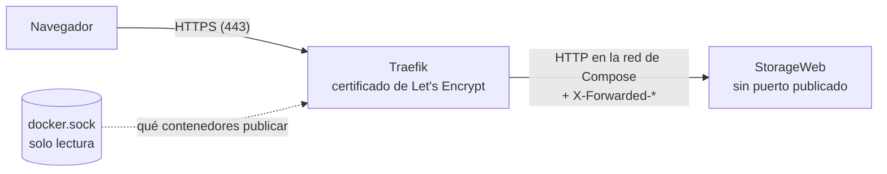

# Docker

Cada release publica la imagen `ghcr.io/vsc55/storageweb` para **amd64** y **arm64**, con las etiquetas:

- `X.Y.Z` y `X.Y`;
- `latest`, que solo se mueve con versiones estables, no con *pre-releases*.

## Arranque

```bash
docker run -d --name storageweb --restart unless-stopped \
  -p 8080:8080 -v storageweb-data:/data \
  -e STORAGEWEB_ADMIN_USER=admin -e STORAGEWEB_ADMIN_PASSWORD='una-clave-larga' \
  ghcr.io/vsc55/storageweb:latest
```

Con Compose, desde una copia del repositorio: el `compose.yaml` de la raíz compila la imagen con el código y sirve solo HTTP, para desarrollo y pruebas. Para un servidor, ver [Caddy o Traefik](#https-caddy-o-traefik).

```bash
printf 'una-clave-larga' > admin_password.txt      # se pasa al contenedor como secret
docker compose up -d
```

## HTTPS: Caddy o Traefik

En producción hace falta HTTPS delante: Entra ID lo exige y la cookie de sesión solo viaja cifrada. Hay dos ficheros de Compose completos en `packaging/docker/`. Los dos piden el certificado a Let's Encrypt, lo renuevan solos y dejan StorageWeb sin puerto publicado.

No hace falta el código: cada fichero usa la imagen publicada y se descarga solo, en una carpeta vacía del servidor (por ejemplo, `/opt/storageweb`). Junto a él van el `.env` con tu nombre y la contraseña del primer administrador.

| | `compose.caddy.yaml` | `compose.traefik.yaml` |
|---|---|---|
| Configuración | Un `Caddyfile` corto, dentro del propio fichero | Opciones de Traefik y etiquetas en el contenedor |
| Socket de Docker | No lo necesita | Lo lee para saber qué publicar (ver el aviso abajo) |
| Cuándo | **Solo StorageWeb en el equipo**: lo más sencillo | Ya usas Traefik, o publicas varios servicios con etiquetas |

## Con Caddy (HTTPS)

```bash
mkdir -p /opt/storageweb && cd /opt/storageweb
curl -fLO https://raw.githubusercontent.com/vsc55/StorageWeb/master/packaging/docker/compose.caddy.yaml
echo 'STORAGEWEB_DOMAIN=files.midominio.com' > .env
printf 'una-clave-larga' > admin_password.txt
docker compose -f compose.caddy.yaml up -d
```

Necesita Docker Compose 2.23.1 o posterior: el `Caddyfile` va dentro del fichero, en `configs: … content:`. Caddy ya hace solo lo que en nginx hay que escribir:

- redirigir HTTP a HTTPS;
- usar solo TLS 1.2 y 1.3;
- no guardar en disco las subidas ni las descargas;
- sustituir `X-Forwarded-For`, `-Proto` y `-Host` por los suyos.

El `Caddyfile` añade lo propio de StorageWeb:

| Directiva | Por qué |
|---|---|
| `request_body { max_size … }` | Tamaño máximo de petición, ≥ `STORAGEWEB_MAX_UPLOAD_MB`. La [unidad de red](../uso/unidad-de-red.md) sube cada archivo en una sola petición. |
| `reverse_proxy storageweb:8080` | El contenedor de StorageWeb, por su nombre en la red de Compose. |
| `header_up -X-Forwarded-Prefix` | La subruta solo la dice el proxy: se quita la que mande el cliente. |
| `flush_interval -1` | Descargas y ZIP al momento, sin esperar a llenar un búfer. |

Si el servidor solo está en una red interna, Let's Encrypt no puede comprobar el nombre. Añade dentro del bloque del nombre una de las opciones de certificado de la [plantilla comentada](https.md#caddy): `tls internal` o tu propio certificado (montado en el contenedor). Los certificados se guardan en el volumen `caddy-data`; no lo borres, porque Let's Encrypt limita cuántos se pueden pedir por semana.

## Con Traefik (HTTPS)

Traefik lee de Docker qué contenedores publicar. `packaging/docker/compose.traefik.yaml` trae Traefik y StorageWeb:

```bash
mkdir -p /opt/storageweb && cd /opt/storageweb
curl -fLO https://raw.githubusercontent.com/vsc55/StorageWeb/master/packaging/docker/compose.traefik.yaml
cat > .env <<'FIN'
STORAGEWEB_DOMAIN=files.midominio.com
ACME_EMAIL=admin@midominio.com
FIN
printf 'una-clave-larga' > admin_password.txt
docker compose -f compose.traefik.yaml up -d
```

El nombre tiene que apuntar al equipo, y los puertos 80 y 443 tienen que llegar desde internet: Let's Encrypt lo comprueba conectando al 443. Si el servidor solo está en una red interna, cambia `tlsChallenge` por la validación por DNS de tu proveedor (`--certificatesResolvers.le.acme.dnsChallenge.provider=…` con sus credenciales en variables de entorno; ver la documentación de Traefik).



### Qué hay en el fichero y por qué

| Dónde | Qué | Por qué |
|---|---|---|
| Traefik | `entryPoints.web` redirige a `websecure` | Todo HTTP pasa a HTTPS. |
| Traefik | `respondingTimeouts.readTimeout=0` | **Traefik 3 corta a los 60 s la lectura de una petición entera.** Las subidas desde el navegador van en partes de hasta 32 MB y no lo notan, pero la [unidad de red](../uso/unidad-de-red.md) sube cada archivo en una sola petición. Sin límite, o un valor grande (`2h`), si prefieres acotarlo. |
| Traefik | `encodedCharacters.allowEncodedPercent`, `…QuestionMark`, `…Hash`, `…Semicolon` | Los nombres de archivo con `%`, `?`, `#` o `;` llegan codificados (`%25`, `%3F`, `%23`, `%3B`). Desde Traefik 3.6.4, según la versión, se rechazan por defecto con un 400. StorageWeb valida cada ruta por su cuenta. |
| Traefik | `certificatesResolvers.le` | El certificado de Let's Encrypt, guardado en el volumen `traefik-certs`. |
| Traefik | `providers.docker.exposedByDefault=false` | Solo se publica lo que tiene `traefik.enable=true`. |
| StorageWeb | sin `ports:` | Solo se llega a través de Traefik. Con `behind_proxy`, publicar el puerto permitiría falsear la IP de origen (`X-Forwarded-For`) y saltarse el bloqueo de intentos. |
| StorageWeb | `STORAGEWEB_PUBLIC_URL` | El nombre público, para las direcciones que salen hacia fuera (Entra ID). |
| Etiqueta | `headers.customrequestheaders.X-Forwarded-Prefix=` | La subruta solo la dice el proxy: vacía, se quita la que mande el cliente. `X-Forwarded-For`, `-Proto` y `-Host` ya los sustituye Traefik, que por defecto no se fía de los del cliente. |
| Etiqueta | `loadbalancer.server.port=8080` | El puerto del contenedor. |

No hace falta nada para el tamaño de las peticiones ni para las descargas: Traefik no pone límite y no guarda en disco ni las subidas ni las descargas. TLS 1.2 como mínimo es lo que hace por defecto.

*Sistema → Red y HTTPS* genera las etiquetas con tu nombre y tu subruta. Bajo una subruta (`www.midominio.com/archivos`), añade `PathPrefix` a la regla y el middleware `stripprefix`, que además envía la `X-Forwarded-Prefix` correcta.

!!! warning "El socket de Docker"
    Traefik necesita leer `/var/run/docker.sock`. Aun montado en solo lectura, quien controle el contenedor de Traefik puede controlar Docker y, con él, el equipo. Para reducirlo, pon delante un proxy del socket que solo permita leer contenedores (por ejemplo, `tecnativa/docker-socket-proxy` con `CONTAINERS=1`) y apunta Traefik a él con `--providers.docker.endpoint=tcp://…:2375`.

Traefik solo envía tráfico a un contenedor cuando su *healthcheck* dice que está sano. Durante los primeros segundos tras arrancar, StorageWeb responde 404.

## Qué hace el contenedor

1. En el primer arranque genera `/data/config.json` solo con lo propio del contenedor:
   - escucha en `0.0.0.0`;
   - datos en `/data/db`;
   - carpetas personales en `/data/files/homes`.

   Lo demás se configura desde la web o con variables de entorno. Lo que pongas en el fichero queda bloqueado en la web (ver [capas de configuración](configuracion.md#capas-de-configuracion)).
2. Si defines `STORAGEWEB_ADMIN_USER` y ese usuario no existe, lo crea con rol `admin`. La contraseña se pasa por stdin, nunca como argumento visible.
3. Ejecuta `storageweb serve` como el usuario sin privilegios `storageweb` (uid/gid **10001**).

## Volumen `/data`

```
/data/
  config.json          configuración (editable)
  db/                  storageweb.db, secret_key, backups/
  files/homes/<usuario>
  files/shared/
```

Para guardar los archivos en una carpeta del host:

```bash
sudo chown -R 10001:10001 /srv/archivos
docker run ... -v storageweb-data:/data -v /srv/archivos:/data/files ...
```

## Variables de entorno

| Variable | Uso |
|---|---|
| `STORAGEWEB_ADMIN_USER` | Usuario admin que se crea si no existe |
| `STORAGEWEB_ADMIN_PASSWORD` / `STORAGEWEB_ADMIN_PASSWORD_FILE` | Su contraseña (mínimo 10 caracteres). Preferible `_FILE` con un *secret* |
| `STORAGEWEB_CONFIG` | Ruta del config (por defecto `/data/config.json`) |
| `STORAGEWEB_PORT` | Puerto (por defecto `8080`) |
| `STORAGEWEB_BEHIND_PROXY` | `true`/`false` (por defecto `true`) |
| `STORAGEWEB_COOKIE_SECURE` | `true`/`false` (por defecto `true`) |
| `STORAGEWEB_PUBLIC_URL` | Nombre público (FQDN), p. ej. `files.midominio.com`; se asume HTTPS (por defecto vacío: el host de cada petición) |
| `STORAGEWEB_PROXY_HOPS` | Proxies encadenados delante del contenedor (por defecto `1`) |
| `STORAGEWEB_MAX_UPLOAD_MB` | Máximo por petición (por defecto `2048`) |
| `STORAGEWEB_APP_NAME` | Nombre visible |
| `STORAGEWEB_<RUTA>` | Cualquier ajuste, con `__` entre niveles: `STORAGEWEB_AUTH__ENTRA__CLIENT_ID`. Ver la [referencia](../referencia/configuracion.md) |
| `STORAGEWEB_SETTINGS_PROFILE` | Perfil de ajustes web, para compartir base de datos entre instancias |
| `HTTPS_PROXY`, `NO_PROXY` | Proxy de salida para Entra ID |

Las variables se leen **en cada arranque** y ganan sobre `config.json` y sobre la web. El ajuste que fijan queda bloqueado en la web, que muestra qué variable lo fija. Para poder cambiarlo desde la web, quita la variable y vuelve a crear el contenedor.

!!! tip "Probar sin HTTPS"
    `-e STORAGEWEB_COOKIE_SECURE=false -e STORAGEWEB_BEHIND_PROXY=false` en un volumen nuevo. Si no, el login vuelve a la página de inicio, porque el navegador no envía la cookie segura por HTTP.

## Operación

```bash
docker exec -it storageweb storageweb user-list
docker exec -it storageweb storageweb backup --keep 14      # copia en /data/db/backups
docker logs -f storageweb
docker inspect -f '{{.State.Health.Status}}' storageweb     # healthcheck contra /healthz
```

Actualizar: `docker pull ghcr.io/vsc55/storageweb:latest`, y luego `docker rm -f storageweb` y el mismo `docker run`. Con Compose: `docker compose -f compose.caddy.yaml pull` y `… up -d`. Las migraciones de la base de datos se aplican solas. Haz antes una [copia de seguridad](copias-seguridad.md).

## Compilar la imagen

```bash
docker build --build-arg VERSION=1.2.0 -t storageweb:1.2.0 .
```
