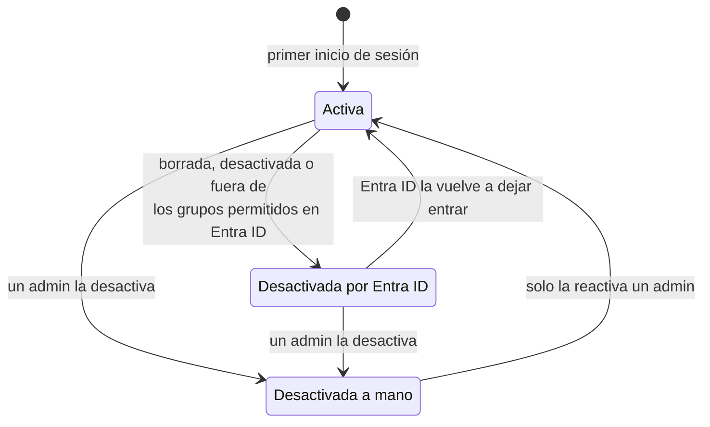
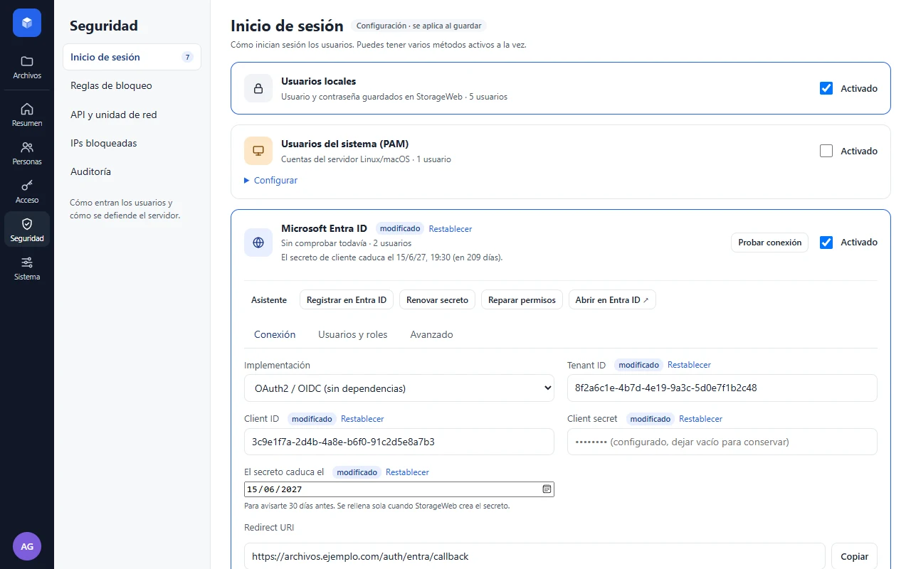
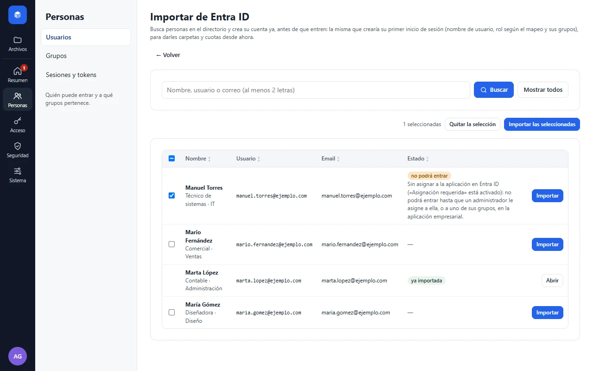

# Microsoft Entra ID (SSO)


## Registro automático (recomendado)

*Seguridad → Inicio de sesión → **Registrar en Entra ID*** crea la aplicación por ti:

1. Elige el nombre y las opciones: App Roles `StorageWeb.Admin` y `StorageWeb.User`, claim de grupos y si solo pueden entrar los usuarios asignados.
2. Pulsa *Iniciar sesión con Microsoft y registrar*. Abre `microsoft.com/devicelogin` en cualquier dispositivo, escribe el código e inicia sesión con una cuenta que pueda registrar aplicaciones (Administrador de aplicaciones o Administrador global).
3. StorageWeb crea con Microsoft Graph la aplicación (solo para tu organización, Redirect URI, permisos `openid profile email User.Read`), un secreto de 24 meses (o los que digas en `auth.entra.secret_months`, si las directivas de tu tenant piden menos), la aplicación empresarial y el consentimiento de administrador. Si se crean los App Roles, te asigna `StorageWeb.Admin` y lo mapea al rol de administrador.
4. Guarda el tenant, el cliente y el secreto en los ajustes y te lleva al último paso del asistente, que comprueba la conexión y activa Entra ID.

Requisitos y detalles:

- La Redirect URI sale del **nombre público** (*Red y HTTPS*); Entra ID solo acepta HTTPS (o `localhost`).
- El inicio de sesión usa el flujo de código de dispositivo con el cliente público de Microsoft *Microsoft Graph Command Line Tools* (el de `Connect-MgGraph`), con los permisos delegados `Application.ReadWrite.All`, `DelegatedPermissionGrant.ReadWrite.All` y `AppRoleAssignment.ReadWrite.All`. La primera vez Microsoft puede pedir que lo autorices. StorageWeb no guarda ese token.
- El consentimiento de administrador y la asignación del rol son de mejor esfuerzo: si fallan, la aplicación ya funciona y el asistente muestra el aviso y el enlace al portal.
- Apunta la caducidad del secreto: el asistente la muestra al terminar.

Si prefieres hacerlo a mano, sigue los pasos de abajo.

## Caducidad y renovación del secreto

El registro automático guarda la fecha de caducidad del secreto (`auth.entra.secret_expires`); si registraste la aplicación a mano, ponla en *Inicio de sesión → Conexión*. Desde 30 días antes (`auth.entra.secret_warn_days`), los administradores ven un aviso en todas las páginas.

*Renovar secreto* inicia sesión con Microsoft (el mismo código de dispositivo) y crea un secreto nuevo en la aplicación existente, que se guarda solo. El anterior sigue funcionando hasta su caducidad; puedes borrarlo después en el portal.

## Nombres de los grupos

Los grupos de Entra ID dados de alta toman de Entra ID su **nombre y descripción** (al darlos de alta, al iniciar sesión sus miembros, en la revisión periódica y al abrir su ficha), así que en StorageWeb se ven pero no se editan.

Para mostrar los grupos de Entra ID con su nombre en lugar del Object ID (en *Grupos*, en la ficha de los usuarios, en el buscador al dar de alta un grupo y en los ajustes de Entra ID: la tabla de asociaciones grupo → rol y los grupos permitidos muestran el nombre de cada Object ID, y basta con escribir parte del nombre de un grupo para encontrar su Object ID, también en el asistente), la aplicación necesita el permiso de aplicación `Group.Read.All` con consentimiento de administrador. El registro automático lo concede (opción marcada por defecto). Para una aplicación existente, *Probar conexión* avisa si falta y ofrece **Reparar automáticamente** (abajo). Sin el permiso todo funciona igual, solo que se ven los Object IDs.

## Cuentas al día con Entra ID



Un usuario de Entra ID puede seguir entrando sin pasar por Microsoft mientras tenga una **sesión abierta** (hasta `session.lifetime_hours`) o un **token de API** (la extensión de VS Code, la unidad de red, scripts), que puede no caducar. Por eso StorageWeb revisa periódicamente esas cuentas contra Entra ID (`auth.entra.directory_sync_minutes`, cada 60 minutos por defecto; `0` = solo al iniciar sesión):

- si la cuenta **se ha borrado o desactivado** en Entra ID, o ya **no está en los grupos permitidos** (`allowed_groups`), se desactiva en StorageWeb y se cierran sus sesiones; sus tokens dejan de valer mientras tanto. En su ficha se indica que la desactivó Entra ID;
- si Entra ID la **vuelve a dejar entrar**, se activa sola (en la revisión o en cuanto inicie sesión). Una cuenta desactivada **a mano** por un admin no se reactiva nunca sola;
- sus **grupos** y su **rol** (`role_mappings`) se actualizan como en un inicio de sesión. Los App Roles solo llegan en el token, así que se conservan los del último inicio de sesión;
- el **nombre y la descripción** de los grupos dados de alta se toman de Entra ID.

Solo se consultan las cuentas que pueden entrar sin Microsoft (con sesión o token vigente) y las que desactivó la propia revisión: las demás se ponen al día cuando inician sesión. Si Microsoft no responde, no se toca nada. Necesita los permisos de aplicación `User.Read.All` y `Group.Read.All` (los concede el registro automático y *Reparar permisos*). Los cambios quedan en la auditoría (`user_disabled`, `user_enabled`, `role_changed`, `directory_synced`).

### Usuarios con más de 200 grupos

Si alguien está en tantos grupos que no caben en el token, Microsoft no los manda (solo una referencia). StorageWeb los lee entonces de Microsoft Graph (`User.Read.All`). Si no puede, conserva los que tenía del inicio de sesión anterior; y si hay `allowed_groups`, no le deja entrar porque no puede comprobarlo («No se pudieron leer tus grupos…»).

### Cerrar sesión en Microsoft

Cuando alguien cierra sesión en Microsoft (en Office, en el portal…), Entra ID avisa a cada aplicación cargando su **URL de cierre de sesión de canal frontal** en un marco invisible. La de StorageWeb es `https://<tu-servidor>/auth/entra/frontchannel-logout`: cierra las sesiones de StorageWeb iniciadas con esa sesión de Microsoft (el claim `sid` del token). El registro automático la pone y pide el claim `sid`; en una aplicación existente lo hace *Reparar permisos*, y *Probar conexión* avisa si el token del último inicio de sesión no traía `sid`. Queda como `logout` con `entra:frontchannel`.

### Email y cambios de UPN

- El **email** de las cuentas de la organización solo llega en el token si la aplicación pide el claim opcional `email` (sin él, Microsoft solo manda el de los invitados y StorageWeb usa el UPN). El registro automático y *Reparar permisos* lo añaden. El nombre y el email se actualizan en cada inicio de sesión y no se editan en StorageWeb.
- La cuenta se identifica por el **origen + identificador de Entra ID** (`oid`), no por el nombre. Si cambia el **UPN** (`juan@contoso.com` → `juan.perez@contoso.com`), al iniciar sesión la cuenta se **renombra**: su carpeta personal se renombra en el disco del servidor (si la nueva no existe; si existe, o está en una ubicación remota, la cuenta conserva la antigua como ruta propia) y las carpetas compartidas que la nombraban pasan al nombre nuevo. Si el nombre nuevo ya es de otra cuenta, no se cambia. Queda como `user_renamed` (o `user_rename_failed`).

## Dirección de vuelta (Redirect URI)

Es `/auth/entra/callback` en la **dirección pública** (`network.public_url`, *Sistema → Red y HTTPS*) o, si no está configurada, en la dirección con la que entra el navegador (su host y puerto). **No se guarda ni se configura**: se calcula en cada petición, así que si cambias la dirección pública, la sigue. La tarjeta de Entra ID la muestra para copiarla. Entra ID solo acepta las que tenga registradas: el registro automático registra la actual y *Reparar permisos* añade la nueva si cambia. Sin dirección pública, cada nombre con el que se entre al servidor tendría que estar registrado; por eso el diagnóstico de red avisa.

## Implementaciones

| `auth.entra.provider` | Descripción |
|---|---|
| `oauth2` (por defecto) | Authorization Code + PKCE, implementado con la librería estándar de Python. No hace descubrimiento por red: las URLs se calculan a partir del tenant. Solo contacta con Microsoft al canjear el código durante el login. Con `authorize_url`, `token_url` e `issuer` sirve para cualquier proveedor OpenID Connect o nube soberana. |
| `msal` | Librería oficial de Microsoft. Descubre la autoridad por red en cada login. |

Los motivos de esta elección están en el [ADR 0003](../arquitectura/decisiones/0003-oauth2-propio.md). Si el servidor sale a Internet por un proxy, define `HTTPS_PROXY` en el servicio, por ejemplo con `systemctl edit storageweb` y una línea `Environment=HTTPS_PROXY=http://proxy:3128`.

## 1. Registrar la aplicación

1. En **Entra admin center → Identity → Applications → App registrations → New registration**:
   - nombre: `StorageWeb`;
   - tipo de cuenta: *Solo este directorio organizativo*;
   - Redirect URI: plataforma **Web**, `https://files.midominio.com/auth/entra/callback`.
2. En **Certificates & secrets → New client secret**, copia el *Value*. Anota también su fecha de caducidad.
3. En **API permissions**, deja `Microsoft Graph → User.Read`, que viene por defecto.
4. Elige cómo restringir el acceso o asignar roles:
   - **App Roles (recomendado):** en *App roles*, crea `StorageWeb.User` y `StorageWeb.Admin`. Asígnalos en *Enterprise applications → StorageWeb → Users and groups*.
   - **Grupos:** en *Token configuration → Add groups claim → Security groups*, marca la opción *Groups assigned to the application* para no superar el límite de 200 grupos del token.
5. Opcional: en *Enterprise applications → StorageWeb → Properties*, pon *Assignment required* = **Sí**. Así solo pueden entrar los usuarios asignados.

## 2. Configurar StorageWeb

La forma más rápida es el **asistente**: *Seguridad → Inicio de sesión → Asistente*. Te da la Redirect URI para copiar, pide los identificadores y el secreto, el alta de usuarios y el grupo de administradores, comprueba la conexión y activa Entra ID.



!!! tip "Probar conexión"
    El botón *Probar conexión* comprueba la configuración guardada sin que nadie inicie sesión: que el tenant existe (metadatos OIDC), que la aplicación existe y la Redirect URI está registrada (petición a `/authorize` con `prompt=none`) y que el secreto es válido y no ha caducado (token de aplicación con `client_credentials`). Después revisa **los permisos de la API, uno a uno**: cada permiso de aplicación que usa StorageWeb (`Group.Read.All` y `User.Read.All`), si está concedido con consentimiento de administrador y si funciona de verdad; si la aplicación tiene **permisos de más** que StorageWeb no usa, lo avisa (mínimo privilegio); y los **permisos de inicio de sesión** (`openid`, `profile`, `email` y los de `auth.entra.scopes`, como `User.Read`), según lo que Microsoft concedió en el último inicio de sesión, que StorageWeb apunta cada vez que alguien entra. Si la aplicación la registró o reparó StorageWeb, ya sabe que les dio el consentimiento y salen en verde desde el principio; si no, hasta el primer inicio de sesión salen como pendientes de comprobar. Necesita salida a `login.microsoftonline.com`. Con endpoints propios solo comprueba los metadatos del `issuer`.

!!! tip "Reparar automáticamente"
    Si la prueba encuentra algo que StorageWeb puede arreglar (la Redirect URI no está registrada, el secreto no es válido o ha caducado, o la aplicación no puede leer los nombres de los grupos), aparece **Reparar automáticamente**, en la tarjeta de Entra ID y en el paso 4 del asistente. Aunque todo parezca bien, el botón **Reparar permisos** de la cabecera de la tarjeta hace lo mismo cuando quieras (por ejemplo, para confirmar el consentimiento de una aplicación que no registró StorageWeb). Y **Abrir en Entra ID** lleva directamente a la aplicación en el Centro de administración de Entra. Inicias sesión con Microsoft con una cuenta que pueda gestionar aplicaciones (el mismo código de dispositivo que al registrar) y StorageWeb revisa la aplicación y arregla lo que falte, sin tocar lo que ya está bien:

    - añade la Redirect URI de StorageWeb y pone la URL de cierre de sesión de canal frontal;
    - añade los claims opcionales `email` y `sid` al id_token;
    - añade los permisos de Microsoft Graph que falten (inicio de sesión, y los de aplicación `Group.Read.All`, `User.Read.All` y `Application.Read.All`, todos de solo lectura) y les da el consentimiento de administrador;
    - crea la aplicación empresarial (*service principal*) si no existe;
    - si el secreto falló, crea uno nuevo y lo guarda (el anterior no se borra).

    Al terminar, un aviso resume lo reparado y lo que no se pudo (cada arreglo es independiente), y la prueba se repite sola. Lo que no se puede reparar (un tenant que no existe, una aplicación que no está en el tenant) sigue como error: para eso, *Registrar en Entra ID*. Queda en la auditoría como `entra_app_repaired`.

También se puede configurar a mano en **Seguridad → Inicio de sesión**, o fijarlo en `config.json` o con variables `STORAGEWEB_AUTH__ENTRA__…`. Lo que fijes así queda bloqueado en la web, y el registro y la renovación del secreto no lo pueden cambiar:

```json
"entra": {
  "enabled": true,
  "provider": "oauth2",
  "tenant_id": "<Directory (tenant) ID>",
  "client_id": "<Application (client) ID>",
  "client_secret": "<secreto>",
  "allowed_groups": ["StorageWeb.User", "StorageWeb.Admin"],
  "auto_provision": true,
  "default_role": "user",
  "role_mappings": {"StorageWeb.Admin": "admin"},
  "sync_role_on_login": true
}
```

## 3. Alta de usuarios y roles

| Ajuste | Efecto |
|---|---|
| `auto_provision: true` | El usuario se crea en su primer inicio de sesión. |
| `auto_provision: false` | Solo entran los usuarios que un admin haya dado de alta antes: importándolos del directorio (*Importar de Entra ID*, abajo) o con origen *Entra ID* y su UPN, desde la web o con `storageweb-admin user-add juan@contoso.com --source entra`. La cuenta se vincula a su identificador de Entra (`oid`) en el primer login. |
| `default_role` | Rol de los usuarios nuevos si no aplica ningún mapeo. |
| `role_mappings` | Grupo (Object ID) o App Role → rol. Si coinciden varios, gana `admin`. |
| `sync_role_on_login` | Con mapeos definidos, el rol se recalcula en cada login: Entra manda. Si está desactivado, el rol solo se asigna al crear el usuario y luego lo gestiona el admin. |
| `allowed_groups` | Si no está vacío, solo entran los miembros de estos grupos o App Roles. |

### Los grupos en cada inicio de sesión

Los grupos que manda Microsoft en el token (Object IDs y App Roles) se usan en este orden, y cada paso va por su
cuenta:

1. **¿Puede entrar?** Con `allowed_groups`, se mira si alguno de los grupos del token está en la lista. Si no, no
   entra.
2. **Su rol.** `role_mappings` convierte los grupos del token en **el rol propio de la persona** (por ejemplo,
   Administrador); con `sync_role_on_login`, en cada inicio de sesión.
3. **Sus grupos de StorageWeb.** Se guardan los grupos del token y la persona queda como miembro **sincronizado** de
   cada grupo dado de alta en *Personas → Grupos* con ese identificador. Sus carpetas compartidas, el rol de sus
   grupos y su cuota salen de ahí.

Los pasos 1 y 2 miran **el token**, no los grupos de StorageWeb: no hace falta que el grupo esté dado de alta, y
**desactivar** en StorageWeb un grupo con ese identificador no cambia ni quién entra ni el rol que le pone el mapeo.
Desactivarlo solo afecta al paso 3: la persona sigue apareciendo como miembro sincronizado de ese grupo, pero no le
da carpetas, rol ni cuota hasta que se vuelva a activar (y entonces ya está dentro, sin esperar a que vuelva a entrar).
Para que alguien deje de ser administrador por un grupo de Entra ID, quita ese grupo de `role_mappings` o saca a la
persona del grupo en Entra ID.

### Importar personas antes de que entren



*Personas → Usuarios → **Importar de Entra ID*** (junto a *Nuevo usuario*) da de alta a quien elijas **antes de que
entre**, para darle ya carpetas compartidas, grupos y cuota:

- **Buscar:** la lista se forma **mientras escribes** (nombre, UPN o correo; al menos dos letras, hasta 25), sin pulsar
  *Buscar*. **Mostrar todos** trae todo el directorio por orden de nombre y **va cargando al bajar**; nada se lista
  hasta que lo pides. Las tablas se ordenan por columnas.
- **Importar una o varias:** el botón de cada fila, o marca varias (también de búsquedas distintas: la selección se
  conserva) e **Importar las seleccionadas**.
- **La cuenta es la misma que crearía su primer inicio de sesión:** el nombre de usuario sale del mismo dato que
  `username_claim` (en minúsculas y sin el dominio si `strip_domain`), queda enlazada a su identificador de Entra
  (`oid`), el rol sale de `role_mappings` con sus grupos y sus grupos se guardan ya. Cuando la persona entra, lo hace
  en esa cuenta. Al importar, la persona se vuelve a leer del directorio por su identificador (lo que mande el
  navegador no cuenta).
- **Avisos en la lista:** quién ya está importado, quién está desactivado en Entra ID, los nombres que ya usa una
  cuenta de otro origen (no se pueden importar, como no se podrían enlazar al entrar) y, si la aplicación empresarial
  tiene **Asignación requerida**, **quién no podrá entrar** porque no está asignado (ni él ni un grupo del que sea
  miembro directo: Entra ID no aplica la asignación a los grupos anidados). A esas personas se las puede importar,
  con el aviso; entrarán cuando las asignes en la aplicación empresarial. Si StorageWeb no puede leer la aplicación,
  lo dice en lugar de callarlo.
- Si hay `allowed_groups` y la persona no está en ellos, no se importa: no podría entrar. Una cuenta de Entra ID dada
  de alta antes a mano (sin identificador) se enlaza.

Necesita los permisos de aplicación `User.Read.All` (buscar y leer las cuentas) y `Application.Read.All` (saber si la
aplicación exige asignación y a quién está asignada), los dos de solo lectura: el registro automático los concede; si
no, *Reparar permisos*. Queda en la auditoría como `user_imported`. Funciona también con `auto_provision`
desactivado: es la forma cómoda de decidir quién entra.

El nombre de usuario es el UPN (`juan@contoso.com`) y su carpeta personal es `homes/juan@contoso.com`. Los grupos del token se guardan en minúsculas y sirven también para dar acceso a carpetas compartidas.

!!! warning "Cuentas con el mismo nombre"
    Una cuenta de Entra **nunca** se vincula automáticamente con un usuario local o PAM del mismo nombre: el login se rechaza para evitar suplantaciones. Si `strip_domain` está activo, `juan@contoso.com` se convierte en `juan`, lo que facilita estas colisiones.

## Entrar directamente con Microsoft

Con *Entrar directamente con Microsoft* (`auth.entra.auto_login`), la página de inicio de sesión no se muestra: `/login` va directamente a Microsoft. En los equipos unidos a Entra ID (Intune), Edge y Chrome ya tienen la sesión de Windows, así que el usuario entra **sin escribir nada** (con el MFA y el acceso condicional de la organización).

- `/login?manual=1` sigue mostrando la página: para los usuarios locales y para entrar si Microsoft falla.
- Tras **salir**, o si el inicio de sesión con Microsoft falla, se vuelve a la página (`?manual=1`) en lugar de volver a entrar solo.
- La unidad de red (WebDAV) no puede usar la sesión de Windows: allí se entra con un token ([Unidad de red](../uso/unidad-de-red.md)).

## Entrar desde VS Code con la cuenta de Windows

Con *Entrar desde VS Code con la cuenta de Windows* (`auth.entra.desktop_sign_in`, en la tarjeta de Entra ID), la
extensión de StorageWeb para VS Code entra **sin navegador** con la cuenta de Windows de los equipos unidos a Entra ID
(Intune): VS Code pide a Windows (el agente de cuentas, WAM) un token de Microsoft para StorageWeb y StorageWeb lo
canjea por un token de API, como el que crea *Iniciar sesión en el navegador*. La primera vez Windows enseña
su selector de cuenta; después es silencioso.

Para activarlo:

1. La aplicación de Entra ID tiene que **exponer su API a VS Code**: la URI `api://<client_id>`, el permiso
   `access_as_user` (tokens v2) y la aplicación de VS Code (`aebc6443-996d-45c2-90f0-388ff96faa56`) como cliente
   autorizado, para que nadie tenga que consentir nada. El **registro automático** lo deja hecho; a una aplicación que
   ya existía se lo añade **Reparar permisos**. A mano, en el portal: *Exponer una API*.
2. Marca la casilla y guarda.

Las reglas son las del inicio de sesión web: alta automática (`auto_provision`), grupos permitidos, mapeo de roles y
cuentas desactivadas, con una diferencia: una cuenta que desactivó la [revisión del directorio](#cuentas-al-dia-con-entra-id)
**no se reactiva** desde VS Code (el token de Microsoft vale una hora y puede ser de antes); entrando en la web, sí. El
token de Microsoft **se comprueba de verdad**, porque llega de un programa y no del propio
servidor (al contrario que el id_token del inicio de sesión web, [ADR 0004](../arquitectura/decisiones/0004-firma-id-token.md)):
la firma con las claves públicas del tenant (`/discovery/v2.0/keys?appid=…`, también las propias de la aplicación si las tiene; guardadas un día), algoritmo RS256, que sea para
esta aplicación, solo tokens v2 (`ver` 2.0 y `aud` = el client id: en los v1 el `aud` es la URI pedida, que podría
haber registrado otra aplicación), el emisor y el tenant (`iss`, `tid`; con `organizations`, sin cuentas personales),
la caducidad (`exp`, `nbf`, con 5 minutos de margen), el permiso `access_as_user` y que lo pidió VS Code (`azp`). Un
token que no firmó Microsoft cuenta para el bloqueo de IPs (uno auténtico caducado o de otra organización, no). Si
Microsoft no contesta (o no da claves), se responde 503, sin apuntarlo en la auditoría, y no se vuelve a preguntar
hasta pasado un minuto. Queda en la auditoría como
`app_authorized` (`entra:desktop`) y `api_token_created` (`connect-desktop`); el token se llama «Visual Studio Code
(<equipo>)», dura **90 días** (volver a entrar no pregunta nada) y se ve y se revoca en *Mi perfil → Tokens de API*.

Solo con la nube pública de Microsoft (sin `authorize_url`/`token_url`/`issuer` propios), con cuentas de trabajo (no
con `tenant_id: consumers`) y con VS Code de escritorio.

El nombre de usuario sale del mismo claim que en la web (`username_claim`), pero del **token de acceso**, que no
lleva los mismos claims opcionales que el id_token: con `preferred_username` (el de serie) no hay que hacer nada; con
`upn` o `email`, añádelo también al token de acceso (*Configuración de token → Agregar notificación opcional →
Acceso*). Si falta, no se entra (con otro nombre la cuenta se renombraría) y el error lo dice.

La extensión solo pide a Windows ese permiso (`api://<id>/access_as_user`), sea cual sea lo que conteste el servidor,
así que un servidor que no sea StorageWeb no puede conseguir con ella un token para el correo o los archivos de
Microsoft 365. Tampoco lo ofrece por `http://` (salvo al propio equipo), y recuerda qué aplicación pidió cada servidor
la primera vez: si luego pide otra, pregunta antes. Lo que no puede evitar es que un servidor falso, **la primera
vez**, pida el de *otra* StorageWeb para usarlo allí (como con *Iniciar sesión en el navegador*, donde bastaría con
pulsar *Permitir*): añade solo servidores de confianza.

Autorizar a VS Code en la API también vale para quien use su client id en un engaño con un **código de dispositivo**
(«entra en microsoft.com/devicelogin y escribe este código»): con la opción activada, ese token entraría en
StorageWeb sin pantalla de permisos. Si no lo usáis, bloquea el flujo de código de dispositivo con Acceso condicional
(*Condiciones → Flujos de autenticación*).

## Comprobaciones de seguridad del login

- `state` (CSRF), `nonce` y PKCE (S256);
- el flujo caduca a los 10 minutos;
- en el id_token: `aud`, `azp`, `iss`, `exp`, `nbf` (con 5 minutos de tolerancia) y `tid`.

La firma del token no se verifica, como permite OIDC cuando el token se obtiene directamente del endpoint por TLS; ver el [ADR 0004](../arquitectura/decisiones/0004-firma-id-token.md).

## Errores frecuentes

| Mensaje o código | Causa |
|---|---|
| `AADSTS50011` | La Redirect URI no coincide con la registrada. StorageWeb la calcula siempre (`/auth/entra/callback` en `network.public_url` o, sin ella, en la dirección con la que se entró): configura la dirección pública y pulsa *Reparar permisos*, que la añade a la aplicación. |
| `AADSTS7000215` / `invalid_client` | `client_secret` incorrecto o caducado. |
| `AADSTS50105` | *Assignment required* activo y el usuario no tiene asignada la aplicación. |
| «Tu cuenta no tiene permiso…» | El usuario no está en `allowed_groups`. |
| «No se pudieron leer tus grupos…» | Tiene más de 200 grupos y la aplicación no puede leerlos de Microsoft Graph: falta `User.Read.All` (*Reparar permisos*). O usa App Roles en `allowed_groups`. |
| «Tu cuenta no está dada de alta…» | `auto_provision` desactivado y el usuario no fue creado antes. |
| `invalid_issuer` en el log | Tenant distinto, o `issuer` mal configurado con endpoints propios. |

En el log del servicio aparece el código exacto (`SSO error: ...`). La auditoría registra `login_failed` con detalle `entra:<código>`.
