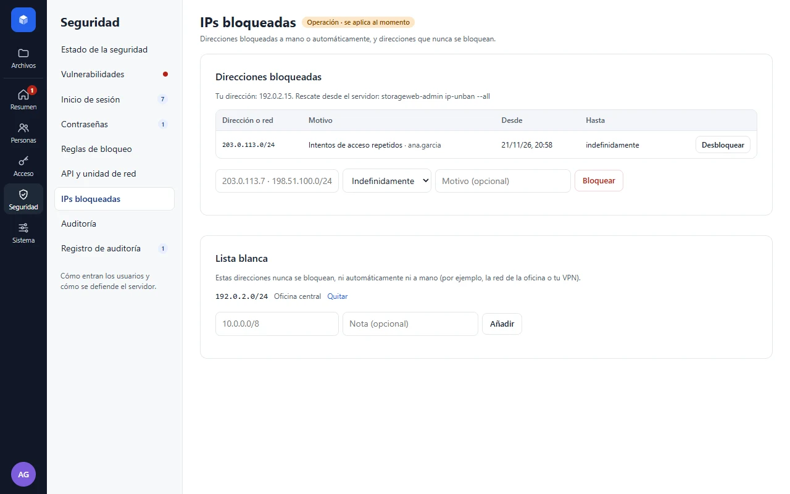
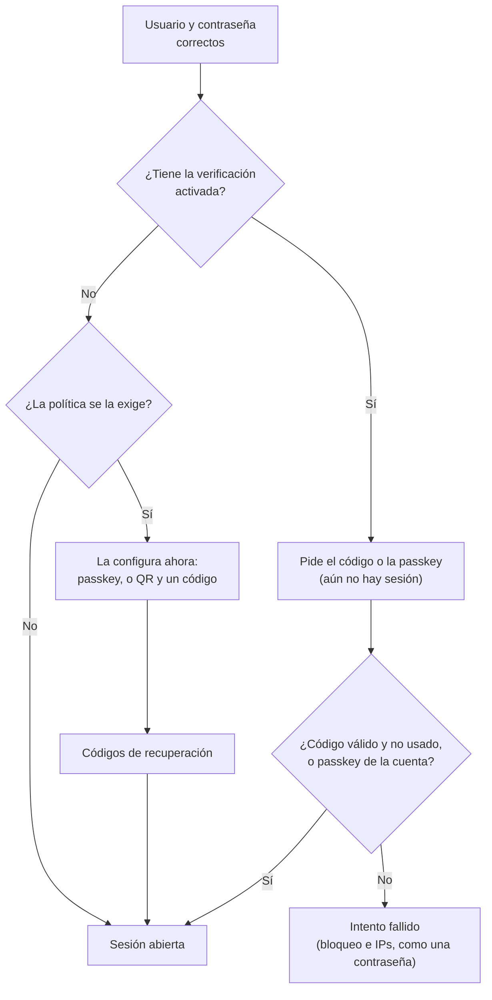
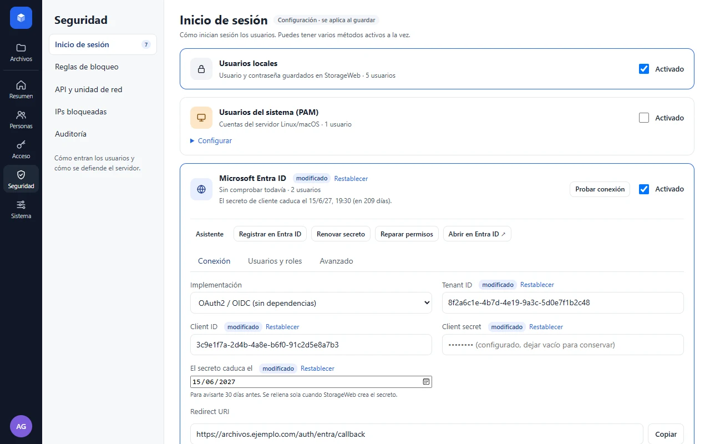
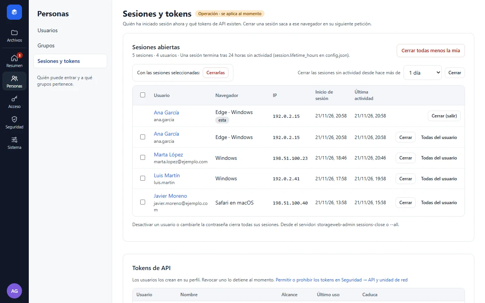

# Seguridad en producción

## Lista de comprobación

- [ ] **HTTPS** con un proxy inverso ([nginx, Apache o Caddy](https.md)) y `session.cookie_secure = true`.
- [ ] El proxy solo acepta TLS 1.2 y 1.3, no anuncia su versión y quita la cabecera `X-Forwarded-Prefix` que mande el cliente (las plantillas de [nginx, Apache y Caddy](https.md) ya lo hacen).
- [ ] `server.host = 127.0.0.1` y `server.behind_proxy = true`, de modo que la aplicación solo sea accesible a través del proxy.
- [ ] El cortafuegos solo expone 443 (y 80 para la redirección). El 8080 no debe ser accesible desde fuera.
- [ ] `/etc/storageweb/config.json` en `root:storageweb 0640`. Si pones secretos en él (el `client_secret`, contraseñas de ubicaciones), cífralos con `storageweb-admin encrypt-secret` o pásalos por variables de entorno.
- [ ] `<data_dir>/secrets.key` y `<data_dir>/secret_key` solo legibles por el servicio (`0600`, los crea así).
- [ ] Al menos un admin con una contraseña larga y **verificación en dos pasos** (`security.mfa_required = admins`), o solo admins de Entra ID con el MFA de Microsoft.
- [ ] *Rechazar las contraseñas comunes* activado (`security.password_check`, de serie).
- [ ] *Seguridad → Estado de la seguridad* sin nada «A corregir», y la comprobación automática de *Seguridad → Vulnerabilidades* encendida (de serie, cada 24 horas) o, en un servidor sin salida a internet, *Comprobar ahora* de vez en cuando desde otro que la tenga, y actualizar lo que salga con avisos.
- [ ] Entra ID: *Assignment required* y App Roles; anota la caducidad del `client_secret`.
- [ ] Copias programadas y [restauración probada](copias-seguridad.md).
- [ ] La auditoría se revisa periódicamente (*Seguridad → Auditoría* o `storageweb-admin audit`).
- [ ] Actualizaciones del sistema y de StorageWeb al día.
- [ ] *Sistema → Carpetas del servidor* con las carpetas de datos, fijadas en el `config.json`: así un administrador de la web no puede publicar otras carpetas del servidor ni recorrerlas con *Examinar*.
- [ ] Límites ajustados: `storage.max_file_size_mb`, `security.max_login_failures`, `client_max_body_size`.

## Qué protege StorageWeb

| Riesgo | Control |
|---|---|
| Robo de sesión | Cookie `HttpOnly`, `Secure` y `SameSite=Lax`, firmada con `secret_key`; caducidad configurable |
| CSRF | Token por sesión en todos los POST/PUT/DELETE |
| Fuerza bruta | Bloqueo temporal por IP y por usuario; **bloqueo automático de IPs** con muchas infracciones; comparación en tiempo constante |
| Sesiones robadas o abandonadas | Sesiones registradas en el servidor: se ven y se cierran en *Personas → Sesiones y tokens*; desactivar un usuario o cambiarle la contraseña las cierra todas |
| Scripts con la contraseña | Tokens de API personales (`sw_…`) con alcance de lectura o de lectura y escritura, caducidad y revocación; solo se guarda su hash |
| Robo de la base de datos | Contraseñas y tokens de API solo como hash; los secretos de los ajustes, **cifrados** (ver abajo) |
| Salir de la carpeta asignada | Se rechazan `..`, rutas absolutas y symlinks que salen de la raíz; se comprueba en cada petición |
| Publicar o recorrer cualquier carpeta del servidor | *Carpetas del servidor permitidas* (`storage.allowed_folders`): las carpetas en el disco y el selector *Examinar* solo dentro de ellas; el selector nunca lista rutas de red y solo contesta a la propia página (token CSRF) |
| Nombres de archivo maliciosos | Saneado, que conserva acentos, rechaza nombres reservados de Windows y limita a 255 bytes |
| XSS / clickjacking | Plantillas con escape automático, CSP sin `unsafe-inline`, `X-Frame-Options: DENY`, `nosniff` |
| Escalada en el servidor | Usuario sin privilegios, systemd con `NoNewPrivileges`, `ProtectSystem=strict`, `PrivateTmp` y `UMask=0007` |
| Tokens SSO falsificados | `state`, `nonce`, PKCE y validación de `iss`, `aud`, `exp` y `tid` |
| Suplantación entre orígenes | Una cuenta de Entra nunca se vincula a una local con el mismo nombre |

## Secretos guardados

| Qué | Cómo se guarda |
|---|---|
| Contraseñas de los usuarios locales | Solo su hash (`scrypt`/`pbkdf2` de Werkzeug): no se pueden recuperar. |
| Tokens de API (extensión de VS Code, unidad de red, scripts) | Solo su hash SHA-256: el token completo solo lo ve quien lo crea, una vez. |
| Secretos de los ajustes guardados desde la web: el `client_secret` de Entra ID, las contraseñas y claves de las ubicaciones remotas (S3, SMB, SFTP, FTP, Azure, WebDAV) y el token de las métricas | **Cifrados** con AES-256-GCM en la base de datos (`enc:v1:…`). |

La clave de cifrado es, por orden, la variable de entorno `STORAGEWEB_SECRETS_KEY` (32 bytes en base64) o el fichero `<data_dir>/secrets.key` (`0600`), que se crea solo la primera vez. Es independiente de la `secret_key` de las sesiones. Quien se lleve solo la base de datos no puede leer los secretos; quien tenga además la clave, sí: es lo máximo que permite un servicio que tiene que usarlos. Los secretos que ya hubiera guardados en claro se cifran solos al arrancar.

- **En `config.json`** o en una variable de entorno, un secreto se puede poner cifrado: `storageweb-admin encrypt-secret` pide el valor sin mostrarlo y escribe `enc:v1:…`, que se pone en su lugar. Lo que no empiece por `enc:v1:` se usa tal cual.
- **Copias de seguridad:** incluyen la clave, así que siguen siendo un fichero sensible (`0600`; guárdalas cifradas). Al restaurar una copia en otro servidor, sus secretos se vuelven a cifrar con la clave de ese servidor.
- **Si la clave se ha podido filtrar:** con el servicio parado, `storageweb-admin rotate-secrets-key` crea una nueva y vuelve a cifrar todo (`secrets_key_rotated` en la auditoría). Si la clave viene de `STORAGEWEB_SECRETS_KEY`, el comando escribe la nueva para que la pongas en la variable. Los secretos cifrados de `config.json` hay que volver a cifrarlos con `encrypt-secret`.
- Si la clave no es la que cifró un secreto (por ejemplo, se borró `secrets.key`), ese secreto se ignora y queda en el registro del servicio: vuelve a escribirlo en la web.

## Bloqueo de IPs

*Seguridad → Reglas de bloqueo* e *IPs bloqueadas*:

- **Automático:** con `security.ipban_threshold` infracciones (contraseña errónea, CSRF no válido, token de API no válido) en `ipban_window_minutes`, la IP queda bloqueada `ipban_minutes` (0 = hasta que la quites). Las direcciones de loopback nunca se bloquean: sin `server.behind_proxy`, todo el tráfico de un proxy local llega como 127.0.0.1.
- **Manual:** bloquea una IP o una red CIDR, con duración. No puedes bloquear la dirección que estás usando.
- **Lista blanca:** redes que nunca se bloquean (la oficina, la VPN).
- **Rescate** si te bloqueas: `sudo storageweb-admin ip-unban --all` (o `ip-unban <ip>`); `ip-list` muestra las reglas.



## Contraseñas

Las reglas de las contraseñas de las cuentas locales están en *Seguridad → Contraseñas*. Se aplican al ponerlas
(crear la cuenta, cambiarla en *Mi perfil*, un administrador a otra persona o `storageweb-admin user-add`/
`user-passwd`); las que ya existen no se tocan. Se guardan con el hash scrypt de Werkzeug. Quien la escribe ve
debajo del campo lo que se le pide («Al menos 12 caracteres, con una mayúscula, un número.»).

| Regla | Ajuste | De serie |
|---|---|---|
| Longitud mínima (de 10 a 128; nunca menos de 10) | `security.password_min_length` | 10 |
| Caracteres distintos como mínimo (`aaaaaaaaaa`, `abababababab`) | `security.password_min_distinct` | 4 |
| Tipos obligatorios: minúscula, mayúscula, número, símbolo | `security.password_require` | ninguno |
| No contener el nombre de usuario (si tiene 4 letras o más; si no, no ser igual) | `security.password_reject_username` | sí |
| No contener ninguna **palabra prohibida** (la empresa, el servicio, la ciudad…) | `security.password_blocklist` | ninguna |
| No ser una de las **más comunes** | `security.password_check` | sí |
| No aparecer en **filtraciones conocidas** (Have I Been Pwned) | `security.password_breach_check` | no |

*Probar una contraseña*, en la misma página, dice regla por regla si una contraseña (y, si se
escribe, un nombre de usuario) se aceptaría con las reglas guardadas, sin guardarla en ningún sitio.

Lo que más protege es la longitud. Obligar a mezclar tipos de caracteres las hace más difíciles de recordar más que
de adivinar (así lo dice NIST SP 800-63B): por eso viene apagado.

### La lista de contraseñas comunes

De serie, unas 19 000 de 10 caracteres o más (`1234567890`, `qwertyuiop`, `password123`, `contraseña`…), de
[SecLists](https://github.com/danielmiessler/SecLists) (licencia MIT). Viaja con StorageWeb y **no se consulta nada
fuera**; la genera `tools/common_passwords.py` desde un commit fijo y con su huella.

Se puede cambiar por una **lista propia** del servidor (`<data_dir>/common_passwords.txt`), desde la misma página o
con la CLI:

- **Descargar ahora** la junta de las direcciones de `security.password_list_urls` (de serie, la versión actual de
  las mismas listas de SecLists: el millón de las más usadas, de las que se quedan las de 10 caracteres o más). Solo
  `https://`, con un tope de 64 MB.
- **Subir una lista**: un fichero de texto con una por línea (la de tu organización, o una descargada en otro
  equipo para un servidor sin internet).
- **Volver a la de serie** borra la propia.

De cualquier lista solo se guardan las de 10 caracteres o más (las más cortas ya las rechaza la longitud), en
minúsculas y sin repetir. Para añadir unas pocas palabras propias, mejor *Palabras prohibidas*, que además rechaza
las contraseñas que las **contienen**.

```bash
sudo storageweb-admin password-list                 # cuál se usa y cuántas tiene
sudo storageweb-admin password-list --download      # de security.password_list_urls (o --url …)
sudo storageweb-admin password-list --file lista.txt
sudo storageweb-admin password-list --reset         # vuelve la de serie
```

### Filtraciones conocidas

Con *Rechazar las contraseñas que aparecen en filtraciones conocidas* se pregunta a
[Pwned Passwords](https://haveibeenpwned.com/Passwords), con más de 900 millones de contraseñas filtradas, al
ponerla. Solo se envían los **5 primeros caracteres de su SHA-1** (k-anonimato, con relleno en la respuesta): ni la
contraseña ni su hash completo salen del servidor. Necesita salida a `api.pwnedpasswords.com`; si no contesta, la
contraseña se acepta (las demás reglas siguen valiendo) y queda un aviso en el log.

## Verificación en dos pasos

Además de la contraseña, un código de seis dígitos de una aplicación de autenticación del móvil (TOTP, RFC 6238: Microsoft Authenticator, Google Authenticator, FreeOTP…) o una **passkey** (WebAuthn: Windows Hello, Touch ID, el móvil o una llave de seguridad). Una cuenta puede tener la app, una o varias passkeys o las dos, y cualquiera completa el segundo paso. Es para las cuentas que entran con contraseña, **locales y del sistema (PAM)**; quien entra con **Microsoft Entra ID** usa el segundo factor de Microsoft y StorageWeb no le pide otro.



- **Quién la activa:** cada persona desde *Mi perfil → Seguridad*: añade una passkey (con un nombre, p. ej. «Portátil del trabajo») o escanea el QR (o escribe la clave) y confirma con un código. Con el primer método recibe los **diez códigos de recuperación**, que se enseñan una sola vez: cada uno vale una vez en lugar de la app o la passkey, por si pierde el móvil o la llave, y sirven con cualquier método. Con la verificación ya activa, **añadir o quitar un método, generar códigos nuevos (anulan los anteriores) o desactivarla pide confirmar antes** con un código o una passkey: la sesión sola no basta (alguien con la sesión abierta en un equipo ajeno no puede añadir su propia passkey). La confirmación vale 5 minutos, y los códigos equivocados al confirmar cuentan como los del inicio de sesión (con demasiados, se bloquea igual). Quitar la última passkey sin app (o la app sin passkeys) desactiva la verificación y borra los códigos.



- **Quién debe tenerla:** *Seguridad → Inicio de sesión → Verificación en dos pasos obligatoria para* (`security.mfa_required`): *nadie* (`off`, por defecto: opcional), *administradores* (`admins`) o *todas las cuentas que entran con contraseña* (`all`). Activarlo **no deja fuera a nadie**: quien debe tenerla y no la tiene la configura en ese momento, al iniciar sesión. Y quien la tiene la usa siempre, valga lo que valga el ajuste.
- **Sin sesión hasta el código:** con la contraseña correcta solo queda una nota en la cookie que caduca a los **5 minutos**; los códigos equivocados cuentan como contraseñas equivocadas (`security.max_login_failures` y el bloqueo de IPs), y acertar la contraseña no reinicia la cuenta. Cada código vale **una sola vez** (también los de recuperación), aunque siga dentro de sus 30 segundos.
- **Passkeys** (`security.passkeys`, activado por defecto, en *Seguridad → Inicio de sesión*): necesitan que la dirección pública (`network.public_url`, *Sistema → Red y HTTPS*) tenga **un nombre** (no una IP) y **HTTPS**, salvo `localhost`. La passkey queda atada a ese nombre (el *RP ID*) y **no se puede mover**: si un día cambia, las passkeys dejan de valer y esas cuentas entran con la app o un código de recuperación. Por eso el nombre sale de `network.public_url` y nunca de la petición (detrás de un proxy, la petición dice lo que diga el proxy). La página avisa si aún no están disponibles. Se comprueban el challenge (de un solo uso, 5 minutos, apuntado como gastado en el servidor: reenviar una cookie de antes no lo devuelve), el tipo de ceremonia, el origen exacto, el nombre, que alguien tocó la llave y el **contador de firmas** (si la llave lleva uno y no avanza, ni siquiera volviendo a 0, la credencial se ha clonado); no se comprueba de qué fabricante es la llave (*attestation*). Algoritmos: ES256, EdDSA y RS256 (de 2048 bits o más). De cada passkey se guarda solo la clave pública.
- **Entrar solo con una passkey** (`security.passkey_login`, apagado de serie, en *Seguridad → Inicio de sesión*): la página de inicio de sesión ofrece *Entrar con una passkey*, sin escribir el usuario ni la contraseña. El navegador enseña las passkeys guardadas para este sitio, la elegida dice de quién es y StorageWeb comprueba que es de esa cuenta. Vale por **los dos pasos** porque la persona **tiene que verificarse** en el dispositivo (PIN, huella o cara; un simple toque no basta). Solo para las **cuentas locales**: en las de PAM decide el sistema si la cuenta sigue valiendo, y eso solo se sabe con su contraseña, así que siguen entrando con ella. Para que el navegador las ofrezca, la passkey tiene que estar **guardada en el dispositivo** (credencial residente): con el ajuste encendido se piden así al añadirlas; Windows Hello, el llavero de Apple o Google y las llaves FIDO2 lo hacen, pero una añadida antes puede no estarlo y entonces hay que añadirla otra vez. Los intentos fallidos cuentan como contraseñas equivocadas: por IP mientras no se sabe la cuenta y por IP y cuenta cuando se sabe. En la auditoría, `login` con el detalle `local+passkey-only`; los rechazos, `login_failed` con `passkey error=…`.
- **La unidad de red** (WebDAV) no pide códigos: a una cuenta con la verificación activada (u obligada a tenerla) no se le admite la contraseña aunque esté `security.webdav_passwords`, solo **tokens de API**. Los tokens y la extensión de VS Code siguen igual (el token se crea con la sesión iniciada, código incluido).
- **Si alguien pierde el móvil (o sus passkeys) y los códigos:** un administrador la quita entera en la ficha del usuario (*Quitar la verificación en dos pasos*; `mfa_reset_by_admin` en la auditoría) y esa persona vuelve a entrar con su contraseña (y la configura otra vez si es obligatoria). Nadie puede activarla por otro. Desde el servidor, cuando ya no queda nadie que pueda entrar: `storageweb-admin mfa-reset <usuario>`; `mfa-status` lista quién la tiene.
- **Dónde se ve:** la lista de usuarios tiene la columna *2FA*, la ficha de cada usuario su estado y *Inicio de sesión* cuántas cuentas la tienen.
- **Cómo se guarda:** la semilla de la app, **cifrada** con la clave de los secretos (`secrets.key`), como los demás secretos; se vuelve a cifrar con `rotate-secrets-key` y al restaurar una copia de otro servidor. De los códigos de recuperación solo se guarda el hash, y de las passkeys su clave pública (que no es un secreto). Una copia de seguridad lleva las dos cosas, así que restaurarla deja la verificación como estaba.

Los parámetros (SHA-1, 6 dígitos, 30 segundos y medio minuto de tolerancia de reloj) son los que entienden todas las aplicaciones y no se configuran: una aplicación que recibe otros suele ignorarlos y los códigos fallarían sin explicación.

## Sesiones y tokens de API

- *Personas → Sesiones y tokens* muestra quién ha iniciado sesión (navegador, IP, última actividad) y todos los tokens de API. Puedes cerrar una sesión, todas las de un usuario o todas menos la tuya, y revocar tokens. Desde el servidor: `storageweb-admin sessions-close <usuario>` o `--all`.
- Cada usuario ve las suyas en *Mi perfil → Seguridad* y puede cerrar las demás. Cambiar la contraseña cierra las otras sesiones.
- Los tokens de API se crean en *Mi perfil → Tokens de API*. Solo sirven para listar, descargar y subir archivos; nunca para la administración ni el perfil. Se desactivan para todos con `security.api_tokens = false` (también se desactiva entonces *conectar aplicaciones desde el navegador*, `/connect`, con el que la extensión de VS Code consigue su token). Cada aplicación conectada así deja en la auditoría `app_authorized` y `api_token_created`. Con `security.api_token_max_days` (*Seguridad → API y unidad de red*) los tokens duran como mucho esos días: no se pueden crear sin caducidad ni más largos, al rotarlos o conectar una aplicación se recortan, y los que ya existían dejan de valer al cumplir ese tiempo desde que se crearon. El *Resumen* avisa de los tokens que siguen valiendo pero nadie usa desde hace más de 90 días: es mejor revocarlos. Cada usuario puede **rotar** sus tokens (secreto nuevo, el anterior deja de valer; `api_token_rotated`); el administrador solo puede revocarlos, para no ver nunca el secreto de otro.



```bash
TOKEN=sw_…
curl -H "Authorization: Bearer $TOKEN" https://files.midominio.com/f/home/            # listado en JSON
curl -H "Authorization: Bearer $TOKEN" -O https://files.midominio.com/download/home/informe.pdf
curl -H "Authorization: Bearer $TOKEN" -F files=@informe.pdf https://files.midominio.com/upload/home/   # alcance de escritura
```

## Reenviar la auditoría a un SIEM

La auditoría se guarda en la base de datos (*Seguridad → Auditoría*, exportable a CSV). Al pulsar una línea (o Enter sobre ella) se abre con todos sus datos: la fecha exacta, el detalle entero (separado en campos si es del tipo `stage=passkey error=…`), enlaces para filtrar por ese usuario o esa acción y *Copiar como JSON*. Para tenerla además en el SIEM de la empresa, o fuera del servidor donde nadie que entre en él pueda borrarla, en *Seguridad → Registro de auditoría*:

- **Syslog** (`audit.syslog`): `udp://host:514`, `tcp://host:514` (un mensaje por línea) o `tls://host:6514` (RFC 5425, con la longitud delante). Con TLS se comprueba el certificado del colector (`audit.tls_verify`); si lo firma una CA propia, indica su fichero PEM en `audit.syslog_ca`.
- **Formato** (`audit.syslog_format`), siempre con cabecera RFC 5424 (facilidad `audit.syslog_facility`, `local0` por defecto; severidad *warning* para fallos, bloqueos y rechazos —`login_failed`, `login_blocked`, `ip_banned`…— e *informational* para lo demás; `MSGID` = la acción):
    - `rfc5424`: datos estructurados `[storageweb@32473 user="ana" ip="…" target="home:/informe.pdf" detail="…"]`.
    - `json`: el evento en JSON (`ts`, `user`, `action`, `target`, `ip`, `detail`): Graylog, Logstash, Wazuh.
    - `cef`: Common Event Format (`suser`, `src`, `fname`, `msg`): ArcSight, QRadar, Microsoft Sentinel.
- **Fichero JSON** (`audit.file`): un evento por línea para un agente (Filebeat, Fluent Bit, Wazuh); se abre en cada escritura, así que se puede rotar con logrotate.

Se envía desde una cola en segundo plano: un colector lento o caído nunca frena el servicio. Si la cola (10 000 eventos) se llena, los que no caben se pierden **solo para el SIEM** (en la base de datos están todos) y se cuentan en `storageweb_audit_forward_dropped_total`. Si los envíos fallan, la página lo dice, el *Resumen* avisa y se cuenta en `storageweb_audit_forward_errors_total`. **Enviar un evento de prueba** manda `audit_forward_test` con los ajustes guardados y muestra el error si no llega. La auditoría de la CLI (`storageweb-admin …`) también se reenvía.

## Estado de la seguridad

*Seguridad → Estado de la seguridad* es el tablero de la seguridad, de solo lectura:

- **Cifras de un vistazo:** vulnerabilidades conocidas de las bibliotecas (y la peor), IPs bloqueadas ahora (y cuántas
  automáticamente), intentos fallidos de inicio de sesión en las últimas 24 horas (y bloqueos), sesiones abiertas (y
  de administradores), cuentas con contraseña que tienen la verificación en dos pasos y tokens de API vigentes. Cada
  cifra lleva a su página.
- **Lista de comprobación:** HTTPS y la dirección pública, la verificación en dos pasos de los administradores y de
  los usuarios, las reglas de las contraseñas, la protección contra quien prueba contraseñas, los tokens de API (sin
  caducidad o sin usar), la unidad de red (si admite la contraseña de la cuenta), las copias (automáticas, recientes y
  fuera del servidor), la auditoría (si sale a un SIEM), la clave de los secretos y las vulnerabilidades de las
  bibliotecas. Cada punto dice **A corregir**, **A revisar**, **Bien** o **Para tu información** (lo que depende de la
  organización, como tener un SIEM), por qué, y lleva a la página donde se cambia. Lo grave sale arriba.
- **Últimos sucesos de seguridad:** lo último de la auditoría con nivel *warning* o más grave (contraseñas y códigos
  equivocados, bloqueos, IPs bloqueadas, accesos denegados…), con un enlace a la auditoría filtrada.

## Vulnerabilidades en las bibliotecas

*Seguridad → Vulnerabilidades* pregunta por cada biblioteca instalada, las de Python (todo el entorno, también las
dependencias de las dependencias) y las de JavaScript que viajan con StorageWeb (Mermaid y highlight.js):

- a [OSV.dev](https://osv.dev) si tiene **vulnerabilidades conocidas** (CVE, avisos de GitHub, PYSEC), con su gravedad
  (la publicada por la base de datos o, si no hay, la puntuación CVSS 3.x de su vector) y un enlace a cada aviso. Un
  mismo fallo con varios nombres (GHSA, PYSEC, CVE) cuenta una vez;
- a PyPI y npm si hay una **versión más nueva**.

La tabla dice el **tipo** de cada biblioteca (Python o JavaScript) y se ordena por cualquier columna. **Comprobar
ahora** la hace en segundo plano con una barra de progreso: *Seguir en segundo plano* cierra la barra y la
comprobación sigue en el servidor (también si sales de la página); *Ver el progreso* la vuelve a abrir, y el botón no
se puede pulsar otra vez hasta que acaba. **Comprobación automática** (`security.dependency_check_hours`, de serie
**cada 24 horas**): la hace sola la tarea de mantenimiento; si ya hay una en marcha, esa vez no empieza otra. En un
servidor sin salida a internet, ponla a `0` (solo con el botón).

**Sale a internet** (`pypi.org`, `registry.npmjs.org` y `api.osv.dev`, por el proxy del sistema si lo hay:
`HTTPS_PROXY`), así que solo se hace al pulsar el botón o con la comprobación automática: nunca al arrancar ni al
abrir una página. De este servidor solo se envían los nombres y las versiones de las bibliotecas, y la lista la
decide el servidor (no la petición). Queda en la auditoría (`dependencies_checked`; la automática, con el usuario
`system`). El resultado se guarda: la página lo enseña hasta la siguiente comprobación y, si encontró
vulnerabilidades, el **Resumen** y el *Estado de la seguridad* lo avisan (en rojo si alguna es alta o crítica). En un
servidor sin salida a internet, la página lo dice y no hay más.

## Lo que NO hace (todavía)

Conviene saberlo para cubrirlo por otros medios:

- **Antivirus:** no analiza los archivos subidos. Usa ClamAV sobre `/srv/storageweb` si lo necesitas.
- **Cifrado en reposo de los archivos:** usa cifrado de disco (LUKS) o del sistema de ficheros. (Los secretos de los ajustes sí se cifran, ver arriba.)
- **Bloqueo de intentos por usuario en memoria:** se reinicia al reiniciar el servicio. El bloqueo de IPs sí se guarda en la base de datos.
- **Expiración del cambio de rol:** un usuario desactivado pierde la sesión en su siguiente petición. Un cambio de rol se aplica también en la siguiente petición.

El análisis completo está en el [modelo de seguridad](../arquitectura/seguridad.md). Para informar de una vulnerabilidad, consulta la [política de seguridad](../proyecto/seguridad.md).
