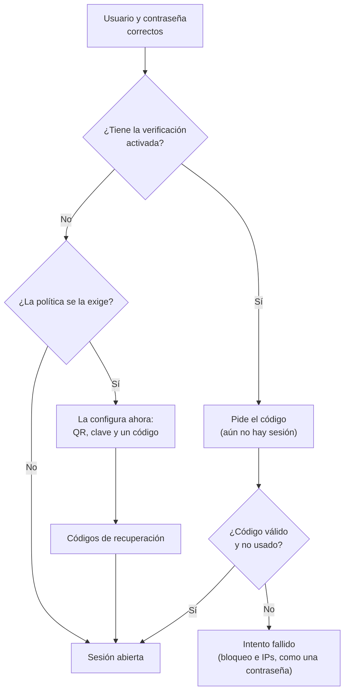

# Seguridad en producción

## Lista de comprobación

- [ ] **HTTPS** con un proxy inverso ([nginx o Apache](https.md)) y `session.cookie_secure = true`.
- [ ] El proxy solo acepta TLS 1.2 y 1.3, no anuncia su versión y quita la cabecera `X-Forwarded-Prefix` que mande el cliente (las plantillas de [nginx y Apache](https.md) ya lo hacen).
- [ ] `server.host = 127.0.0.1` y `server.behind_proxy = true`, de modo que la aplicación solo sea accesible a través del proxy.
- [ ] El cortafuegos solo expone 443 (y 80 para la redirección). El 8080 no debe ser accesible desde fuera.
- [ ] `/etc/storageweb/config.json` en `root:storageweb 0640`. Si pones secretos en él (el `client_secret`, contraseñas de ubicaciones), cífralos con `storageweb-admin encrypt-secret` o pásalos por variables de entorno.
- [ ] `<data_dir>/secrets.key` y `<data_dir>/secret_key` solo legibles por el servicio (`0600`, los crea así).
- [ ] Al menos un admin con una contraseña larga y **verificación en dos pasos** (`security.mfa_required = admins`), o solo admins de Entra ID con el MFA de Microsoft.
- [ ] Entra ID: *Assignment required* y App Roles; anota la caducidad del `client_secret`.
- [ ] Copias programadas y [restauración probada](copias-seguridad.md).
- [ ] La auditoría se revisa periódicamente (*Seguridad → Auditoría* o `storageweb-admin audit`).
- [ ] Actualizaciones del sistema y de StorageWeb al día.
- [ ] Límites ajustados: `storage.max_file_size_mb`, `security.max_login_failures`, `client_max_body_size`.

## Qué protege StorageWeb

| Riesgo | Control |
|---|---|
| Robo de sesión | Cookie `HttpOnly`, `Secure` y `SameSite=Lax`, firmada con `secret_key`; caducidad configurable |
| CSRF | Token por sesión en todos los POST/PUT/DELETE |
| Fuerza bruta | Bloqueo temporal por IP y por usuario; **bloqueo automático de IPs** con muchas infracciones; comparación en tiempo constante |
| Sesiones robadas o abandonadas | Sesiones registradas en el servidor: se ven y se cierran en *Personas → Sesiones y tokens*; desactivar un usuario o cambiarle la contraseña las cierra todas |
| Scripts con la contraseña | Tokens de API personales (`sw_…`) con alcance de lectura o de lectura y escritura, caducidad y revocación; solo se guarda su hash |
| Robo de la base de datos | Contraseñas y tokens de API solo como hash; los secretos de los ajustes, **cifrados** (ver abajo) |
| Salir de la carpeta asignada | Se rechazan `..`, rutas absolutas y symlinks que salen de la raíz; se comprueba en cada petición |
| Nombres de archivo maliciosos | Saneado, que conserva acentos, rechaza nombres reservados de Windows y limita a 255 bytes |
| XSS / clickjacking | Plantillas con escape automático, CSP sin `unsafe-inline`, `X-Frame-Options: DENY`, `nosniff` |
| Escalada en el servidor | Usuario sin privilegios, systemd con `NoNewPrivileges`, `ProtectSystem=strict`, `PrivateTmp` y `UMask=0007` |
| Tokens SSO falsificados | `state`, `nonce`, PKCE y validación de `iss`, `aud`, `exp` y `tid` |
| Suplantación entre orígenes | Una cuenta de Entra nunca se vincula a una local con el mismo nombre |

## Secretos guardados

| Qué | Cómo se guarda |
|---|---|
| Contraseñas de los usuarios locales | Solo su hash (`scrypt`/`pbkdf2` de Werkzeug): no se pueden recuperar. |
| Tokens de API (extensión de VS Code, unidad de red, scripts) | Solo su hash SHA-256: el token completo solo lo ve quien lo crea, una vez. |
| Secretos de los ajustes guardados desde la web: el `client_secret` de Entra ID, las contraseñas y claves de las ubicaciones remotas (S3, SMB, SFTP, FTP, Azure, WebDAV) y el token de las métricas | **Cifrados** con AES-256-GCM en la base de datos (`enc:v1:…`). |

La clave de cifrado es, por orden, la variable de entorno `STORAGEWEB_SECRETS_KEY` (32 bytes en base64) o el fichero `<data_dir>/secrets.key` (`0600`), que se crea solo la primera vez. Es independiente de la `secret_key` de las sesiones. Quien se lleve solo la base de datos no puede leer los secretos; quien tenga además la clave, sí: es lo máximo que permite un servicio que tiene que usarlos. Los secretos que ya hubiera guardados en claro se cifran solos al arrancar.

- **En `config.json`** o en una variable de entorno, un secreto se puede poner cifrado: `storageweb-admin encrypt-secret` pide el valor sin mostrarlo y escribe `enc:v1:…`, que se pone en su lugar. Lo que no empiece por `enc:v1:` se usa tal cual.
- **Copias de seguridad:** incluyen la clave, así que siguen siendo un fichero sensible (`0600`; guárdalas cifradas). Al restaurar una copia en otro servidor, sus secretos se vuelven a cifrar con la clave de ese servidor.
- **Si la clave se ha podido filtrar:** con el servicio parado, `storageweb-admin rotate-secrets-key` crea una nueva y vuelve a cifrar todo (`secrets_key_rotated` en la auditoría). Si la clave viene de `STORAGEWEB_SECRETS_KEY`, el comando escribe la nueva para que la pongas en la variable. Los secretos cifrados de `config.json` hay que volver a cifrarlos con `encrypt-secret`.
- Si la clave no es la que cifró un secreto (por ejemplo, se borró `secrets.key`), ese secreto se ignora y queda en el registro del servicio: vuelve a escribirlo en la web.

## Bloqueo de IPs

*Seguridad → Reglas de bloqueo* e *IPs bloqueadas*:

- **Automático:** con `security.ipban_threshold` infracciones (contraseña errónea, CSRF no válido, token de API no válido) en `ipban_window_minutes`, la IP queda bloqueada `ipban_minutes` (0 = hasta que la quites). Las direcciones de loopback nunca se bloquean: sin `server.behind_proxy`, todo el tráfico de un proxy local llega como 127.0.0.1.
- **Manual:** bloquea una IP o una red CIDR, con duración. No puedes bloquear la dirección que estás usando.
- **Lista blanca:** redes que nunca se bloquean (la oficina, la VPN).
- **Rescate** si te bloqueas: `sudo storageweb-admin ip-unban --all` (o `ip-unban <ip>`); `ip-list` muestra las reglas.


## Verificación en dos pasos

Además de la contraseña, un código de seis dígitos de una aplicación de autenticación del móvil (TOTP, RFC 6238: Microsoft Authenticator, Google Authenticator, FreeOTP…). Es para las cuentas que entran con contraseña, **locales y del sistema (PAM)**; quien entra con **Microsoft Entra ID** usa el segundo factor de Microsoft y StorageWeb no le pide otro.



- **Quién la activa:** cada persona desde *Mi perfil → Verificación en dos pasos*: escanea el QR (o escribe la clave), confirma con un código y guarda los **diez códigos de recuperación** que se enseñan una sola vez. Cada uno vale una vez en lugar del código de la aplicación, por si pierde el móvil; desde el perfil se generan otros (anulan los anteriores) o se desactiva, siempre con un código válido.


- **Quién debe tenerla:** *Seguridad → Inicio de sesión → Verificación en dos pasos obligatoria para* (`security.mfa_required`): *nadie* (`off`, por defecto: opcional), *administradores* (`admins`) o *todas las cuentas que entran con contraseña* (`all`). Activarlo **no deja fuera a nadie**: quien debe tenerla y no la tiene la configura en ese momento, al iniciar sesión. Y quien la tiene la usa siempre, valga lo que valga el ajuste.
- **Sin sesión hasta el código:** con la contraseña correcta solo queda una nota en la cookie que caduca a los **5 minutos**; los códigos equivocados cuentan como contraseñas equivocadas (`security.max_login_failures` y el bloqueo de IPs), y acertar la contraseña no reinicia la cuenta. Cada código vale **una sola vez** (también los de recuperación), aunque siga dentro de sus 30 segundos.
- **La unidad de red** (WebDAV) no pide códigos: a una cuenta con la verificación activada (u obligada a tenerla) no se le admite la contraseña aunque esté `security.webdav_passwords`, solo **tokens de API**. Los tokens y la extensión de VS Code siguen igual (el token se crea con la sesión iniciada, código incluido).
- **Si alguien pierde el móvil y los códigos:** un administrador la quita en la ficha del usuario (*Quitar la verificación en dos pasos*; `mfa_reset_by_admin` en la auditoría) y esa persona vuelve a entrar con su contraseña (y la configura otra vez si es obligatoria). Nadie puede activarla por otro. Desde el servidor, cuando ya no queda nadie que pueda entrar: `storageweb-admin mfa-reset <usuario>`; `mfa-status` lista quién la tiene.
- **Dónde se ve:** la lista de usuarios tiene la columna *2FA*, la ficha de cada usuario su estado y *Inicio de sesión* cuántas cuentas la tienen.
- **Cómo se guarda:** la semilla, **cifrada** con la clave de los secretos (`secrets.key`), como los demás secretos; se vuelve a cifrar con `rotate-secrets-key` y al restaurar una copia de otro servidor. De los códigos de recuperación solo se guarda el hash. Una copia de seguridad lleva las dos cosas, así que restaurarla deja la verificación como estaba.

Los parámetros (SHA-1, 6 dígitos, 30 segundos y medio minuto de tolerancia de reloj) son los que entienden todas las aplicaciones y no se configuran: una aplicación que recibe otros suele ignorarlos y los códigos fallarían sin explicación.

## Sesiones y tokens de API

- *Personas → Sesiones y tokens* muestra quién ha iniciado sesión (navegador, IP, última actividad) y todos los tokens de API. Puedes cerrar una sesión, todas las de un usuario o todas menos la tuya, y revocar tokens. Desde el servidor: `storageweb-admin sessions-close <usuario>` o `--all`.
- Cada usuario ve las suyas en *Mi perfil* y puede cerrar las demás. Cambiar la contraseña cierra las otras sesiones.
- Los tokens de API se crean en *Mi perfil → Tokens de API*. Solo sirven para listar, descargar y subir archivos; nunca para la administración ni el perfil. Se desactivan para todos con `security.api_tokens = false` (también se desactiva entonces *conectar aplicaciones desde el navegador*, `/connect`, con el que la extensión de VS Code consigue su token). Cada aplicación conectada así deja en la auditoría `app_authorized` y `api_token_created`. Cada usuario puede **rotar** sus tokens (secreto nuevo, el anterior deja de valer; `api_token_rotated`); el administrador solo puede revocarlos, para no ver nunca el secreto de otro.


```bash
TOKEN=sw_…
curl -H "Authorization: Bearer $TOKEN" https://files.midominio.com/f/home/            # listado en JSON
curl -H "Authorization: Bearer $TOKEN" -O https://files.midominio.com/download/home/informe.pdf
curl -H "Authorization: Bearer $TOKEN" -F files=@informe.pdf https://files.midominio.com/upload/home/   # alcance de escritura
```

## Lo que NO hace (todavía)

Conviene saberlo para cubrirlo por otros medios:

- **Antivirus:** no analiza los archivos subidos. Usa ClamAV sobre `/srv/storageweb` si lo necesitas.
- **Cifrado en reposo de los archivos:** usa cifrado de disco (LUKS) o del sistema de ficheros. (Los secretos de los ajustes sí se cifran, ver arriba.)
- **Cuotas:** no hay cuota por usuario; usa cuotas del sistema de ficheros o un tamaño máximo por archivo.
- **Bloqueo de intentos por usuario en memoria:** se reinicia al reiniciar el servicio. El bloqueo de IPs sí se guarda en la base de datos.
- **Expiración del cambio de rol:** un usuario desactivado pierde la sesión en su siguiente petición. Un cambio de rol se aplica también en la siguiente petición.

El análisis completo está en el [modelo de seguridad](../arquitectura/seguridad.md). Para informar de una vulnerabilidad, consulta la [política de seguridad](../proyecto/seguridad.md).
