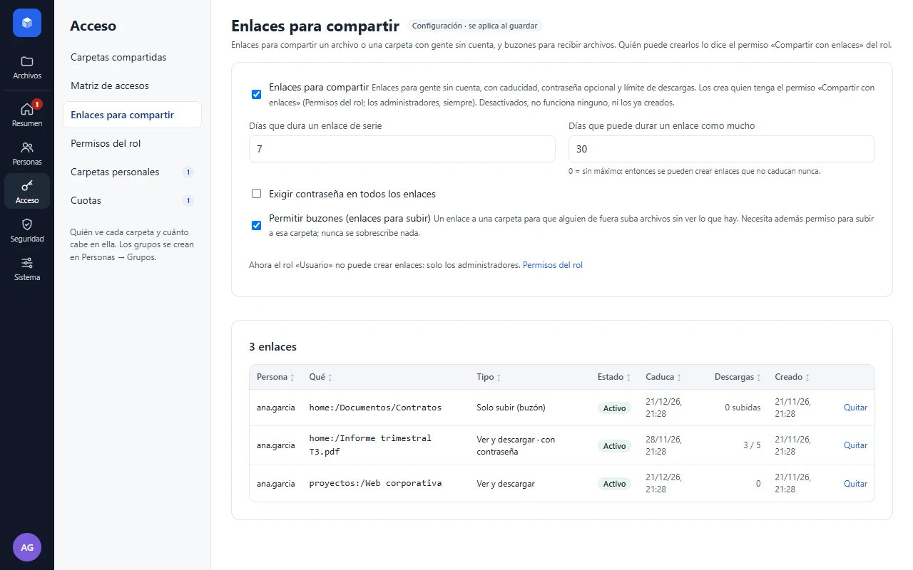
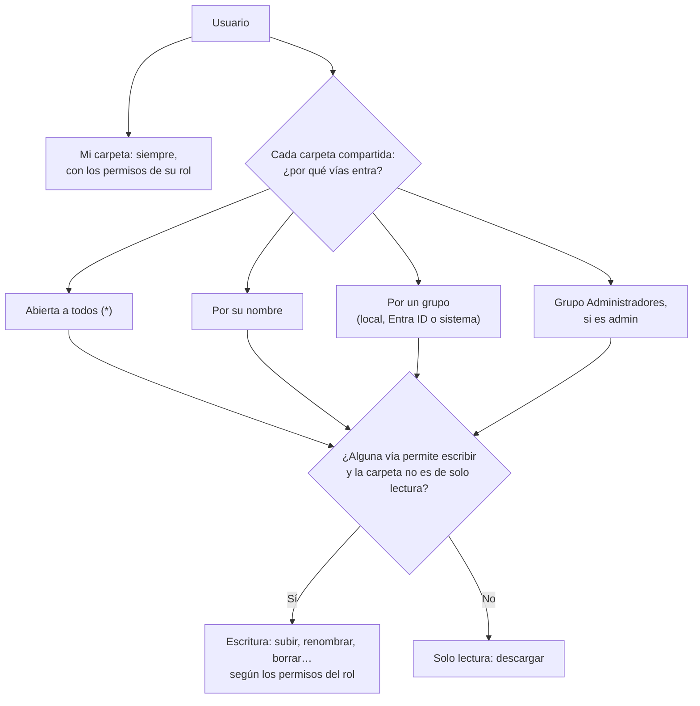
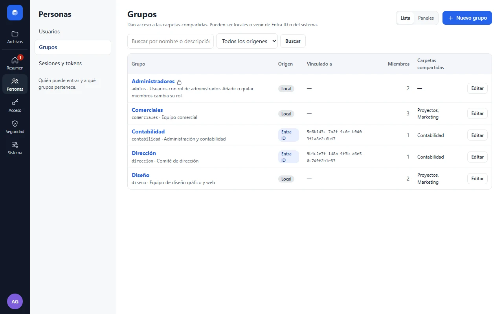
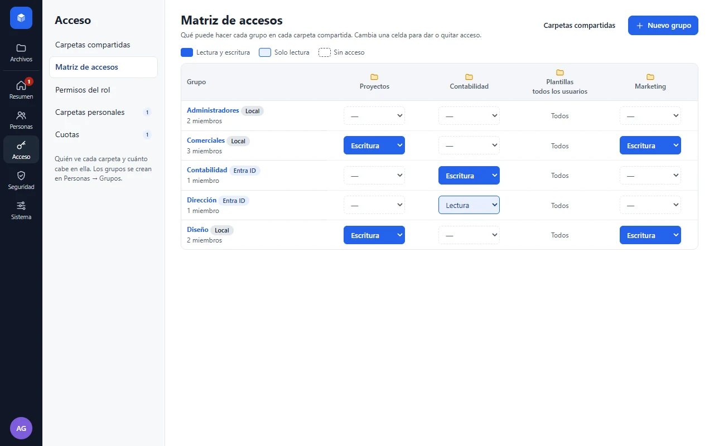
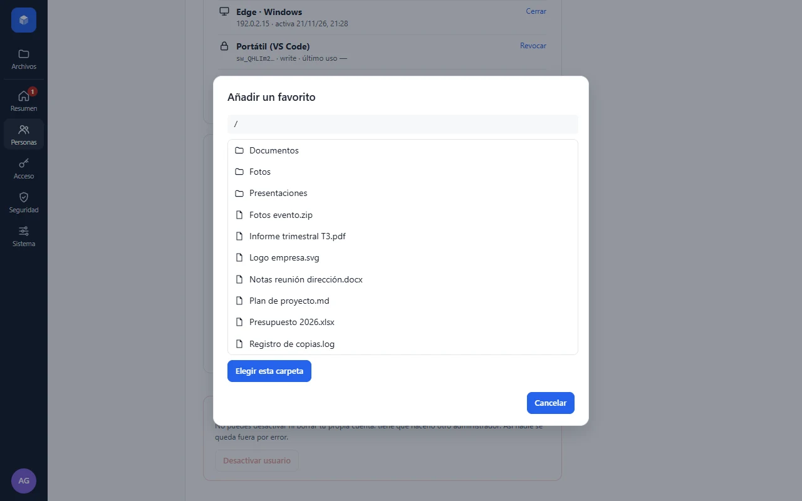

# Usuarios, roles y permisos

## Orígenes de usuario

| Origen | Cómo entra | Quién lo crea |
|---|---|---|
| **Local** | Usuario y contraseña (hash scrypt en SQLite; mínimo 10 caracteres o los de `security.password_min_length`) | Un admin, desde la web o la CLI |
| **Sistema (PAM)** | Usuario y contraseña del sistema operativo | Automático en su primer login (`auth.pam.enabled`) |
| **Entra ID** | Botón *Iniciar sesión con Microsoft* | Automático (`auto_provision`) o un admin por adelantado |

## Roles

| Rol | Puede |
|---|---|
| `admin` | Todo sobre archivos, y además *Administración*: usuarios, ajustes y auditoría |
| `user` | Los permisos de `permissions.user`. Por defecto: subir, descargar y crear carpetas |
| `none` | Nada (*Sin permisos*): lo que pueda hacer se lo dan sus grupos. Es el de las cuentas nuevas de serie |

Hay tres protecciones: un admin no puede quitarse el rol, ni desactivarse, ni borrarse a sí mismo, y siempre debe quedar **al menos un admin activo**.

## Permisos sobre archivos

| Permiso | `admin` | `user` (por defecto) | Carpeta de solo lectura |
|---|---|---|---|
| Descargar | ✔ | ✔ | ✔ |
| Subir | ✔ | ✔ | ✘ |
| Crear carpetas | ✔ | ✔ | ✘ |
| Renombrar | ✔ | ✘ | ✘ |
| Eliminar | ✔ | ✘ | ✘ |
| Editar archivos de texto | ✔ | ✘ | ✘ |
| Compartir con enlaces | ✔ | ✘ | ✔ (solo para descargar) |

*Editar archivos de texto* deja cambiar y guardar desde el visor los archivos de texto en UTF-8 que se pueden ver (botón **Editar**); es aparte de *Subir* y *Eliminar*, que son los que pide la unidad de red para sobrescribir. Con un token de solo lectura no se edita.

*Compartir con enlaces* deja crear [enlaces para gente sin cuenta](#enlaces-para-compartir) de lo que la persona
puede descargar (y buzones donde puede subir). En una carpeta de solo lectura, solo enlaces para descargar.

Los permisos del rol `user` se cambian en *Acceso → Roles*, en la ficha de *Usuario* (los fijados en `config.json` o en el entorno salen bloqueados). El servidor los comprueba en cada acción, también en la API: la interfaz solo oculta los botones.

*Acceso → Roles* tiene dos vistas, como *Personas → Usuarios* y *Grupos*: **Lista** (una tabla con los permisos, cuántas personas y grupos tienen cada rol y sus acciones) y **Paneles** (los roles a la izquierda y la ficha del elegido a la derecha), con una búsqueda por nombre o descripción y por tipo (de serie o propios). Se recuerda la última vista; al crear un rol se vuelve a ella. **Clonar** abre *Nuevo rol* con los permisos y la descripción de otro (también de *Usuario* o *Sin permisos*, no de *Administrador*) y el nombre «X (copia)»: se cambia lo que haga falta y se crea, sin tocar el original. *Administrador* y *Sin permisos* no se editan.

### Roles propios

En *Acceso → Roles* se crean **roles propios**: un nombre y los permisos de la tabla de arriba que quieras (por
ejemplo, *Lectores* solo descarga; *Editores* además sube, renombra y edita textos). Se asignan:

- **a una persona**, en su ficha (pestaña *Perfil*), en bloque desde la lista de personas o con
  `storageweb-admin user-set ana --role editores`: es su rol, uno solo;
- **a un grupo**, en la ficha del grupo (*Rol de los miembros*): todos sus miembros reciben también esos permisos.

Lo que puede hacer una persona es la **suma** de su rol y de los roles de sus grupos. *Administrador* sigue siendo
especial: lo da el rol de cada persona o el [mapeo de roles](entra-id.md) de Entra ID, nunca un grupo local (si no,
añadir a alguien a un grupo lo haría administrador). En el mapeo de Entra ID también se puede elegir un rol propio.

El **rol de las cuentas nuevas** (`permissions.default_role`) es el que lleva la **estrella** rellena delante del
nombre, en las dos vistas; se cambia pulsando la estrella de otro (cualquiera, también *Administrador*: la página lo
confirma antes y *Seguridad → Estado* lo marca como un problema mientras siga así). Es el que reciben las cuentas que se dan de alta desde la web o con `user-add` sin `--role`, las
importadas y las que crea un método de inicio de sesión al entrar si el suyo está vacío (en Entra ID, *Rol de los
usuarios nuevos* vacío = este). De serie, **Sin permisos**: una cuenta nueva no puede hacer nada con los archivos
hasta que un grupo o un rol se lo da. Para el comportamiento anterior, elige *Usuario*.

Borrar un rol deja a sus personas **sin permisos** (rol *Sin permisos*: nunca ganan permisos porque se borre un rol) y
sus grupos dejan de dar rol. En las carpetas de solo lectura,
diga lo que diga el rol, solo se descarga (y se comparte para descargar). Cada cambio queda en la auditoría
(`role_created`, `role_updated`, `role_deleted`, `group_role_changed`).

## Enlaces para compartir

*Acceso → Enlaces para compartir* (`sharing.*`) decide si se pueden compartir archivos y carpetas con gente sin
cuenta, cuánto duran los enlaces (de serie 7 días, como mucho 30; con máximo `0`, también sin caducidad), si todos
llevan contraseña y si se permiten **buzones** (enlaces para que alguien de fuera suba archivos a una carpeta sin ver
lo que hay). Debajo están todos los enlaces de todos, con su dueño, su estado y sus descargas, para quitar el que
haga falta; las direcciones no se enseñan (un administrador no abre los enlaces de los demás desde ahí).

**Actividad de cada enlace:** cada visita (también a cada subcarpeta), contraseña equivocada o correcta, descarga
(qué y cuánto), ZIP, subida a un buzón e intento rechazado (caducado, sin descargas, quitado…) queda con su fecha y
hora, la IP y el navegador. Se ve en *Actividad* (en *Mi perfil → Enlaces* para su dueño y en esta lista para los
administradores), con un resumen (visitas, descargas, rechazos, último acceso) y la descarga en CSV. Quitar un enlace
no lo borra: queda *Quitado*, con quién y cuándo.

**Filtro y cuánto se conservan:** las dos listas (*Mi perfil → Enlaces* y la de esta página) enseñan de entrada los
enlaces **activos**, con un filtro encima que dice cuántos hay de cada clase: *activos*, *caducados* (o sin descargas),
*quitados*, *borrados* y *en total*. La limpieza diaria borra los quitados o caducados hace más de
`sharing.keep_days` días (30 de serie; `0` = nunca), pero su historial se queda: esos enlaces aparecen en *Borrados*,
con lo que compartían, el primer y el último suceso y su *Actividad* entera. El historial se borra pasados
`sharing.history_days` días (`0`, de serie, = lo mismo que la auditoría, `maintenance.audit_retention_days`); con un
número, nunca menos que `sharing.keep_days`, para que ningún enlace se quede sin su historial. Lo que borra la
limpieza queda en la auditoría (`links_purged`).

Cada enlace funciona con los permisos **de ahora** de quien lo creó: si se desactiva su cuenta, pierde la carpeta
o el permiso *Compartir con enlaces*, deja de funcionar al momento. Sigue al archivo si se renombra o se mueve desde
StorageWeb y se borra con él. Los de cada persona están en *Mi perfil → Enlaces*. La seguridad de los enlaces se
cuenta en [Seguridad](seguridad.md#enlaces-para-compartir).



## Carpetas

- **Personal:** sale de `storage.home_template`, o de la ruta personalizada del usuario (campo *Carpeta personal*). Se crea en el primer acceso si `create_home` está activo.
- **Compartidas:** se asignan por usuario o por [grupo](#grupos). El acceso de un grupo puede ser de lectura y escritura o de solo lectura (`read_only_groups`); un usuario puede escribir si entra por su nombre o por algún grupo que no sea de solo lectura. Si la carpeta es `read_only`, nadie escribe.



## Grupos

*Personas → Grupos* reúne los grupos que dan acceso a las carpetas compartidas. Cada grupo tiene un **identificador** (el que usan las carpetas, p. ej. `rrhh`), un nombre visible y un origen:

| Origen | Miembros |
|---|---|
| Local | Los añade el admin a mano. |
| Entra ID | Se sincronizan en cada inicio de sesión desde el Object ID del grupo o el nombre del App Role (*Grupo externo*). El id_token debe incluir el claim `groups` o `roles`. |
| Sistema (PAM) | Miembros de un grupo del servidor, sincronizados en cada inicio de sesión. |

El grupo **Administradores** (`admins`) viene de serie y no se puede editar ni eliminar. Sus miembros son los usuarios con rol `admin`: añadir a alguien le da el rol y quitarlo se lo retira, con las mismas protecciones que el rol (no puedes quitártelo a ti mismo y siempre queda un admin activo). Las carpetas compartidas pueden usarlo con el identificador `admins`. Si el rol viene de Entra ID (`role_mappings`) o de PAM (`admin_groups`), se recalcula en el siguiente inicio de sesión.

El **nombre y el email** de los usuarios de Entra ID los pone Entra ID y se actualizan en cada inicio de sesión: en su ficha se ven pero no se pueden editar (se cambian en Entra ID). Si cambia su UPN, la cuenta se renombra al entrar; y las cuentas borradas o desactivadas en Entra ID se desactivan solas (ver [Cuentas al día con Entra ID](entra-id.md#cuentas-al-dia-con-entra-id)).

Un admin también puede añadir a mano a un usuario a un grupo de Entra ID o del sistema. Las pertenencias manuales **se conservan** al volver a iniciar sesión; las sincronizadas se cambian en el proveedor. En la ficha del usuario, los grupos sincronizados se ven con un candado.

Los grupos que llegan del proveedor o que usan las carpetas pero no están dados de alta aparecen como **grupos sin dar de alta**, con un botón para darlos de alta. Siguen funcionando igual mientras tanto: las carpetas pueden referenciar directamente un Object ID.

Con la lectura del directorio de Entra ID (permiso `Group.Read.All`, ver [Entra ID](entra-id.md)), al darlo de alta el formulario llega relleno con el **nombre** y la **descripción** del grupo en Entra ID y un **identificador** sacado del nombre («Permitir Instalación» → `permitir-instalacion`; si ya existe, `-2`…), que puedes cambiar antes de guardar. **Dar de alta todos** los da de alta de una vez con esos datos; los App Roles, que no están en el directorio, usan su nombre como identificador. Al elegir un grupo con el buscador del alta se rellenan igual.

**Importar de Entra ID** (botón junto a *Nuevo grupo*, con la lectura del directorio activada) busca grupos en el directorio mientras escribes, o los lista todos con *Mostrar todos*, y los da de alta igual que *Dar de alta*: con su nombre y descripción de Entra ID y un identificador sacado del nombre. Se pueden marcar varios, también de búsquedas distintas, e importarlos de una vez. Así puedes darles carpetas, rol y cuota antes de que entre ninguno de sus miembros: los miembros llegan en cada inicio de sesión.

**Desactivar** un grupo (en su ficha o en Paneles) lo deja como está, con sus miembros, su rol, su cuota y su acceso a carpetas, pero no da nada a nadie mientras siga desactivado: es como si sus miembros no estuvieran en él, aunque Entra ID o el sistema los sigan mandando. *Activar* lo devuelve tal cual. El grupo de serie no se desactiva. Las personas que Entra ID o el sistema mandan en él siguen apareciendo como miembros sincronizados (sin efecto), así que al activarlo ya están dentro. El **mapeo de roles** y los **grupos permitidos para entrar** de Entra ID van aparte: miran los grupos que manda Microsoft al iniciar sesión, no los de StorageWeb, y siguen aplicándose aunque el grupo con ese identificador esté desactivado aquí. Ver [Los grupos en cada inicio de sesión](entra-id.md#los-grupos-en-cada-inicio-de-sesion). La búsqueda tiene un filtro de estado (*Todos*, *Activos*, *Deshabilitados*).

**Clonar** abre *Nuevo grupo* relleno con lo de otro grupo: el nombre «X (copia)», la descripción, el rol y la cuota, y dos casillas marcadas para copiar también **sus miembros** y **su acceso a las carpetas compartidas**. La copia es siempre un grupo local: sus miembros quedan como añadidos a mano, aunque el original venga de Entra ID o del sistema. Las carpetas definidas en `config.json` no se cambian desde la web: si el original tiene acceso a alguna, se avisa para que lo añadas allí.

Cada grupo se ve con un **cuadrado con sus iniciales** (las personas, con un círculo); el de un grupo o una persona desactivados sale en gris con un símbolo de prohibido en la esquina.

Hay dos vistas para elegir, con el selector *Lista · Paneles* (se recuerda la última):

- **Lista:** tabla de grupos (con su estado) y una ficha por grupo con sus datos, miembros, carpetas, *Clonar*, *Desactivar* y baja.
- **Paneles:** lista a la izquierda y detalle con *Clonar*, *Desactivar*, *Eliminar* y las pestañas *Miembros*, *Carpetas* y *Ajustes*.



La **matriz de accesos** está en *Acceso → Matriz de accesos*: una fila por grupo y una columna por carpeta compartida; cada celda es *—*, *Lectura* o *Escritura*. Guarda los cambios en los ajustes de las carpetas (`groups` y `read_only_groups`). Las carpetas abiertas a todos (`users: ["*"]`) no dependen de los grupos.



Eliminar un grupo quita el acceso que da; no toca usuarios ni archivos. La [decisión 0011](../arquitectura/decisiones/0011-grupos-gestionados.md) explica el modelo.

## Gestión

=== "Web"

    *Personas → Usuarios*: crear, **importar de Entra ID** (buscar en el directorio y dar de alta antes de que entren; ver [Entra ID](entra-id.md#importar-personas-antes-de-que-entren)), editar (rol, grupos, carpeta, estado), cambiar la contraseña, activar o desactivar y eliminar.
    Hay dos vistas para elegir con el selector *Lista · Paneles* (se recuerda la última):

    - **Lista:** filtros por estado, origen, rol y grupo, paginación y **acciones en bloque** (añadir a un grupo, cambiar el rol, activar, desactivar). Cada acción se aplica a cada usuario con sus protecciones; los que no se pueden cambiar se listan.
    - **Paneles:** lista a la izquierda y detalle con lo mismo que la ficha: arriba quién es (origen, alta y último acceso) con *Desactivar*, *Cambiar contraseña* y *Eliminar usuario*, y las pestañas *Perfil* (nombre, email, rol, carpeta personal, cuota y lo que ocupa), *Grupos*, *Acceso efectivo*, *Favoritos*, *Seguridad* (verificación en dos pasos, sesiones y tokens) y *Actividad*.

    

    La ficha de cada usuario muestra su **acceso efectivo** (qué carpetas ve, con qué permiso y por qué: su carpeta, abierta a todos, por su nombre o por un grupo) y su **actividad reciente** en la auditoría.

    
    La lista se puede filtrar por estado (*Todos*, *Activos*, *Desactivados*) y cada fila tiene sus acciones como iconos: **Editar** (lápiz), **Cambiar contraseña** (llave; desactivada en las cuentas de Entra ID o PAM, cuya contraseña se gestiona allí) y **Desactivar**/**Activar**; con el ratón encima se ve qué hace cada uno. *Cambiar contraseña* también está en la vista de paneles, y no dentro de *Editar*. El servidor vuelve a comprobarlo todo: un botón desactivado no se salta con una petición hecha a mano. La ficha de cada usuario se ordena por lo que se viene a hacer: arriba, quién es (rol, origen, estado, alta y último acceso); después lo que se edita, *Perfil* (nombre y email), *Acceso* (el rol y los grupos, que deciden juntos qué puede hacer y qué ve; el resultado, en *Acceso efectivo* al lado) y *Carpeta personal* (ruta, cuota y lo que ocupa), con una barra *Cambios sin guardar* que solo aparece al tocar algo (y avisa si se sale sin guardar); luego *Inicio de sesión y seguridad* (verificación en dos pasos y quitarla, sesiones y tokens), *Favoritos* (los enlaces de arriba de su explorador: todos, también los que ya no le sirven porque perdió el acceso o están ocultos; quitar uno o todos y añadirle uno de sus carpetas que exista, sin tocar sus archivos; auditado) y, al final, la zona peligrosa: desactivar y eliminar. Activar o desactivar se hace solo con su botón, no al editar. Se abre en una ventana encima de la lista o de los paneles, sin salir de ellos, con la contraseña nueva dos veces (si no cumple las reglas o no coinciden, el aviso sale en la misma ventana; sin JavaScript, en su propia página); al guardarla se cierran todas las sesiones de esa persona (`password_reset_by_admin` en la auditoría), pero sus tokens de API siguen valiendo; para cortarle el paso del todo, desactívala o revoca sus tokens en la ficha. La propia se cambia en *Mi perfil*, que pide la actual.

=== "CLI"

    ```bash
    sudo storageweb-admin user-add ana --role user --groups rrhh,it   # grupos manuales; se crean si no existen
    sudo storageweb-admin user-set ana --role admin
    sudo storageweb-admin user-set ana --disable
    sudo storageweb-admin user-set ana --locale en      # idioma preferido de la interfaz
    sudo storageweb-admin user-passwd ana
    sudo storageweb-admin user-add juan@contoso.com --source entra     # alta previa de Entra
    sudo storageweb-admin user-list
    ```

Los campos de ruta de la administración (la carpeta personal, los favoritos, la ruta de una carpeta compartida y la carpeta de las copias fuera del servidor) tienen un botón **Examinar** para ir por las carpetas y elegir, y se autocompletan mientras se escribe con lo que hay en la carpeta escrita. Miran a donde corresponde: las carpetas de esa persona, la ubicación de almacenamiento elegida o, sin ella, el disco del servidor (ahí, solo carpetas y, si las hay, solo dentro de las [carpetas del servidor permitidas](almacenamiento.md#carpetas-del-servidor-permitidas)). Solo lo usan administradores y solo desde la propia página (pide el token CSRF en una cabecera); en las carpetas de una persona y en una ubicación no se sale de ellas (ni con `..` ni siguiendo un enlace simbólico) ni enseña lo oculto para todos, y en el disco nunca lista rutas de red (`\\equipo\recurso`) ni de dispositivo: el servidor se conectaría a otro equipo con su cuenta.



### Desactivar en lugar de eliminar

Desactivar funciona con **cualquier origen**: local, Entra ID o PAM. Una cuenta desactivada no puede iniciar sesión aunque Microsoft o el sistema la sigan autenticando: StorageWeb rechaza el acceso con «Tu cuenta está deshabilitada» (también con usuario y contraseña, si la contraseña es la buena: no cuenta como intento fallido). Sus archivos, grupos y preferencias se conservan para cuando se active de nuevo.

**Qué pasa en ese momento** (y, salvo la sesión, también cuando alguien pierde el acceso a una carpeta, por ejemplo al desactivar el grupo que se la daba):

| | Qué pasa |
|---|---|
| Sesiones en la web | Se cierran al momento. Si tenía una página abierta, su siguiente clic lleva a la entrada; lo que pida el JavaScript de la página avisa «Tu sesión ha terminado» y lleva a la entrada, y al volver se regresa a la misma página. Un envío de esa página (guardar, borrar…) no da «token CSRF no válido» ni cuenta para bloquear la IP. |
| Editor | Si estaba guardando, lo escrito no se pierde: al volver al archivo se ofrece recuperarlo. |
| Tokens de API, unidad de red y extensión de VS Code | Dejan de valer en la siguiente petición (vuelven a valer si se activa de nuevo). El programa recibe el motivo (`X-StorageWeb-Reason: account_disabled`) y la extensión lo dice tal cual. Los reintentos de un token que fue bueno no cuentan para bloquear la IP. |
| Descargas en curso (archivo, ZIP, unidad de red, enlaces) | Se comprueba cada 30 segundos mientras se envían: si ya no puede, **se cortan** a mitad (el cliente sabe que no la tiene entera) y queda `download_cut` en la auditoría. |
| Subidas por partes (archivos grandes) | La parte siguiente se rechaza y lo subido a medias **se borra** al momento. Las que nadie sigue se borran solas a las `storage.upload_stale_hours` (cada hora). |
| Subida o descarga de una sola vez ya empezada | Termina. |
| Enlaces para compartir que creó | Dejan de funcionar al momento (y su descarga en curso se corta). |

Al eliminar un usuario, **sus archivos se conservan** en el disco, pero se pierde la cuenta.

!!! warning "Usuarios de Entra ID con alta automática"
    Si `auth.entra.auto_provision` está activo, **eliminar** a un usuario de Entra ID no le bloquea: en su siguiente inicio de sesión se crea otra vez con el rol por defecto. Para bloquearle, desactívalo.

Las dos acciones quedan en la [auditoría](../referencia/auditoria.md) como `user_disabled` y `user_enabled`. Un admin no puede desactivarse a sí mismo, ni desactivar al último admin activo.

## Usuarios del sistema (PAM)

1. Activa `auth.pam.enabled`. Con `allowed_groups` limitas quién entra; con `admin_groups` decides quién recibe el rol admin.
2. `pam_unix` necesita leer `/etc/shadow`, y el servicio no puede usar `unix_chkpwd` porque corre con `NoNewPrivileges`. En Debian/Ubuntu añade el usuario del servicio al grupo `shadow`: `usermod -aG shadow storageweb` (lo hace `install.sh --pam`).
3. Para usar el home real (`/home/<usuario>`):
   - activa `use_system_home` o pon `home_template = "/home/{username}"`;
   - da acceso al servicio: `setfacl -R -m u:storageweb:rwx -m d:u:storageweb:rwx /home/ana`;
   - en la unidad systemd, cambia `ProtectHome=true` a `false` y añade `/home` a `ReadWritePaths` (`systemctl edit storageweb`).

Todos los archivos se escriben con el usuario del servicio, no con el del usuario que inicia sesión; ver el [ADR 0009](../arquitectura/decisiones/0009-usuario-de-servicio.md).
