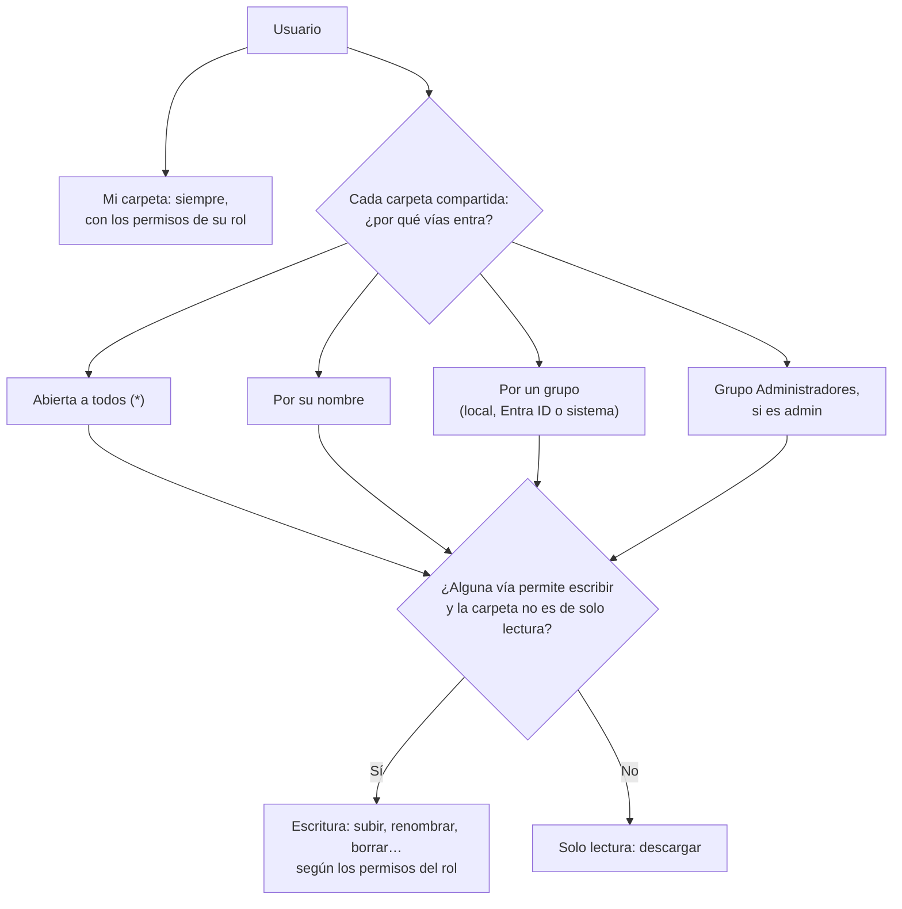
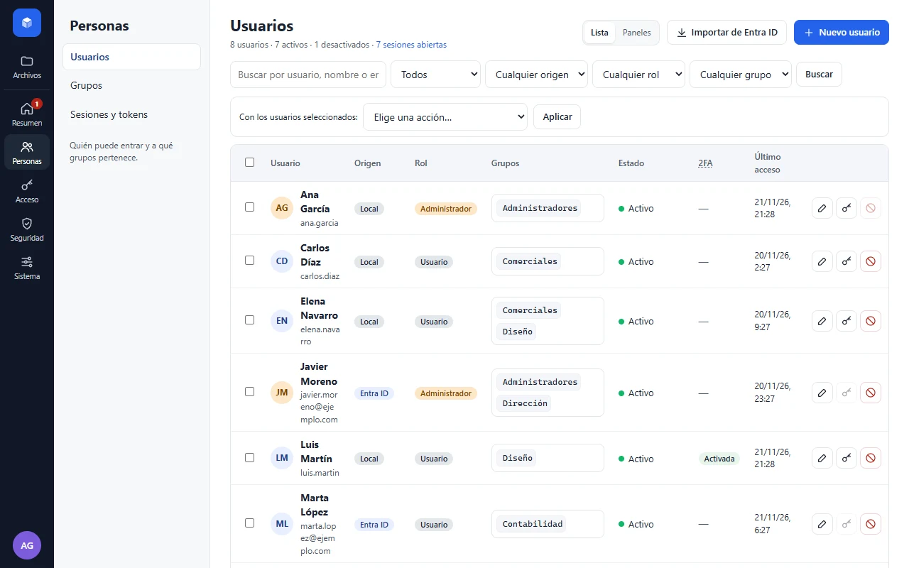
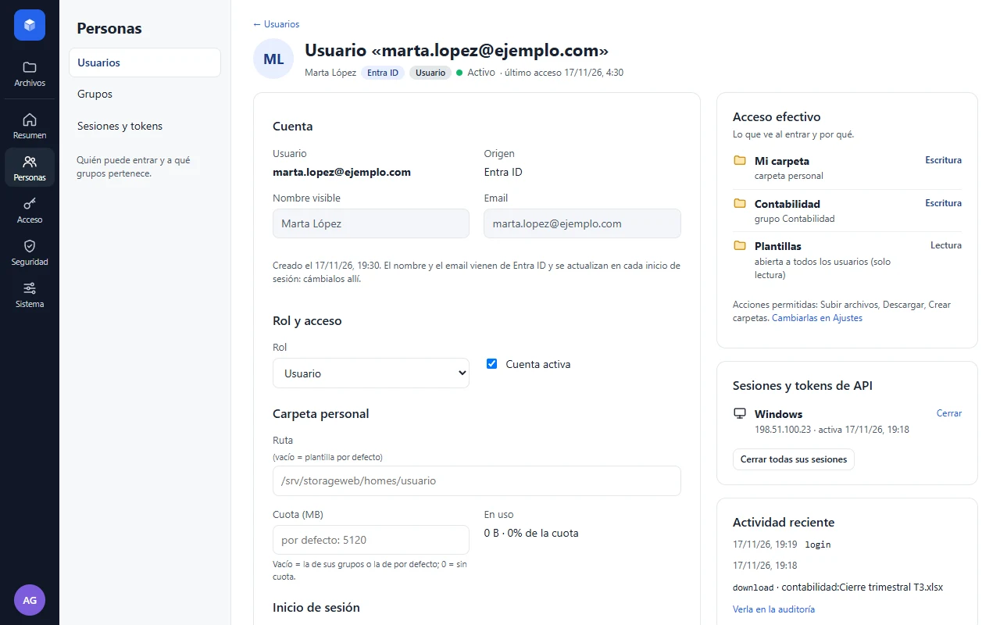

# Usuarios, roles y permisos

## Orígenes de usuario

| Origen | Cómo entra | Quién lo crea |
|---|---|---|
| **Local** | Usuario y contraseña (hash scrypt en SQLite; mínimo 10 caracteres) | Un admin, desde la web o la CLI |
| **Sistema (PAM)** | Usuario y contraseña del sistema operativo | Automático en su primer login (`auth.pam.enabled`) |
| **Entra ID** | Botón *Iniciar sesión con Microsoft* | Automático (`auto_provision`) o un admin por adelantado |

## Roles

| Rol | Puede |
|---|---|
| `admin` | Todo sobre archivos, y además *Administración*: usuarios, ajustes y auditoría |
| `user` | Los permisos de `permissions.user`. Por defecto: subir, descargar y crear carpetas |

Hay tres protecciones: un admin no puede quitarse el rol, ni desactivarse, ni borrarse a sí mismo, y siempre debe quedar **al menos un admin activo**.

## Permisos sobre archivos

| Permiso | `admin` | `user` (por defecto) | Carpeta de solo lectura |
|---|---|---|---|
| Descargar | ✔ | ✔ | ✔ |
| Subir | ✔ | ✔ | ✘ |
| Crear carpetas | ✔ | ✔ | ✘ |
| Renombrar | ✔ | ✘ | ✘ |
| Eliminar | ✔ | ✘ | ✘ |
| Editar archivos de texto | ✔ | ✘ | ✘ |

*Editar archivos de texto* deja cambiar y guardar desde el visor los archivos de texto en UTF-8 que se pueden ver (botón **Editar**); es aparte de *Subir* y *Eliminar*, que son los que pide la unidad de red para sobrescribir. Con un token de solo lectura no se edita.

Los permisos del rol `user` se cambian en *Acceso → Permisos del rol*. El servidor los comprueba en cada acción, también en la API: la interfaz solo oculta los botones.

## Carpetas

- **Personal:** sale de `storage.home_template`, o de la ruta personalizada del usuario (campo *Carpeta personal*). Se crea en el primer acceso si `create_home` está activo.
- **Compartidas:** se asignan por usuario o por [grupo](#grupos). El acceso de un grupo puede ser de lectura y escritura o de solo lectura (`read_only_groups`); un usuario puede escribir si entra por su nombre o por algún grupo que no sea de solo lectura. Si la carpeta es `read_only`, nadie escribe.



## Grupos

*Personas → Grupos* reúne los grupos que dan acceso a las carpetas compartidas. Cada grupo tiene un **identificador** (el que usan las carpetas, p. ej. `rrhh`), un nombre visible y un origen:

| Origen | Miembros |
|---|---|
| Local | Los añade el admin a mano. |
| Entra ID | Se sincronizan en cada inicio de sesión desde el Object ID del grupo o el nombre del App Role (*Grupo externo*). El id_token debe incluir el claim `groups` o `roles`. |
| Sistema (PAM) | Miembros de un grupo del servidor, sincronizados en cada inicio de sesión. |

El grupo **Administradores** (`admins`) viene de serie y no se puede editar ni eliminar. Sus miembros son los usuarios con rol `admin`: añadir a alguien le da el rol y quitarlo se lo retira, con las mismas protecciones que el rol (no puedes quitártelo a ti mismo y siempre queda un admin activo). Las carpetas compartidas pueden usarlo con el identificador `admins`. Si el rol viene de Entra ID (`role_mappings`) o de PAM (`admin_groups`), se recalcula en el siguiente inicio de sesión.

El **nombre y el email** de los usuarios de Entra ID los pone Entra ID y se actualizan en cada inicio de sesión: en su ficha se ven pero no se pueden editar (se cambian en Entra ID). Si cambia su UPN, la cuenta se renombra al entrar; y las cuentas borradas o desactivadas en Entra ID se desactivan solas (ver [Cuentas al día con Entra ID](entra-id.md#cuentas-al-dia-con-entra-id)).

Un admin también puede añadir a mano a un usuario a un grupo de Entra ID o del sistema. Las pertenencias manuales **se conservan** al volver a iniciar sesión; las sincronizadas se cambian en el proveedor. En la ficha del usuario, los grupos sincronizados se ven con un candado.

Los grupos que llegan del proveedor o que usan las carpetas pero no están dados de alta aparecen como **grupos sin dar de alta**, con un botón para darlos de alta. Siguen funcionando igual mientras tanto: las carpetas pueden referenciar directamente un Object ID.

Con la lectura del directorio de Entra ID (permiso `Group.Read.All`, ver [Entra ID](entra-id.md)), al darlo de alta el formulario llega relleno con el **nombre** y la **descripción** del grupo en Entra ID y un **identificador** sacado del nombre («Permitir Instalación» → `permitir-instalacion`; si ya existe, `-2`…), que puedes cambiar antes de guardar. **Dar de alta todos** los da de alta de una vez con esos datos; los App Roles, que no están en el directorio, usan su nombre como identificador. Al elegir un grupo con el buscador del alta se rellenan igual.

Hay dos vistas para elegir, con el selector *Lista · Paneles* (se recuerda la última):

- **Lista:** tabla de grupos y una ficha por grupo con sus datos, miembros, carpetas y baja.
- **Paneles:** lista a la izquierda y detalle con las pestañas *Miembros*, *Carpetas* y *Ajustes*.


La **matriz de accesos** está en *Acceso → Matriz de accesos*: una fila por grupo y una columna por carpeta compartida; cada celda es *—*, *Lectura* o *Escritura*. Guarda los cambios en los ajustes de las carpetas (`groups` y `read_only_groups`). Las carpetas abiertas a todos (`users: ["*"]`) no dependen de los grupos.


Eliminar un grupo quita el acceso que da; no toca usuarios ni archivos. La [decisión 0011](../arquitectura/decisiones/0011-grupos-gestionados.md) explica el modelo.

## Gestión

=== "Web"

    *Personas → Usuarios*: crear, editar (rol, grupos, carpeta, estado), cambiar la contraseña, activar o desactivar y eliminar.
    Hay dos vistas para elegir con el selector *Lista · Paneles* (se recuerda la última):

    - **Lista:** filtros por estado, origen, rol y grupo, paginación y **acciones en bloque** (añadir a un grupo, cambiar el rol, activar, desactivar). Cada acción se aplica a cada usuario con sus protecciones; los que no se pueden cambiar se listan.
    - **Paneles:** lista a la izquierda y detalle con las pestañas *Perfil*, *Grupos*, *Acceso efectivo* y *Actividad*.

    

    La ficha de cada usuario muestra su **acceso efectivo** (qué carpetas ve, con qué permiso y por qué: su carpeta, abierta a todos, por su nombre o por un grupo) y su **actividad reciente** en la auditoría.

    
    La lista se puede filtrar por estado (*Todos*, *Activos*, *Desactivados*) y cada fila tiene sus acciones como iconos: **Editar** (lápiz), **Cambiar contraseña** (llave; desactivada en las cuentas de Entra ID o PAM, cuya contraseña se gestiona allí) y **Desactivar**/**Activar**; con el ratón encima se ve qué hace cada uno. *Cambiar contraseña* también está en la vista de paneles, y no dentro de *Editar*. El servidor vuelve a comprobarlo todo: un botón desactivado no se salta con una petición hecha a mano. La ficha de cada usuario se ordena por lo que se viene a hacer: arriba, quién es (rol, origen, estado, alta y último acceso); después lo que se edita, *Perfil* (nombre y email), *Acceso* (el rol y los grupos, que deciden juntos qué puede hacer y qué ve; el resultado, en *Acceso efectivo* al lado) y *Carpeta personal* (ruta, cuota y lo que ocupa), con una barra *Cambios sin guardar* que solo aparece al tocar algo (y avisa si se sale sin guardar); luego *Inicio de sesión y seguridad* (verificación en dos pasos y quitarla, sesiones y tokens) y, al final, la zona peligrosa: desactivar y eliminar. Activar o desactivar se hace solo con su botón, no al editar. Lleva a su propia página, con la contraseña nueva dos veces; al guardarla se cierran todas las sesiones de esa persona (`password_reset_by_admin` en la auditoría). La propia se cambia en *Mi perfil*, que pide la actual.

=== "CLI"

    ```bash
    sudo storageweb-admin user-add ana --role user --groups rrhh,it   # grupos manuales; se crean si no existen
    sudo storageweb-admin user-set ana --role admin
    sudo storageweb-admin user-set ana --disable
    sudo storageweb-admin user-set ana --locale en      # idioma preferido de la interfaz
    sudo storageweb-admin user-passwd ana
    sudo storageweb-admin user-add juan@contoso.com --source entra     # alta previa de Entra
    sudo storageweb-admin user-list
    ```

### Desactivar en lugar de eliminar

Desactivar funciona con **cualquier origen**: local, Entra ID o PAM. Una cuenta desactivada no puede iniciar sesión aunque Microsoft o el sistema la sigan autenticando: StorageWeb rechaza el acceso con «Tu cuenta está deshabilitada». Su sesión abierta se cierra en la siguiente petición, y sus archivos, grupos y preferencias se conservan para cuando se active de nuevo.

Al eliminar un usuario, **sus archivos se conservan** en el disco, pero se pierde la cuenta.

!!! warning "Usuarios de Entra ID con alta automática"
    Si `auth.entra.auto_provision` está activo, **eliminar** a un usuario de Entra ID no le bloquea: en su siguiente inicio de sesión se crea otra vez con el rol por defecto. Para bloquearle, desactívalo.

Las dos acciones quedan en la [auditoría](../referencia/auditoria.md) como `user_disabled` y `user_enabled`. Un admin no puede desactivarse a sí mismo, ni desactivar al último admin activo.

## Usuarios del sistema (PAM)

1. Activa `auth.pam.enabled`. Con `allowed_groups` limitas quién entra; con `admin_groups` decides quién recibe el rol admin.
2. `pam_unix` necesita leer `/etc/shadow`, y el servicio no puede usar `unix_chkpwd` porque corre con `NoNewPrivileges`. En Debian/Ubuntu añade el usuario del servicio al grupo `shadow`: `usermod -aG shadow storageweb` (lo hace `install.sh --pam`).
3. Para usar el home real (`/home/<usuario>`):
   - activa `use_system_home` o pon `home_template = "/home/{username}"`;
   - da acceso al servicio: `setfacl -R -m u:storageweb:rwx -m d:u:storageweb:rwx /home/ana`;
   - en la unidad systemd, cambia `ProtectHome=true` a `false` y añade `/home` a `ReadWritePaths` (`systemctl edit storageweb`).

Todos los archivos se escriben con el usuario del servicio, no con el del usuario que inicia sesión; ver el [ADR 0009](../arquitectura/decisiones/0009-usuario-de-servicio.md).
