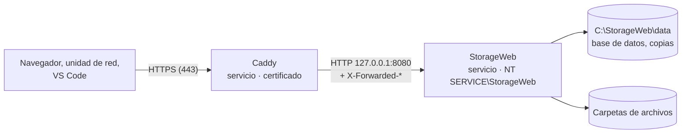

# Windows

StorageWeb funciona en Windows 10 y 11 (también Pro y Home) y en Windows Server. Para dejarlo como un servidor de verdad hacen falta dos piezas: **StorageWeb como servicio de Windows**, para que arranque solo con el equipo, y **Caddy** delante, para el HTTPS.



!!! note "¿Por qué no IIS?"
    En Windows 10 y 11, IIS atiende como mucho 10 peticiones a la vez, y su proxy (ARR) está pensado para Windows Server. Además, su módulo WebDAV intercepta la unidad de red y no admite peticiones de más de 4 GB. Caddy es un solo ejecutable, sin esos límites, y renueva el certificado él solo.

## 1. Python y StorageWeb

1. Instala **Python (3.9 o posterior; mejor la última) desde [python.org](https://www.python.org/downloads/windows/)** (marca *Install for all users*). El Python de la Microsoft Store no puede ejecutar servicios.
2. Abre **PowerShell como administrador** e instala StorageWeb en `C:\StorageWeb` con el wheel de la [última versión](https://github.com/vsc55/StorageWeb/releases):

```powershell
mkdir C:\StorageWeb; cd C:\StorageWeb
python -m venv venv
venv\Scripts\pip install storageweb-X.Y.Z-py3-none-any.whl
notepad C:\StorageWeb\config.json
```

Un `config.json` para Windows detrás de Caddy (las barras pueden ser `/`):

```json
{
  "server": { "host": "127.0.0.1", "port": 8080, "behind_proxy": true, "max_upload_mb": 2048 },
  "data_dir": "C:/StorageWeb/data",
  "session": { "cookie_secure": true },
  "network": { "public_url": "archivos.midominio.es" },
  "storage": { "home_template": "D:/Archivos/{username}" }
}
```

- `server.host` **127.0.0.1**: solo Caddy llega a la aplicación. Con `behind_proxy`, escuchar en toda la red permitiría falsear la IP de origen.
- `network.public_url`: el nombre con el que se entra desde los navegadores (el mismo que en el `Caddyfile`).
- El resto de opciones, en [Configuración](configuracion.md).

Crea el primer administrador:

```powershell
venv\Scripts\storageweb --config C:\StorageWeb\config.json user-add admin --role admin
```

## 2. StorageWeb como servicio

Desde la misma PowerShell de administrador:

```powershell
venv\Scripts\storageweb --config C:\StorageWeb\config.json service install
venv\Scripts\storageweb --config C:\StorageWeb\config.json service start
```

`service install` registra el servicio **StorageWeb**:

- arranca solo con el equipo (inicio automático retrasado), aunque nadie haya iniciado sesión, y se reinicia solo si se para por un error;
- se ejecuta con su propia **cuenta virtual**, `NT SERVICE\StorageWeb`: no tiene contraseña ni es administradora, y solo puede tocar lo que necesita. El instalador le da lectura sobre Python, el venv y `config.json`, y escritura sobre la carpeta de datos, la de las carpetas personales y las carpetas compartidas locales que ya existan. Lo que hace aparece en pantalla.

| Orden | Qué hace |
|---|---|
| `service status` | Estado del servicio y dónde está su registro. |
| `service stop` / `service start` | Pararlo y arrancarlo (también desde *Servicios* de Windows, `services.msc`). |
| `service remove` | Quitarlo. Los permisos que se dieron a su cuenta se quedan en las carpetas. |
| `service install --account LocalSystem` | Con la cuenta del sistema, que puede tocar todo el equipo. Solo si la cuenta virtual no te sirve. |
| `service install --name StorageWeb2` | Otro servicio con otro nombre (otra instancia con otro `config.json`). |

El registro del servicio está en `C:\StorageWeb\data\logs\service.log`. Si no arranca, la causa está ahí (un puerto ocupado, un error en `config.json`…).

!!! warning "Carpetas nuevas en otro sitio"
    Si más adelante creas una carpeta compartida fuera de las que ya tenían permiso (por ejemplo, en otro disco), da también acceso a la cuenta del servicio: `icacls E:\Proyectos /grant "NT SERVICE\StorageWeb:(OI)(CI)M"`.

Para actualizar StorageWeb: `service stop`, instala el wheel nuevo con `venv\Scripts\pip install`, y `service start`. Si cambias de versión de Python, vuelve a crear el venv y el servicio (`service remove` y `service install`).

## 3. Caddy

1. Descarga Caddy para Windows (`amd64`) de [caddyserver.com/download](https://caddyserver.com/download) y guárdalo como `C:\Caddy\caddy.exe`.
2. Crea `C:\Caddy\Caddyfile`. La página *Sistema → Red y HTTPS* de la administración tiene un ejemplo ya rellenado con tus valores. La [plantilla comentada](https://github.com/vsc55/StorageWeb/blob/master/packaging/caddy/Caddyfile) explica cada línea y las opciones del certificado. Lo mínimo:

```
archivos.midominio.es {
	request_body {
		max_size 2100MB
	}
	reverse_proxy 127.0.0.1:8080 {
		header_up -X-Forwarded-Prefix
		flush_interval -1
	}
}
```

3. Pruébalo y regístralo como servicio (PowerShell como administrador):

```powershell
cd C:\Caddy
.\caddy.exe validate --config C:\Caddy\Caddyfile
sc.exe create caddy start= auto binPath= "C:\Caddy\caddy.exe run --config C:\Caddy\Caddyfile"
sc.exe start caddy
```

Después de cambiar el `Caddyfile`: `.\caddy.exe reload --config C:\Caddy\Caddyfile` (sin parar el servicio).

4. Abre los puertos en el firewall de Windows. El 80 sirve para redirigir a HTTPS y para que Let's Encrypt compruebe el nombre. El 443 en UDP es HTTP/3 y es opcional.

```powershell
New-NetFirewallRule -DisplayName "Caddy (HTTP y HTTPS)" -Direction Inbound -Action Allow -Protocol TCP -LocalPort 80,443
New-NetFirewallRule -DisplayName "Caddy (HTTP/3)" -Direction Inbound -Action Allow -Protocol UDP -LocalPort 443
```

Si Caddy no arranca porque el puerto está ocupado, `netstat -ano | findstr :443` dice qué proceso lo tiene (a menudo IIS o otro servidor web instalado).

## El certificado

El navegador, la **unidad de red de Windows** y Entra ID necesitan un certificado de confianza. Con uno que no lo es, el Explorador de Windows ni siquiera conecta la unidad.

| Situación | Qué poner en el `Caddyfile` |
|---|---|
| El nombre apunta a este equipo y los puertos 80 y 443 llegan desde internet | Nada: Caddy lo pide a Let's Encrypt y lo renueva solo. |
| Tienes un dominio, pero el equipo **solo está en la red interna** | Let's Encrypt **validando por DNS**: no hace falta abrir puertos. Descarga en [caddyserver.com/download](https://caddyserver.com/download) un `caddy.exe` con el módulo de tu proveedor de DNS y añade `tls { dns <proveedor> <credenciales> }`. En el DNS interno, el nombre apunta a la IP local del equipo. **Es lo recomendable.** |
| Tu empresa ya tiene certificados | `tls C:/certs/fullchain.pem C:/certs/privkey.pem`. Al renovarlo, `caddy reload`. |
| Sin dominio, pocos equipos | `tls internal`: Caddy crea su propia autoridad. Instala su certificado raíz en **cada equipo** que vaya a entrar: `certutil -addstore -f Root root.crt` como administrador. El fichero está en `C:\Windows\System32\config\systemprofile\AppData\Roaming\Caddy\pki\authorities\local\root.crt` (la carpeta de datos del servicio, no la de tu usuario). |

## El equipo

- **Que no se suspenda:** `powercfg /change standby-timeout-ac 0` y `powercfg /change hibernate-timeout-ac 0`.
- **Windows Update:** los dos servicios arrancan solos tras los reinicios. Ajusta las *horas activas* para que no reinicie en horario de trabajo.
- Comprueba el resultado en *Sistema → Red y HTTPS*: avisa si las cabeceras del proxy no llegan o la dirección pública no coincide.
