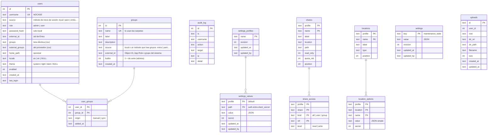

# Datos

## Base de datos (SQLite)

Un único fichero (`storageweb.db`) en modo WAL. El esquema se crea y evoluciona con [migraciones versionadas](decisiones/0007-migraciones.md) en `src/storageweb/db/migrations/`.



| Tabla | Uso |
|---|---|
| `users` | Cuentas. `uid` es su identificador público (UUID v4): el que va en las direcciones y los formularios de la administración; `id` es la clave interna de las relaciones. `source` es la clave de su método de inicio de sesión (cualquiera registrado; sin `CHECK` desde la migración 007). `(source, external_id)` es único: una cuenta de Entra por `oid`. `username` no distingue mayúsculas. `groups` es la lista efectiva que usan las carpetas: `external_groups` más los nombres de sus grupos. |
| `groups` | Grupos dados de alta. Como los usuarios, `uid` es su identificador público. `(source, external_id)` es único. `home_quota_mb` es la cuota de la carpeta personal de sus miembros. `builtin = 1` marca el grupo de serie `admins` (migración 005), cuyos miembros son los usuarios con rol admin. Ver la [decisión 0011](decisiones/0011-grupos-gestionados.md). |
| `user_groups` | Pertenencias. Al iniciar sesión solo se reemplazan las `sync`; las `manual` se conservan. |
| `audit_log` | Registro de eventos; ver la [referencia de auditoría](../referencia/auditoria.md). |
| `settings_values` | Ajustes guardados desde la web: una fila por perfil (`settings_profile`) y campo, con su valor en JSON (los secretos, cifrados), y quién y cuándo lo cambió. Solo lo que difiere de los predeterminados. Ver la [decisión 0017](decisiones/0017-ajustes-web-por-campo.md). |
| `settings_profiles` | Un perfil por fila; `revision` sube en cada guardado para invalidar la caché de los ajustes efectivos. |
| `shares`, `share_access` | Carpetas compartidas creadas desde la web (por perfil) y quién entra en cada una: todos, un usuario o un grupo, con lectura o escritura. Las de `config.json` no están aquí: se leen del fichero y se ven de solo lectura. Ver la [decisión 0018](decisiones/0018-carpetas-y-ubicaciones-como-entidades.md). |
| `locations`, `location_options` | Ubicaciones de almacenamiento externo creadas desde la web y sus opciones (dependen del tipo); los secretos, cifrados. |
| `settings` | Estado interno como documentos JSON: cuándo corrió cada tarea de mantenimiento (`maintenance_state`), permisos del último inicio de sesión de cada método SSO… |
| `uploads` | Subidas por partes en curso. El progreso **no** se guarda aquí: es el tamaño del `.part`. |

`PRAGMA user_version` guarda la versión del esquema.

Las sesiones **no** se guardan en la base de datos: son cookies firmadas con `secret_key` que contienen el id de usuario y el token CSRF. Por eso, si cambias `secret_key`, se cierran todas las sesiones.

## Sistema de ficheros

```
<home_template>/<usuario>/       carpeta personal (se crea en el primer acceso)
<share.path>/                    cada carpeta compartida
  .sw-upload-<id>.part           subida en curso (oculta en el listado)
```

- **Propietario:** todo se escribe con el usuario del servicio. Con `UMask=0007` y el bit setgid (`2770`) en las carpetas creadas por los paquetes, los ficheros quedan legibles por el grupo `storageweb`.
- **Nombres de carpeta:** el nombre de usuario se sanea para usarlo como carpeta (`safe_username_for_path`): minúsculas y solo `[a-z0-9._@-]`.
- **Escrituras atómicas:** las subidas se escriben en el `.part` y se renombran al terminar, así que un archivo a medias nunca aparece con su nombre final.
