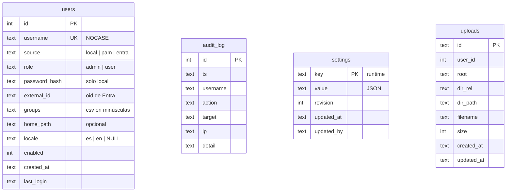

# Datos

## Base de datos (SQLite)

Un único fichero (`storageweb.db`) en modo WAL. El esquema se crea y evoluciona con [migraciones versionadas](decisiones/0007-migraciones.md) en `src/storageweb/db/migrations/`.



| Tabla | Uso |
|---|---|
| `users` | Cuentas. `(source, external_id)` es único: una cuenta de Entra por `oid`. `username` no distingue mayúsculas. |
| `audit_log` | Registro de eventos; ver la [referencia de auditoría](../referencia/auditoria.md). |
| `settings` | Ajustes web como un documento JSON (`key = runtime`). `revision` se incrementa en cada cambio para invalidar cachés. |
| `uploads` | Subidas por partes en curso. El progreso **no** se guarda aquí: es el tamaño del `.part`. |

`PRAGMA user_version` guarda la versión del esquema.

Las sesiones **no** se guardan en la base de datos: son cookies firmadas con `secret_key` que contienen el id de usuario y el token CSRF. Por eso, si cambias `secret_key`, se cierran todas las sesiones.

## Sistema de ficheros

```
<home_template>/<usuario>/       carpeta personal (se crea en el primer acceso)
<share.path>/                    cada carpeta compartida
  .sw-upload-<id>.part           subida en curso (oculta en el listado)
```

- **Propietario:** todo se escribe con el usuario del servicio. Con `UMask=0007` y el bit setgid (`2770`) en las carpetas creadas por los paquetes, los ficheros quedan legibles por el grupo `storageweb`.
- **Nombres de carpeta:** el nombre de usuario se sanea para usarlo como carpeta (`safe_username_for_path`): minúsculas y solo `[a-z0-9._@-]`.
- **Escrituras atómicas:** las subidas se escriben en el `.part` y se renombran al terminar, así que un archivo a medias nunca aparece con su nombre final.
