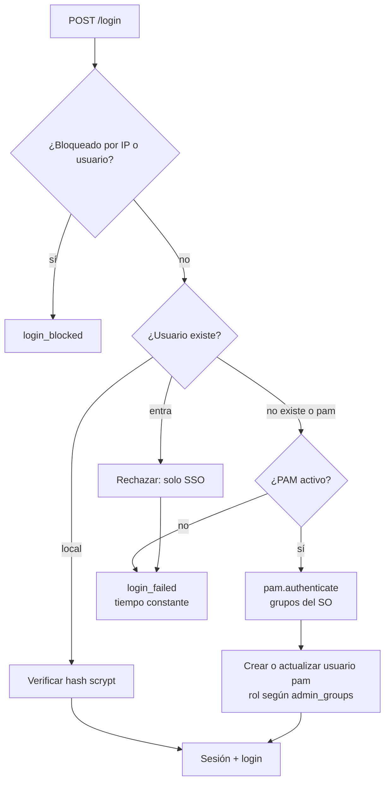
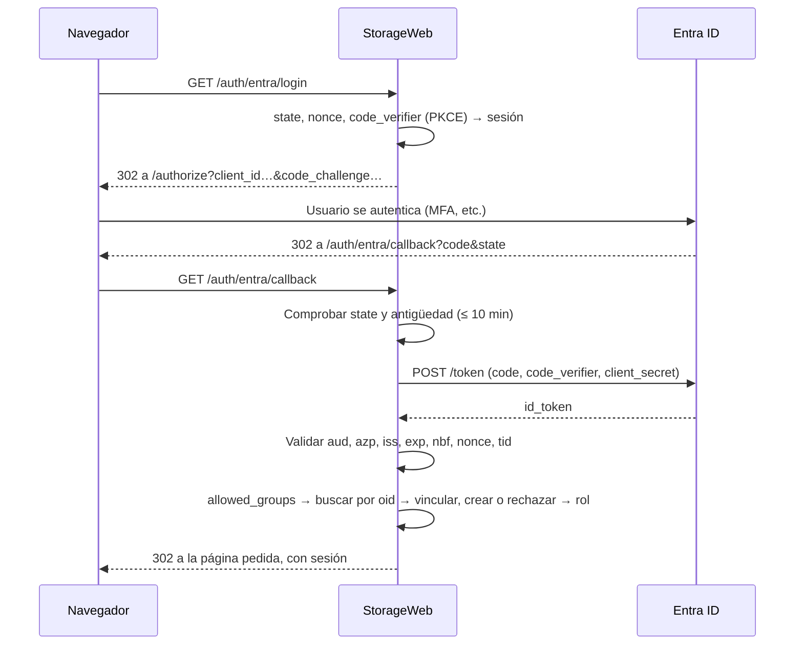
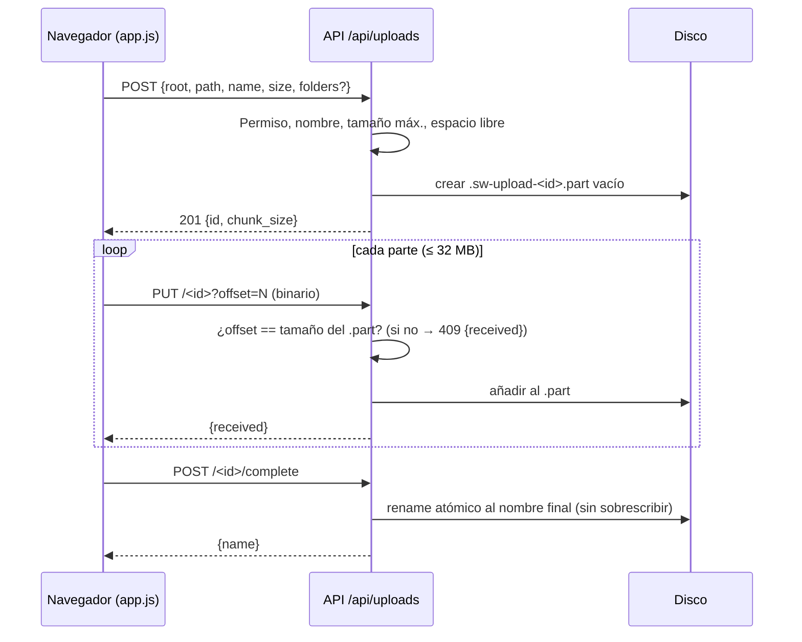
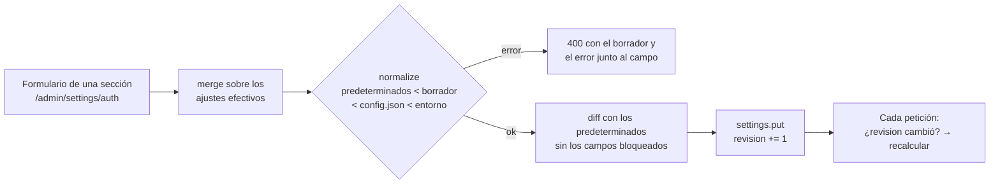

# Flujos

## Inicio de sesión con usuario y contraseña

Cuando el usuario no existe o no tiene contraseña, se calcula igualmente un hash ficticio. Así el tiempo de respuesta no revela qué usuarios existen.

## Inicio de sesión con Entra ID (`oauth2`)

Reglas del alta (`core.accounts.login_with_claims`):

1. Si existe un usuario con ese `oid`, entra con esa cuenta.
2. Si no, pero existe un usuario de Entra con ese nombre y sin `oid` (dado de alta por un admin), se le vincula ese `oid`.
3. Si existe un usuario local o PAM con ese nombre, se **rechaza** el login.
4. Si no existe ninguno, se crea el usuario cuando `auto_provision` está activo; si no, se rechaza.
5. El rol se calcula con `resolve_role`, a partir de `role_mappings`, `default_role` y `sync_role_on_login`.

## Subida por partes

- **Reanudación:** el progreso real es el tamaño del `.part` en disco. Tras un corte, el navegador consulta `GET /<id>` y sigue desde `received`. El id se guarda en `localStorage` para continuar incluso tras recargar la página.
- **Reintentos:** ante errores de red o 5xx, el navegador reintenta con espera exponencial, hasta 8 veces.
- **Permisos:** se vuelven a comprobar **en cada parte**. Si un admin quita el permiso a mitad de la subida, se corta.
- **Limpieza:** las subidas sin actividad durante 24 h se eliminan al iniciar otra.

## Ajustes web

Los campos que fijan `config.json` o el entorno no se guardan: la web los muestra bloqueados. La revisión se lee en cada petición, una consulta trivial. Por eso todos los hilos aplican los cambios al momento, sin reiniciar y sin mensajes entre procesos.
