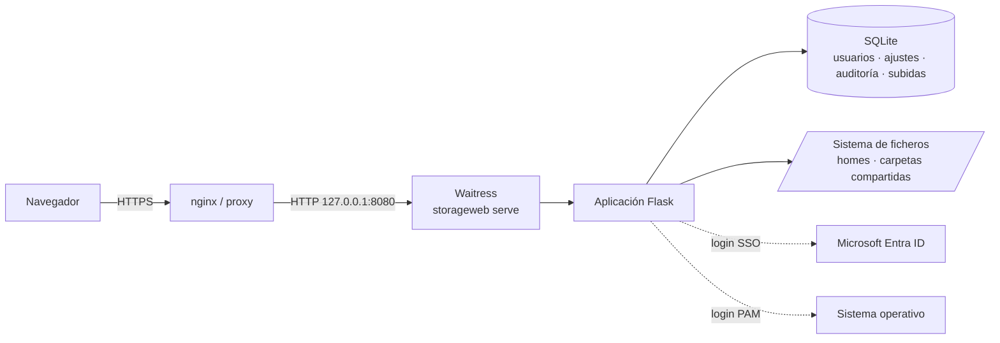
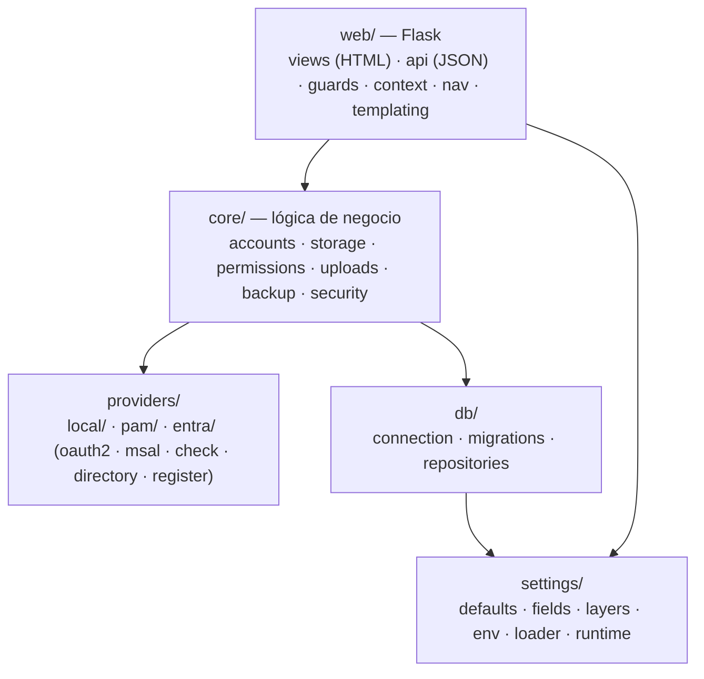

# Arquitectura

StorageWeb es una aplicación **WSGI monolítica**: Flask para la web, Waitress como servidor y SQLite para el estado. Los archivos se guardan en el sistema de ficheros, sin base de datos de contenidos. Se ejecuta como **un único proceso** con varios hilos, bajo un usuario de sistema sin privilegios.

## Capas

Las dependencias van **en un solo sentido**: una capa solo importa las que están por debajo.

| Paquete | Responsabilidad | Depende de Flask |
|---|---|---|
| `storageweb.settings` | Configuración por capas ([ADR 0013](decisiones/0013-capas-de-configuracion.md)): valores por defecto, registro de campos (`fields`), combinación de capas (`layers`), variables de entorno (`env`), carga y validación de `config.json` (`loader`) y ajustes web con caché por revisión y bloqueos (`RuntimeSettings`) | No |
| `storageweb.db` | Conexión SQLite, migraciones versionadas, repositorios por entidad. **Todos reciben la conexión como argumento** | No |
| `storageweb.providers` | Autenticación, **una carpeta por proveedor**: `local/` (contraseñas), `pam/` y `entra/` (SSO `oauth2` y `msal` con la interfaz `SSOProvider` de `base.py`, más la comprobación, el directorio de grupos y el registro de la aplicación en Microsoft Graph) | No |
| `storageweb.core` | Reglas de negocio: cuentas y roles, raíces de almacenamiento, permisos, subidas por partes, copias, saneado de rutas y nombres | No |
| `storageweb.web` | HTTP: vistas HTML, API JSON, CSRF, control de acceso y cabeceras. `web/context.py` es **el único punto** que une Flask (`g`, `current_app`) con el resto | Sí |
| `storageweb.i18n` | Idioma activo (`ContextVar`), traducción (`_`, `_l`, `ngettext`) y formatos de fecha y tamaño. Catálogos en `locale/`. Ver [ADR 0010](decisiones/0010-internacionalizacion.md) | No |
| `storageweb.cli` | Comando `storageweb` (servidor y administración), un módulo por grupo de comandos | Solo para `serve` |

Con esta separación, la lógica se prueba sin servidor (`tests/unit`, unos 3 segundos) y la capa web queda delgada: traduce HTTP a llamadas de `core`. El razonamiento está en el [ADR 0002](decisiones/0002-paquete-y-capas.md).

## Una petición de principio a fin

1. Waitress recibe la petición. Si `behind_proxy` está activo, `ProxyFix` reescribe la IP, el esquema y el host a partir de `X-Forwarded-*`.
2. `before_request`:
   - `load_current_user` carga el usuario de la sesión y la cierra si está desactivado;
   - `select_locale` fija el idioma (usuario → sesión → navegador → `default_locale`);
   - `check_csrf` valida el token en los métodos que modifican datos. Va el último para que su error salga traducido.
3. La vista obtiene la configuración efectiva (`context.settings()`, cacheada por petición y por revisión de los ajustes web) y la conexión (`context.get_db()`, una por petición).
4. La vista llama a `core`, por ejemplo `storage.find_root` → `security.resolve_inside` → `permissions.permissions_for`, y escribe en la auditoría.
5. `after_request` añade las cabeceras de seguridad (CSP, `X-Frame-Options`…). `teardown` cierra la conexión.

## Procesos y concurrencia

- **Un proceso, varios hilos** (`server.threads`). SQLite en modo WAL admite lecturas concurrentes y una escritura a la vez, más que suficiente para el uso previsto. Las escrituras son breves: auditoría, sesiones de subida y ajustes.
- **Estado en memoria:** solo el bloqueo de intentos de login y la caché de ajustes, que se invalida por número de revisión guardado en la base de datos.
- **No está pensado para varias réplicas.** El bloqueo de intentos no se compartiría y SQLite no es una base de datos en red. Para alta disponibilidad, usa una sola instancia con reinicio automático (systemd o Docker) y copias de seguridad.

Más detalle en [Flujos](flujos.md), [Datos](datos.md) y el [modelo de seguridad](seguridad.md).
