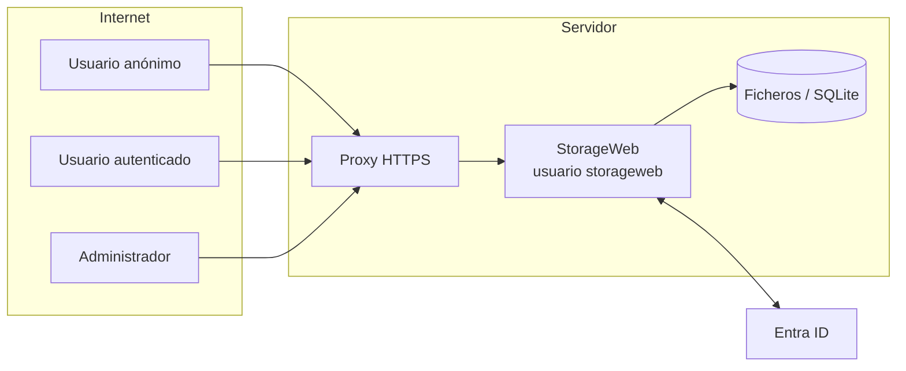

# Modelo de seguridad

## Activos

| Activo | Dónde |
|---|---|
| Archivos de los usuarios | Sistema de ficheros (homes y carpetas compartidas) |
| Credenciales | Hashes scrypt (`users.password_hash`), `client_secret` de Entra (`config.json` o `settings`), `secret_key` |
| Sesiones | Cookies firmadas |
| Registro de auditoría | `audit_log` |

## Actores y fronteras de confianza

- **Lo que se considera hostil:** todo lo que llega del navegador (rutas, nombres de archivo, cabeceras, cuerpos) y las cabeceras `X-Forwarded-*` si no hay un proxy de confianza.
- **Lo que se considera de confianza:**
  - el sistema operativo y quien tiene acceso de root;
  - el proxy inverso, si `behind_proxy` está activo;
  - el endpoint de token de Entra ID, al que se accede por TLS.

## Amenazas y controles

| Amenaza | Control | Dónde |
|---|---|---|
| Acceder a archivos de otro usuario o del sistema (path traversal, symlinks) | `resolve_inside` resuelve la ruta real y exige que quede dentro de la raíz. Rechaza `..` y rutas absolutas. Borrar y renombrar no siguen el symlink final (`resolve_entry`) | `core/security.py` |
| Salir de la raíz en almacenamiento externo (S3, SMB, SFTP, FTP, WebDAV, Azure) | Toda ruta pasa por `clean_rel`: rechaza `..`, unidades (`C:`) y caracteres de control (NUL, CR, LF: comandos FTP o cabeceras HTTP inyectadas), convierte `\` en `/` y quita las barras iniciales; la ruta siempre se une a la raíz de la carpeta | `core/backends/base.py` |
| Nombres especiales de Windows: saltarse los «ocultos para todos» o colgar una petición sin salir de la carpeta | En el disco de un servidor Windows, siempre en SMB, y en SFTP, FTP o WebDAV con la opción *El servidor es Windows* (`windows_server`), se rechaza cualquier trozo de la ruta que Windows no trate tal cual: acabado en punto o espacio (`secreto.md.` abriría `secreto.md`), con `:` (flujos de NTFS: `secreto.md::$DATA`), comodines o un dispositivo (`CON`, `NUL`, `COM1`… también con extensión; `CON` dejaba la petición colgada). Un nombre corto de 8.3 (`SECRET~1.MD`) solo vale si es el nombre de verdad. Los tests de ataques los prueban en el visor, la descarga, el editor y el explorador | `core/security.py` (`windows_reserved`, `resolve_inside`), `core/backends/smb.py` |
| Servidor remoto malicioso o comprometido | Los nombres que devuelve un listado se filtran (`is_safe_name`: ni `..`, ni `a/b`, ni caracteres de control); WebDAV rechaza XML con `DOCTYPE` o entidades; la clave del servidor SFTP se comprueba (`host_key`) y el certificado TLS de FTPS y WebDAV, salvo que el admin lo desactive | `core/storage.py`, `core/backends/` |
| Nombres de archivo maliciosos | `safe_filename`: solo el último componente, sin caracteres de control ni reservados, NFC, ≤ 255 bytes, sin nombres reservados de Windows. Renombrar en disco lo vuelve a comprobar en el backend | `core/security.py`, `core/backends/local.py` |
| CSRF | Token aleatorio por sesión, comparado en tiempo constante, en POST/PUT/DELETE (formularios y `X-CSRF-Token`) | `web/guards.py` |
| Conectar aplicaciones desde el navegador (`/connect`) | OAuth con PKCE: el código de vuelta es de un solo uso, caduca a los 5 minutos y solo se canjea con el *verifier* que nunca sale del equipo (otro programa que capture la vuelta no puede usarlo); un canje fallido gasta el código y cuenta como infracción; la dirección de vuelta está fijada por aplicación (`vscode://storageweb.storageweb-sync/auth`), nunca una web cualquiera; la página exige sesión y CSRF y pregunta antes; el token se crea al canjear y se ve y revoca en *Mi perfil* | `core/connect.py`, `web/views/connect.py`, [ADR 0016](decisiones/0016-conectar-aplicaciones-con-el-navegador.md) |
| Ocultos para todos (`storage.hidden`) | Se comprueba en cada entrada (rutas de la web, subidas por partes, WebDAV y destino de `COPY`/`MOVE`): como si no existieran y sin poder crearlos. No es un control de acceso; la lista de patrones no se envía a los clientes, solo una marca en la ruta concreta pedida | `patterns.py`, `core/storage.is_hidden` |
| Unidad de red (WebDAV) | Solo credenciales en la cabecera (`Basic usuario:token`, o la contraseña si el admin lo permite; `Bearer`): la cookie del navegador no vale en `/dav/`, así que no hay CSRF posible. Mismos permisos que la web en cada petición, más el de borrar para sobrescribir; `Destination` de `COPY`/`MOVE` solo dentro de `/dav/` del mismo servidor; los fallos cuentan para los bloqueos | `web/views/dav.py`, `guards._load_dav_user` |
| Archivos subidos que se ejecutan en el navegador (HTML, SVG) | Las descargas (web y WebDAV) van como adjunto y con `Content-Security-Policy: sandbox` | `web/downloads.py` |
| Documentos que se ven en el navegador (visor) | El Markdown se convierte en el servidor sin dependencias y con todo el texto escapado: solo salen las etiquetas que genera el conversor; los enlaces solo a `http(s)`, `mailto` o rutas de la misma carpeta raíz (ni `javascript:` ni `data:`); las imágenes, solo de la misma raíz (una externa diría a un tercero quién lee el documento). El HTML y el SVG se ven como código. Los diagramas `mermaid` los dibuja Mermaid en un marco aislado por documento (`sandbox allow-scripts` en el `iframe` y en su CSP: origen opaco, sin cookies ni acceso a la página; el código entra por `postMessage` y solo sale la altura). Mermaid se copia con `tools/vendor.py`, que comprueba su huella. Las imágenes, los PDF, el vídeo y el audio los sirve `files.inline` **en línea pero con el tipo de `core/media_types.json`** (nunca el del archivo ni el del sistema), con `nosniff`, aislados (`Content-Security-Policy: sandbox`) y `Cross-Origin-Resource-Policy: same-origin`; el PDF, además, solo enmarcable desde StorageWeb (`frame-ancestors 'self'`, `X-Frame-Options: SAMEORIGIN`) y abierto por el visor de PDF del navegador. El SVG nunca entra en esa lista (es un documento con scripts), y el JSON se valida al arrancar: un tipo que no sea imagen, vídeo, audio o `application/…`, o `svg`/`html`, para el arranque | `core/markdown.py`, `core/preview.py`, `core/media_types.json`, `web/views/files.py` (`view`, `inline`, `diagram_frame`) |
| Robo o fijación de sesión | Cookie `HttpOnly`, `Secure` y `SameSite=Lax`; la sesión se limpia al iniciar y al cerrar sesión; caducidad | `app.py`, `guards.start_session` |
| Fuerza bruta y enumeración de usuarios | Bloqueo por IP y por usuario; hash ficticio para igualar tiempos | `core/security.LoginThrottle`, `providers/local/` |
| Open redirect tras el login | `safe_next` solo admite rutas relativas del propio sitio | `web/guards.py` |
| XSS | Escape automático de Jinja; CSP `default-src 'self'` sin scripts ni estilos inline | `templates/`, `guards.set_security_headers` |
| Clickjacking | `X-Frame-Options: DENY` y `frame-ancestors 'none'` | ídem |
| Escalada de privilegios en la app | Permisos comprobados en el servidor en cada acción (también en cada parte de una subida); rol admin protegido (último admin, auto-degradación) | `core/permissions.py`, `core/accounts.py` |
| Suplantación con SSO | `state`, `nonce`, PKCE; validación de `iss`, `aud`, `azp`, `exp`, `nbf` y `tid`; nunca se vincula a una cuenta local o PAM del mismo nombre | `providers/entra/oauth2.py`, `core/accounts.py` |
| Agotar disco o memoria | Límite por petición y por archivo; comprobación de espacio libre; streaming en subidas y descargas; limpieza de subidas abandonadas | `core/uploads.py` |
| Fuga de secretos | `client_secret` y los secretos de las ubicaciones (claves, contraseñas, claves privadas, tokens SAS) nunca se muestran en la web ni en `check-config`; las listas de objetos se muestran por su nombre; `config.json` en `0640`; copias en `0600` | `settings/`, `core/backup.py` |
| Compromiso del proceso | Usuario sin privilegios; systemd con `NoNewPrivileges`, `ProtectSystem=strict`, `ProtectHome`, `PrivateTmp`, `RestrictAddressFamilies` | `packaging/systemd/` |

## Decisiones con impacto en la seguridad

- **No se verifica la firma del id_token:** se obtiene directamente del endpoint de token por TLS y con autenticación del cliente ([ADR 0004](decisiones/0004-firma-id-token.md)).
- **Un único usuario de servicio** escribe todos los archivos. El aislamiento entre usuarios lo garantiza la aplicación, no el sistema operativo ([ADR 0009](decisiones/0009-usuario-de-servicio.md)).
- **Bloqueo de intentos en memoria:** se pierde al reiniciar. Es aceptable para una instancia única.
- **Las ubicaciones de almacenamiento las configura un admin:** su dirección (endpoint S3, URL WebDAV, servidor SFTP/FTP/SMB) puede apuntar a cualquier equipo de la red. Un admin ya tiene control total de la instalación, así que no se limita; quien tenga el rol admin debe ser de confianza.
- **`tests/integration/test_path_security.py`** ataca todas las operaciones (navegar, descargar, subir, subir por partes, crear carpeta, renombrar, borrar) en disco y en cada tipo remoto con rutas y nombres maliciosos, y comprueba que nada fuera de la raíz se lee ni cambia.

## Limitaciones conocidas

Sin antivirus, sin cifrado en reposo propio, sin cuotas por usuario y sin MFA para usuarios locales (usa Entra ID para MFA). Ver la [lista de producción](../administracion/seguridad.md).
