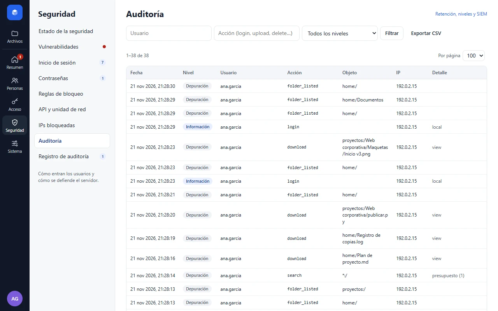

# Registro de auditoría

Cada acción relevante se guarda en la tabla `audit_log`. Se puede consultar en *Seguridad → Auditoría*, filtrando por usuario, acción y nivel, o con `storageweb-admin audit`.



| Campo | Contenido |
|---|---|
| `ts` | Fecha y hora en UTC (ISO 8601) |
| `username` | Usuario que hace la acción (`cli` para comandos de administración) |
| `action` | Tipo de evento (tabla siguiente) |
| `target` | Objeto afectado: `raíz:/ruta` en archivos, nombre de usuario o fichero de copia |
| `ip` | IP del cliente (real si `server.behind_proxy` está activo detrás de un proxy) |
| `detail` | Información adicional |
| `level` | Nivel del evento: `debug`, `info`, `warning`, `error` o `critical` (ver *Niveles*) |

## Niveles

Cada evento tiene un nivel, según su acción (columna *Nivel* de la tabla de acciones; `storageweb/audit_levels.py`):

| Nivel | Qué es | Ejemplos |
|---|---|---|
| `debug` | Consultas y preferencias | Listar una carpeta, buscar, abrir en el visor, favoritos, tema e idioma |
| `info` | Lo que se hace normalmente | Entrar y salir, subir, descargar, editar, crear, renombrar, cambiar ajustes |
| `warning` | Intentos rechazados y pruebas que fallan | Contraseña o código erróneo, acceso denegado, CSRF no válido, cuota llena |
| `error` | Fallos del sistema | Una copia automática que no se hizo o no se pudo enviar fuera del servidor |
| `critical` | Incidentes de seguridad y cambios que no se deshacen | Bloqueo por intentos, IP bloqueada, restaurar una copia, borrar un usuario, purgar la auditoría |

- **Qué se guarda:** *Seguridad → Registro de auditoría → Guardar en la auditoría desde el nivel* (`audit.min_level`). De serie, `debug`: **todo**. Subirlo a `info` deja fuera las consultas, que son la mayoría de los eventos.
- **Qué se reenvía al SIEM:** `audit.forward_min_level` (de serie, `info`), en la misma página. La severidad del mensaje syslog sale del nivel (`debug` 7, `info` 6, `warning` 4, `error` 3, `critical` 2) y en CEF también (1, 3, 6, 8 y 10).
- **Consultarlos:** en *Seguridad → Auditoría* cada evento lleva su nivel y se puede filtrar «desde un nivel» (por ejemplo, *Aviso y superiores*); la exportación CSV incluye la columna `level`.

## Acciones

| Acción | Nivel | Cuándo | `detail` |
|---|---|---|---|
| `login` | `info` | Inicio de sesión correcto | Origen: `local`, `pam` o `entra`; con verificación en dos pasos, `+totp` (código de la aplicación), `+passkey` o `+recovery` (código de recuperación): `local+totp` |
| `login_failed` | `warning` | Contraseña incorrecta, error del proveedor SSO o credenciales de la unidad de red no válidas | `entra:<código>` en SSO; en WebDAV, `webdav:bad_token`, `webdav:bad_password`, `webdav:password_not_allowed` (se usó la contraseña de la cuenta sin estar admitida) `webdav:mfa_requires_token` (contraseña correcta de una cuenta con verificación en dos pasos: en la unidad de red solo valen tokens), `webdav:token_expired` (token caducado) o `webdav:account_disabled` (token o contraseña buenos de una cuenta desactivada); `account_disabled` en la página de entrada (contraseña buena de una cuenta desactivada: no cuenta como intento fallido); `entra:desktop:<motivo>` si VS Code manda un token de Microsoft que no vale (`invalid_token`, `expired`, `client`, `tenant`…) |
| `login_blocked` | `critical` | Intento durante un bloqueo por intentos fallidos | `mfa` si fue al escribir el código del segundo paso |
| `mfa_enrolled` | `info` | Verificación en dos pasos activada (el primer factor de la cuenta) | `self` (desde *Mi perfil*) o `forced` (la política la exigía y se configuró al iniciar sesión), seguido de ` passkey` si fue con una passkey |
| `mfa_enrol_started` | `debug` | Empezó a configurar la verificación en dos pasos en *Mi perfil* (aún sin activar) |  |
| `mfa_failed` | `warning` | Código o passkey del segundo paso rechazados (cuenta como intento fallido) | `stage=verify` (código al entrar), `passkey` (passkey al entrar), `enrol` (al activarla o añadir una passkey) o `manage` (al cambiarla en *Mi perfil*), y `error=empty`, `bad_code` o, con una passkey, la comprobación que falló (`signature_does_not_verify`, `challenge_does_not_match`, `no_challenge`, `unknown_credential`…) |
| `mfa_recovery_used` | `info` | Se gastó un código de recuperación | `left=<los que quedan>` |
| `mfa_recovery_regenerated` | `info` | Juego nuevo de códigos de recuperación (los anteriores dejan de valer) | |
| `mfa_disabled` | `warning` | Verificación en dos pasos desactivada por su dueño | `self` (todo: app, passkeys y códigos) o `self app` (solo la app de códigos) |
| `passkey_added` | `info` | Passkey añadida a la cuenta (objetivo: su nombre) | |
| `passkey_renamed` | `info` | Passkey renombrada (objetivo: el nombre nuevo) | `from=<nombre anterior>` |
| `passkey_removed` | `warning` | Passkey quitada por su dueño (objetivo: su nombre) | |
| `mfa_reset_by_admin` | `critical` | Un administrador (o `cli`, con `mfa-reset`) quitó la verificación en dos pasos de otra cuenta | |
| `login_denied` | `warning` | Cuenta de Entra rechazada (tenant, grupo, conflicto, no dada de alta, desactivada), también al entrar desde VS Code con la cuenta de Windows | `entra:<motivo>`; desde VS Code, `entra:desktop:<motivo>` |
| `logout` | `info` | Cierre de sesión | `entra:frontchannel` si la cerró Microsoft (cierre de sesión de canal frontal) |
| `login_cancelled` | `info` | Se canceló el inicio de sesión cuando pedía el código del segundo paso | `mfa` |
| `csrf_rejected` | `warning` | Formulario rechazado: el token CSRF faltaba o no valía (una página abierta hace mucho, o una petición falsificada desde otra web) | Método HTTP |
| `access_denied` | `warning` | Alguien con sesión pidió algo sin permiso (escribir en una carpeta de solo lectura, una acción que su rol no tiene, la administración sin ser administrador). *target* = la ruta pedida | Método y motivo |
| `user_provisioned` | `info` | Usuario de Entra creado automáticamente | `entra:<rol>` |
| `user_linked` | `info` | Usuario de Entra dado de alta antes, vinculado en su primer login | |
| `user_imported` | `info` | Persona importada del directorio (*Personas → Usuarios → Importar de Microsoft Entra ID*) antes de que entre, o enlazada con la cuenta que se dio de alta antes a mano | `<método>:<rol> created` o `<método>:<rol> linked` |
| `role_changed` | `info` | Rol recalculado en el login o en la revisión periódica a partir de `role_mappings` | `anterior->nuevo (entra)` o `(entra:directory)` |
| `user_renamed` | `info` | Cuenta de Entra renombrada al entrar porque cambió su UPN | `anterior -> nuevo`, y `home moved` (carpeta personal renombrada) o `home kept` (se conserva la antigua como ruta propia) |
| `user_rename_failed` | `warning` | No se pudo renombrar: el nombre nuevo ya es de otra cuenta, o las carpetas compartidas que la nombran están fijadas en `config.json` | Motivo |
| `directory_synced` | `info` | Revisión periódica de las cuentas contra Entra ID que cambió algo | Recuento: revisadas, desactivadas, reactivadas, actualizadas, sin respuesta, grupos |
| `user_created` | `info` | Alta de usuario desde la web | `origen:rol` |
| `user_updated` | `info` | Edición de usuario desde la web | Rol y estado (`role=… enabled=…`); la contraseña va aparte, en `password_reset_by_admin` |
| `user_deleted` | `critical` | Baja de usuario desde la web | |
| `user_disabled` | `info` | Cuenta desactivada desde la web (botón *Desactivar*) o por la revisión contra Entra ID (*usuario* = `system`) | Origen de la cuenta, o `entra:deleted` / `entra:disabled` / `entra:not_allowed` y las sesiones cerradas |
| `user_enabled` | `info` | Cuenta activada de nuevo desde la web, o sola cuando Entra ID la vuelve a dejar entrar | Origen de la cuenta, o `entra:directory` / `entra:signin` |
| `group_created` | `info` | Alta de grupo (también al clonar, al importar de Entra ID o al dar de alta uno detectado) | `origen:grupo externo`, y ` copy=<grupo>` al clonar o ` import` al importar |
| `group_enabled` | `info` | Grupo activado de nuevo (*Personas → Grupos*) | |
| `group_disabled` | `info` | Grupo desactivado: se conserva, pero no da carpetas, rol ni cuota a sus miembros | |
| `group_updated` | `info` | Edición de grupo | `origen:grupo externo` |
| `group_role_changed` | `info` | Cambió el rol que un grupo da a sus miembros (*Personas → Grupos*) | La clave del rol, o `-` si ya no da ninguno |
| `role_created` | `info` | Se creó un rol propio (*Acceso → Roles*) | Sus permisos, separados por comas |
| `role_updated` | `info` | Se cambió un rol propio | Sus permisos, separados por comas |
| `role_deleted` | `info` | Se borró un rol propio: sus personas pasan a Usuario y sus grupos dejan de dar rol | `users=N groups=N` |
| `group_deleted` | `info` | Baja de grupo | |
| `group_member_added` | `info` | Usuario añadido a mano a un grupo (*target* = grupo) | Usuario |
| `group_member_removed` | `info` | Usuario quitado de un grupo (*target* = grupo) | Usuario |
| `group_access_updated` | `info` | Cambios guardados en la matriz de accesos | `grupo@carpeta=nivel, …` |
| `share_created` | `info` | Carpeta compartida creada en *Acceso → Carpetas compartidas* (*target* = carpeta) | Ruta |
| `share_updated` | `info` | Carpeta compartida guardada (nombre, ruta o quién entra) | `quién=nivel, …` |
| `share_deleted` | `info` | Carpeta compartida quitada (los archivos se quedan en el servidor) | Ruta |
| `location_created` | `info` | Ubicación de almacenamiento creada en *Sistema → Almacenamiento externo* (*target* = ubicación) | Dirección (`s3://…`, `\servidor
ecurso`) |
| `location_updated` | `info` | Ubicación de almacenamiento guardada | Dirección |
| `location_tested` | `info` (`warning` si falla) | Prueba de conexión de una ubicación | `ok` o el error |
| `location_deleted` | `info` | Ubicación quitada (los archivos se quedan donde estaban) | Dirección |
| `profile_updated` | `info` | El usuario guarda su perfil | Campos guardados |
| `preference_changed` | `debug` | Cambio de tema o de idioma (desde el menú; también antes de entrar) | `theme=<tema>` o `locale=<idioma>` |
| `password_changed` | `info` | El usuario cambia su contraseña desde su perfil | |
| `password_reset_by_admin` | `warning` | Un administrador pone una contraseña nueva a otra cuenta (*Cambiar contraseña* en *Personas*); se cierran sus sesiones | `sessions_closed=<n>` |
| `password_change_failed` | `warning` | Intento de cambio de contraseña con la contraseña actual incorrecta | |
| `settings_updated` | `info` | Ajustes web guardados | Sección (`general`, `auth`…) o paso del asistente de Entra ID |
| `entra_app_registered` | `info` | Aplicación creada en Entra ID con *Registrar en Entra ID* (*target* = Client ID) | Tenant |
| `entra_app_repaired` | `info` | *Reparar automáticamente* revisó la aplicación de Entra ID y arregló lo que faltaba | Lo arreglado (o `-` si nada) |
| `entra_app_register_failed` | `warning` | Falló el registro automático en Entra ID | Motivo |
| `entra_secret_rotated` | `info` | Secreto de Entra ID renovado con *Renovar secreto* (*target* = Client ID) | Nueva caducidad |
| `entra_groups_granted` | `info` | Se concedió `Group.Read.All` a la aplicación (*target* = Client ID) |  |
| `entra_tested` | `info` (`warning` si falla) | Comprobación de la conexión con Entra ID (*Probar la conexión*) | `ok` o `problems` |
| `entra_flow_started` | `info` | Empezó un inicio de sesión con Microsoft para registrar, reparar o dar permisos a la aplicación (*target* = Client ID) | `register`, `rotate`, `repair` o `grant_groups` |
| `entra_flow_cancelled` | `info` | Se canceló ese inicio de sesión con Microsoft | El mismo tipo |
| `session_closed` | `info` | Un admin o el propio usuario cerró una sesión | IP de la sesión |
| `sessions_closed` | `info` | Se cerraron varias sesiones: las de un usuario (web o `sessions-close`), todas (*target* `*`), las seleccionadas (`selected`) o las inactivas (`idle>Nh`) | Número de sesiones |
| `api_token_created` | `info` | El usuario creó un token de API (en *Mi perfil*, o una aplicación al canjear su autorización: detalle `connect`; al entrar desde VS Code con la cuenta de Windows: `connect-desktop`) | Nombre del token |
| `app_authorized` | `info` | El usuario permitió a una aplicación (la extensión de VS Code) conectarse a su cuenta desde el navegador, o entró con ella con la cuenta de Windows; el token se crea al canjearlo (`api_token_created`) | Nombre del equipo; con la cuenta de Windows, `entra:desktop` |
| `api_token_rotated` | `info` | El usuario rotó un token de API (*Mi perfil*): uno nuevo con el mismo nombre, alcance y caducidad; el anterior deja de valer | Nombre del token |
| `api_token_revoked` | `info` | Token de API revocado por su usuario o por un admin | Nombre del token |
| `ip_banned` | `critical` | IP bloqueada (automática por infracciones o manual) | `auto:<tipo>:<n>` o `manual:<motivo>` |
| `ip_unbanned` | `info` | IP desbloqueada (web o `ip-unban`) |  |
| `ip_allowed` | `info` | IP o red añadida a la lista blanca | Nota |
| `ip_allow_removed` | `info` | IP o red quitada de la lista blanca |  |
| `password_list_updated` | `info` | Nueva lista propia de contraseñas comunes (*Seguridad → Contraseñas* o `password-list`) | `download` o `upload` |
| `password_list_reset` | `info` | Se borró la lista propia de contraseñas comunes: vuelve la de serie |  |
| `audit_purged` | `critical` | Entradas de auditoría borradas por la retención | Número de entradas |
| `audit_exported` | `info` | Auditoría exportada a CSV | Número de filas |
| `db_vacuum` | `info` | Base de datos compactada | Tamaño antes→después (bytes) |
| `backup_created` | `info` | Copia de seguridad creada (web, automática o `storageweb backup`) | `web`, `auto` o `cli` |
| `backup_downloaded` | `info` | Copia de seguridad descargada desde la web |  |
| `backup_deleted` | `info` | Copia de seguridad borrada desde la web |  |
| `backup_uploaded` | `info` | Copia de seguridad subida desde la web (de este u otro servidor) | Tamaño en bytes |
| `backup_restored` | `critical` | Copia restaurada desde la web (en la base de datos restaurada) | Versión del esquema, copia previa y sesiones cerradas |
| `secrets_key_rotated` | `critical` | Clave de los secretos cambiada con `rotate-secrets-key` (*usuario* = `cli`) | Juegos de ajustes vueltos a cifrar |
| `backup_failed` | `error` | Falló una copia automática | Error |
| `audit_forward_test` | `info` (`warning` si falla) | Evento de prueba del reenvío al SIEM (*Seguridad → Registro de auditoría*) | `ok` o el error |
| `backup_offsite` | `info` | Copia enviada fuera del servidor (`maintenance.offsite_location`; *usuario* = `system` si es la automática, `cli` desde `storageweb backup`) | Dirección de la carpeta; `(-N)` si se borraron N copias antiguas de allí |
| `backup_offsite_failed` | `error` | No se pudo enviar la copia fuera del servidor (la del servidor sí se hizo) | Dirección y error |
| `backup_fetched` | `info` | Copia traída de la ubicación externa a este servidor, para restaurarla | Dirección de la carpeta |
| `branding_logo_updated` | `info` | Logo propio subido | Fichero |
| `branding_logo_removed` | `info` | Logo propio quitado |  |
| `branding_login_image_updated` | `info` | Imagen propia del inicio de sesión subida | Fichero |
| `branding_login_image_removed` | `info` | Imagen propia del inicio de sesión quitada (vuelve la de serie) |  |
| `settings_field_reset` | `info` | Un ajuste vuelve a su valor predeterminado (*Restablecer*) | Ruta del ajuste |
| `settings_reset` | `critical` | Ajustes web descartados (web o `settings-reset`) | |
| `system_report` | `info` | Informe de *Sistema → Información* descargado (versión, máquina, base de datos, carpetas y componentes; sin secretos) | Formato: `txt` o `json` |
| `dependencies_checked` | `info` | Comprobadas las bibliotecas instaladas contra PyPI, npm y OSV.dev (*Seguridad → Vulnerabilidades*: el botón *Comprobar ahora* o la comprobación automática, con *usuario* `system`; sale a internet) | `packages=N vulnerable=N advisories=N behind=N`, y `error=…` si OSV.dev no contestó |
| `upload` | `info` | Archivo subido (también al copiar por la unidad de red) | Tamaño en bytes; por la unidad de red, `webdav:<bytes>` o `webdav:copy:<destino>` |
| `download` | `info` (`debug` en el visor) | Archivo descargado | Por la unidad de red, `webdav`; abierto en el visor, `view` |
| `link_created` | `info` | Se creó un enlace para compartir (*Compartir enlace* en el explorador); *target* `carpeta:/ruta` | Tipo (`download` o `upload`), días, `password` y `max=N` si los tiene |
| `link_revoked` | `info` | Se quitó un enlace: su dueño (*Mi perfil → Enlaces*) o un administrador (*Acceso → Enlaces para compartir*). No se borra: deja de funcionar y conserva su historial | `owner=<dueño>` |
| `link_download` | `info` | Alguien descargó con un enlace (sin cuenta: sin usuario) | `link=<inicio del identificador> owner=<dueño>`, y `zip` si fue una carpeta entera |
| `link_upload` | `info` | Alguien subió un archivo a un buzón (enlace de subida) | `link=… owner=…` y el tamaño en bytes |
| `link_password_failed` | `warning` | Contraseña equivocada al abrir un enlace (cuenta en el limitador de intentos y como infracción de la IP) | `link=… owner=…` |
| `links_purged` | `info` | La limpieza diaria borró enlaces quitados o caducados hace más de `sharing.keep_days` días (su historial sigue: filtro *Borrados*) o historial más viejo que `sharing.history_days` | `links=<n> events=<n>` |
| `link_activity_exported` | `info` | Se descargó en CSV el historial de un enlace (su dueño o un administrador) | `owner=<dueño>` |
| `edit` | `info` | Archivo de texto editado y guardado desde el navegador (permiso *Editar archivos de texto*) | Tamaño nuevo en bytes |
| `mkdir` | `info` | Carpeta creada | Por la unidad de red, `webdav` |
| `rename` | `info` | Archivo o carpeta renombrado o movido | Nombre nuevo; por la unidad de red, `webdav:move:<destino>` |
| `delete` | `info` | Archivo o carpeta eliminado | Por la unidad de red, `webdav` |
| `folder_listed` | `debug` | Se listó una carpeta: el explorador (cada página o trozo de una carpeta grande) o la API. No las de la unidad de red (PROPFIND), que los clientes de sincronización repiten sin parar | `page=`, `q=`, `rows=` o `api` |
| `search` | `debug` | Búsqueda por nombre (*target* = `raíz:/carpeta` o `*:/` en todas) | Lo buscado y cuántos resultados |
| `favorite_added` | `debug` | Archivo o carpeta añadido a favoritos |  |
| `favorite_removed` | `debug` | Quitado de favoritos (con la estrella, el panel de detalle o la X de la lista) | `list` si fue con la X de la lista |
| `favorite_added_by_admin` | `info` | Un administrador añade un favorito a otra persona (ficha del usuario); *objetivo* = la persona | `carpeta:/ruta` |
| `favorite_removed_by_admin` | `info` | Un administrador quita un favorito de otra persona; *objetivo* = la persona | `carpeta:/ruta` |
| `favorites_cleared_by_admin` | `info` | Un administrador quita todos los favoritos de otra persona; *objetivo* = la persona | `removed=N` |
| `upload_started` | `debug` | Empezó una subida por partes (la API o el explorador); al terminar, `upload` | Tamaño en bytes |
| `download_cut` | `warning` | Una descarga (archivo, ZIP, unidad de red o enlace para compartir) cortada a mitad porque dejó de poder hacerse: se comprueba cada 30 segundos mientras se envía | `account_disabled`, `signed_out` (sesión cerrada), `token_invalid` (token revocado o caducado), `no_access` (ya no tiene la carpeta), `no_permission`, `hidden` (la ruta pasó a estar oculta) o, en un enlace (`link=… owner=… <motivo>`), `link_closed` (revocado o caducado) |
| `quota_exceeded` | `warning` | Algo no se subió, copió, movió o guardó porque no cabía en la cuota de la carpeta | Tamaño en bytes; `api:`, `edit:`, `copy:`, `move:` o `webdav:` delante según por dónde |
| `restore` | `critical` | Copia restaurada | Fecha y versión de la copia |

**Con qué programa.** Si la acción con archivos se hizo con un token de API, su detalle termina en `token=<nombre del token>`. Es el caso de la unidad de red, la extensión de VS Code y los scripts. Así se distingue, por ejemplo, un guardado desde VS Code (`webdav:1532 token=Visual Studio Code (PORTATIL-ANA)`, el nombre que pone la extensión al conectarse) de uno desde el Explorador de Windows con otro token. Con la contraseña de la cuenta, o desde la web, no hay token y el detalle no lo lleva. Pon a cada token un nombre que diga dónde se usa.

Listar carpetas por la unidad de red (`PROPFIND`) no se registra: los clientes lo hacen continuamente. La primera sincronización de VS Code de cada sesión sube y borra un archivo de prueba `.storageweb-probe-…`.

La tabla crece indefinidamente. Si necesitas purgarla, hazlo con SQL sobre una copia, o con el servicio parado:

```sql
DELETE FROM audit_log WHERE ts < '2025-01-01';
VACUUM;
```
