# Guía de uso

Esta guía es para las personas que usan StorageWeb para subir y descargar archivos. Lo que puedes hacer depende de los permisos que haya configurado el administrador.

## Iniciar sesión

Abre la dirección que te haya dado tu organización (por ejemplo `https://files.midominio.com`). Hay dos formas de entrar:

- **Usuario y contraseña:** para cuentas locales o del sistema.
- **Iniciar sesión con Microsoft:** con tu cuenta del trabajo (Entra ID / Microsoft 365).

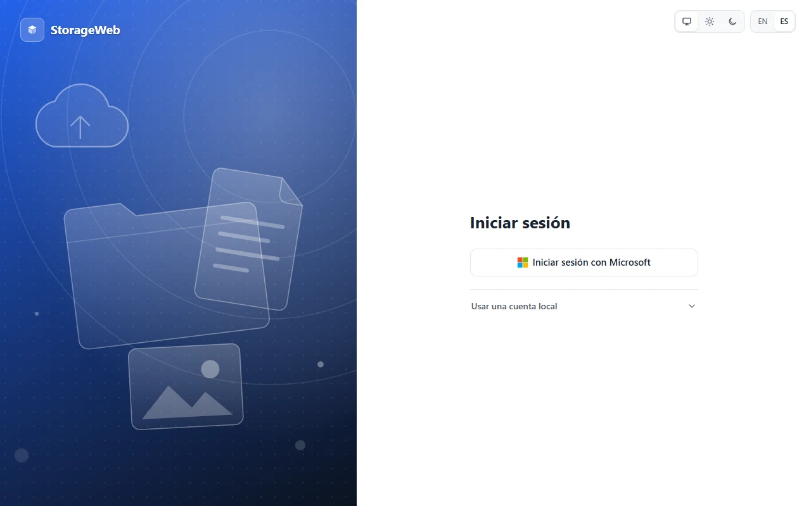

Si tu organización usa Microsoft, su botón va primero y el usuario y la contraseña quedan plegados en **Usar una cuenta local**. Arriba a la derecha puedes elegir el tema y el idioma.

Si fallas la contraseña varias veces seguidas, el acceso se bloquea unos minutos. Es una protección contra ataques; espera y vuelve a intentarlo.

## Tu cuenta: idioma, tema y perfil

Pulsa tus iniciales, abajo en la barra de la izquierda, para abrir el menú de tu cuenta:

- **Mi perfil:** a la izquierda, un menú con sus secciones, como en la administración: **Cuenta** (nombre visible, email, idioma y tema), **Seguridad** (cambio de contraseña —te pide la actual—, verificación en dos pasos y sesiones abiertas), **Tokens de API**, **Unidad de red** (la dirección lista para copiar) y **Espacio** (lo que ocupa tu carpeta). *Tokens de API* y *Unidad de red* solo aparecen si el administrador las tiene activadas. Si entras con Microsoft o con un usuario del sistema, tu nombre y tu contraseña se gestionan en ese sistema.
- **Idioma:** **EN** / **ES**. Si no eliges ninguno, se usa el de tu navegador, o el que haya configurado el administrador (por defecto, inglés).
- **Tema:** **Sistema** (sigue la configuración de tu equipo), **Claro** u **Oscuro**.
- **Salir.**

Tus preferencias se guardan en tu cuenta. En la página de inicio de sesión también puedes elegir el idioma y el tema.

### Verificación en dos pasos

Si entras con usuario y contraseña, puedes añadir un segundo paso: un código de seis dígitos que genera una aplicación del móvil (Microsoft Authenticator, Google Authenticator, FreeOTP…) o una **passkey** (Windows Hello, Touch ID, el móvil o una llave de seguridad, que confirmas con la huella, la cara o el PIN). Así, aunque alguien sepa tu contraseña, no puede entrar. Puedes tener las dos cosas y varias passkeys (la del portátil, la del móvil…).

**Con una passkey:** en *Mi perfil → Seguridad*, escribe un nombre para reconocerla y pulsa **Añadir una passkey**; el navegador te pide la huella, la cara o el PIN. Si es lo primero que activas, guarda los códigos de recuperación que aparecen. Al entrar, después de la contraseña pulsa **Usar una passkey**. (Si el botón no aparece, el servidor aún no tiene su dirección con HTTPS: avisa al administrador.)

**Con una aplicación:**

1. En *Mi perfil → Seguridad*, junto a *Verificación en dos pasos*, pulsa **Usar una aplicación de autenticación**.
2. Escanea el código QR con la aplicación (o escribe la clave que aparece debajo).
3. Escribe el código que muestra la aplicación y pulsa **Activar**.
4. **Guarda los códigos de recuperación** que aparecen: se enseñan una sola vez. Cada uno te deja entrar una vez si no tienes el móvil (o la passkey) a mano.

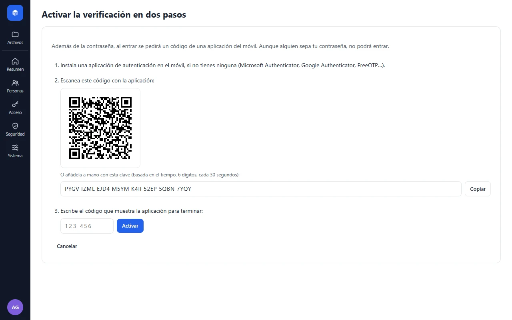

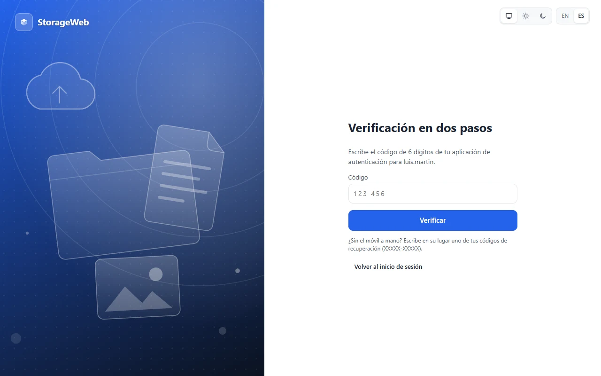

Desde entonces, al entrar se te pide el código después de la contraseña. Si tu organización la exige, se te pedirá configurarla la primera vez que entres. Para cambiar algo en el perfil (añadir o quitar la app o una passkey, renombrarla, generar códigos de recuperación nuevos —anulan los anteriores— o desactivarla) primero confirmas que eres tú con un código o una passkey; durante 5 minutos ya no se vuelve a pedir. Si pierdes el móvil, las passkeys y los códigos, pide a un administrador que te la quite. Con la verificación activada, la [unidad de red](unidad-de-red.md) solo admite tokens de API, no tu contraseña.

Si entras con Microsoft, la verificación en dos pasos la gestiona tu organización en Microsoft.

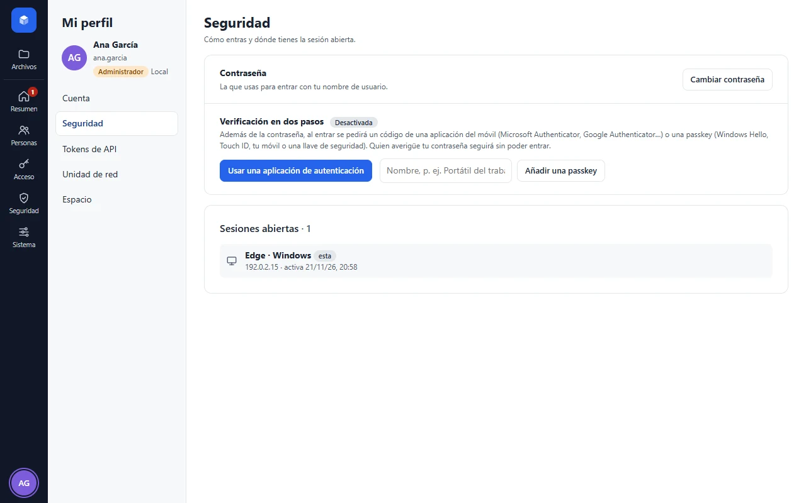

## La pantalla

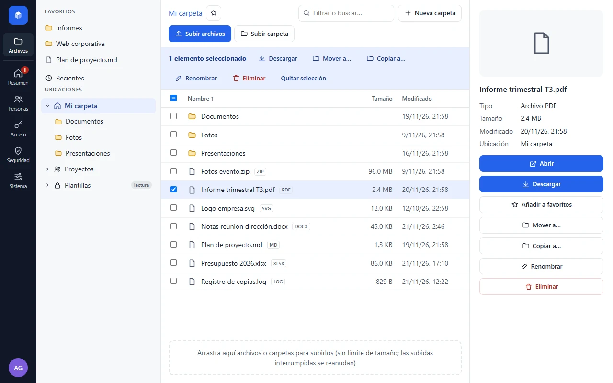

- **Barra de la izquierda:** *Archivos* y, si eres administrador, el *Resumen* y las zonas *Personas*, *Acceso*, *Seguridad* y *Sistema* (Ctrl+K busca en todas). Abajo, tus iniciales abren el menú de tu cuenta.
- **Ubicaciones:** *Mi carpeta*, solo tuya, y las carpetas compartidas que te haya asignado el administrador. Las marcadas *(lectura)* solo permiten descargar. Bajo la ubicación abierta se ven la ruta actual y sus subcarpetas.
- **Lista:** pulsa el nombre de una carpeta para entrar en ella, o el de un archivo para descargarlo. Pulsa los títulos *Nombre*, *Tamaño* o *Modificado* para ordenar; la segunda pulsación invierte el orden. El cuadro *Filtrar o buscar…* oculta lo que no coincide mientras escribes; con **Intro** busca en todas tus carpetas (ver *Buscar archivos*).
- **Carpetas con muchos elementos:** de una vez se muestran 200 (el administrador puede cambiarlo, de 50 a 5000). Según cómo lo haya configurado, el resto **se carga al bajar** (lo normal), se ve **por páginas** (*Anterior* / *Siguiente*) o **solo con el filtro**. Debajo de la lista pone cuántos se ven de cuántos. En estas carpetas el filtro busca entre **todos** sus elementos, no solo los que ya se ven, sin distinguir mayúsculas ni tildes.
- **Detalle (derecha):** sin nada seleccionado, muestra la carpeta, su **cuota** si tiene (cuánto lleva usado y qué porcentaje; a partir del 90 % (el administrador puede cambiarlo) y al superarla aparece además un aviso encima de la lista; lo que no quepa en la cuota no se puede subir, copiar ni mover a esa carpeta, salvo que el administrador haya dejado las cuotas solo como aviso) y el **espacio libre** de su almacenamiento, con una barra del espacio usado (naranja a partir del 80 %, roja del 95 %). En S3 y Azure no hay un tamaño fijo y lo dice; en otros almacenamientos remotos no se muestra. Al pulsar una fila (fuera del nombre) se selecciona y se muestran su tipo, tamaño, fecha y acciones. En pantallas estrechas el detalle aparece debajo de la lista, y en el móvil los paneles se apilan.

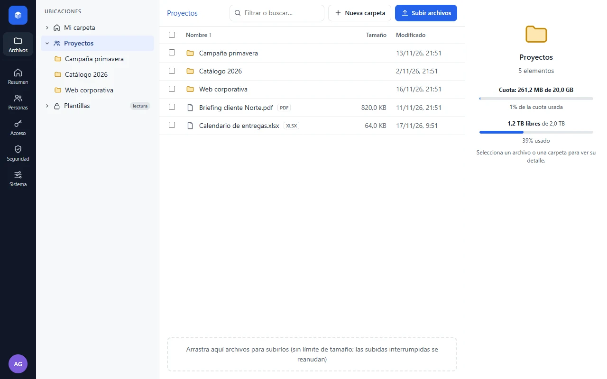

<p align="center">
  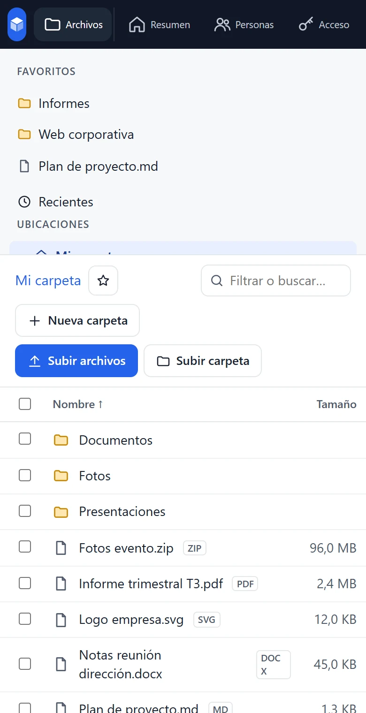
  &nbsp;&nbsp;
  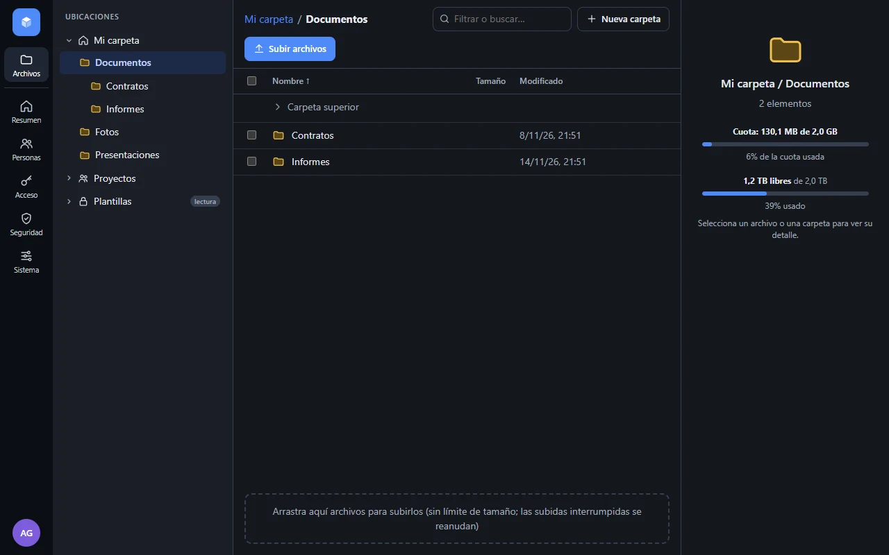
</p>

## Ver archivos en el navegador

Los archivos de texto, las imágenes, los PDF, los vídeos y el audio se abren en el navegador, sin descargarlos: con **doble clic**, pulsando su nombre o con **Abrir** en el panel de detalle. El resto (Office, comprimidos…) se descarga como siempre.

- **Markdown** (`.md`): se ve con formato (títulos, listas, tablas, código, citas, diagramas `mermaid`, enlaces e imágenes de la misma carpeta) y, en pantallas anchas, con un índice a la derecha. **Código** muestra el texto tal cual. Los enlaces a otros `.md` se abren también en el visor.
- **Texto y código** (`.txt`, `.log`, `.csv`, `.json`, `.yml`, `.ini`, `.py`, `.js`, `.ps1`, `.sql` y muchos más): con números de línea, **Ajustar líneas** para las largas y **Copiar todo**. En los `.log`, los avisos salen en ámbar y los errores en rojo. Para buscar dentro, la búsqueda del navegador (Ctrl+F).
- **Colores del código:** Python, PHP, JavaScript, TypeScript, SQL, YAML, JSON, PowerShell, Bash, C#, Java, Go… se ven coloreados, y también los bloques de código de los `.md` (con su lenguaje: ```` ```python ````). La cabecera dice el lenguaje. Los archivos de más de 1 MB y los `.log` (que tienen sus propios colores) se ven sin ellos.
- **HTML y SVG**: se ve su código, nunca la página. Abrirla aquí podría ejecutar lo que lleve dentro con tu sesión; para verla, descárgala.
- **Imágenes** (`.png`, `.jpg`, `.gif`, `.webp`, `.bmp`, `.ico`, `.avif`): entera en la ventana, sobre un fondo de cuadros donde es transparente; al pulsarla se ve a su tamaño real (y otra vez, de vuelta).
- **PDF**: con el visor de PDF de tu navegador (páginas, zoom, buscar, imprimir…). Si el navegador no tiene, se descarga.
- **Vídeo** (`.mp4`, `.m4v`, `.webm`, `.ogv`) y **audio** (`.mp3`, `.wav`, `.ogg`, `.opus`, `.m4a`, `.aac`, `.flac`, `.weba`): con su reproductor; puedes saltar a cualquier punto sin esperar a que baje entero. Si tu navegador no sabe reproducirlo (un formato que no tiene), lo dice y ofrece la descarga.
- Con las flechas de arriba pasas al archivo anterior o al siguiente de la carpeta que también se pueda ver.

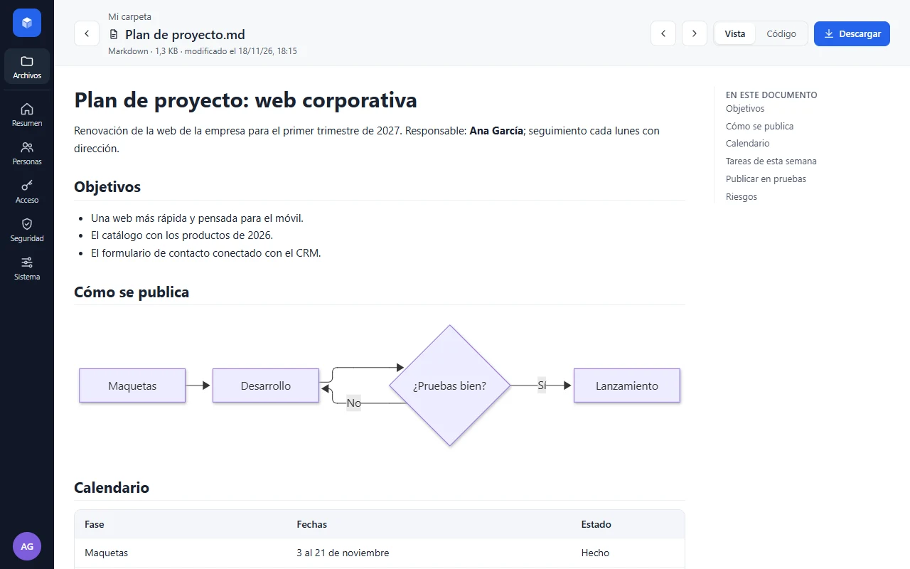

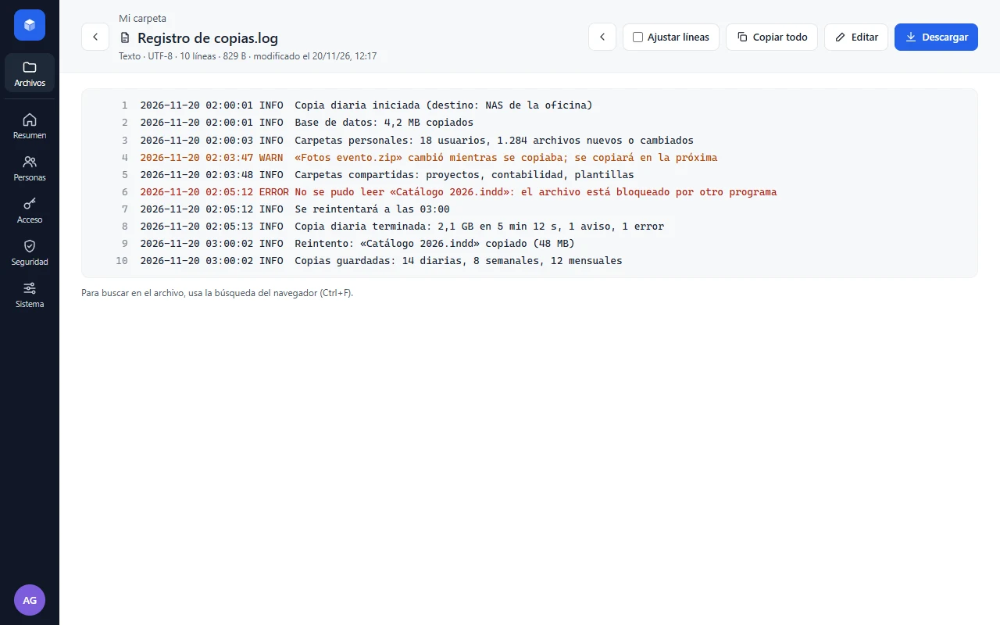

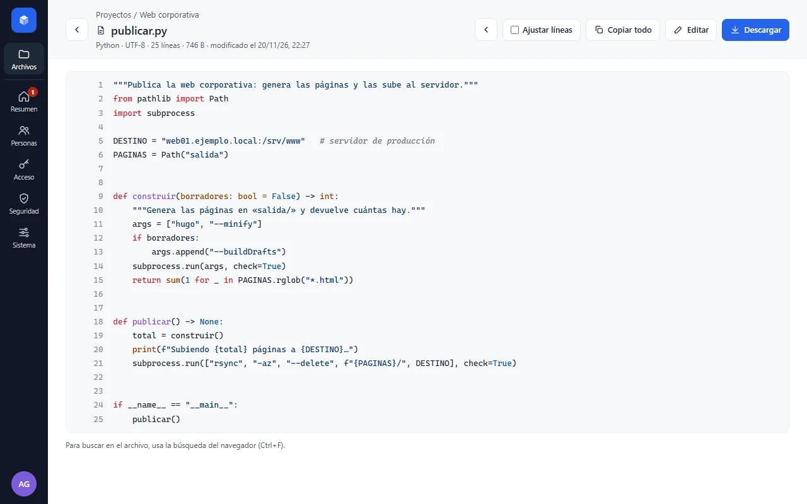

Se ven enteros los archivos de texto de hasta 2 MB (el administrador puede cambiarlo; las imágenes, los PDF, el vídeo y el audio no tienen límite). Un texto más grande, como un log, se ve **por partes**: de entrada la última, con los botones *Principio*, *Anterior*, *Siguiente* y *Final* para moverse; solo se lee esa parte, también en almacenamiento remoto. Un Markdown más grande, o un archivo que no es texto, se descarga. Si no está en UTF-8, se muestra como Windows-1252 (lo habitual en archivos antiguos de Windows) y lo avisa. Las imágenes de otras webs no se cargan dentro de un documento, para que nadie sepa quién lo está leyendo; queda un enlace para abrirlas. Los diagramas `mermaid` se dibujan (sin JavaScript se ve su código). Ver un archivo cuenta en la auditoría como una descarga (detalle `view`), una vez aunque saltes de un punto a otro de un vídeo.

El administrador decide en *Sistema → Vista previa* si hay visor, qué tipos multimedia se ven (imágenes, PDF, vídeo y audio, cada uno aparte), si se dibujan los diagramas, el tamaño máximo, la lista de extensiones que se abren y las que no se abren nunca. De serie no se abren los archivos de texto que suelen guardar secretos o claves (`.env`, `.pem`, `.key`, `.ppk`, `.asc`): se descargan. *Restablecer* devuelve una lista a la de serie y, antes, dice qué extensiones se añaden y cuáles se quitan. Ver `preview.*` en la [referencia de configuración](../referencia/configuracion.md).

### Editar un archivo de texto

Si tienes el permiso *Editar archivos de texto* (el administrador lo da en *Acceso → Permisos del rol*; los administradores lo tienen siempre), el visor muestra **Editar**: el archivo se abre en un cuadro de texto, **Guardar** (o **Ctrl+S**) lo guarda y vuelves al visor. Se edita el archivo entero, así que solo los que se ven enteros y en UTF-8; los de solo lectura, no.

- Ocupa toda la ventana y el código se ve **con sus colores**, como en el visor (hasta 256 KB; más grande, sin colores).
- **Barra de herramientas**, arriba del cuadro, con el lenguaje del archivo: en los `.md`, **negrita** (Ctrl+B), *cursiva* (Ctrl+I), tachado, código, enlace, título, lista, lista numerada, cita y bloque de código (pulsar otra vez quita el formato); en el código, **comentar o descomentar** las líneas seleccionadas (Ctrl+/, con el comentario de cada lenguaje: `#`, `//`, `--`, `<!-- -->`…) y sangrar o quitar sangría. Todo se deshace con Ctrl+Z.
- **Números de línea** a la izquierda, con la línea del cursor marcada; se ocultan o se muestran con **Números de línea** en la barra de estado (el navegador lo recuerda).
- **Barra de estado**, abajo: línea y columna (y cuántas líneas o caracteres hay seleccionados), *Sin guardar* si hay cambios, la sangría (**Espacios: 4**; pulsa para cambiar entre 2 espacios, 4 o tabuladores) y los finales de línea (**LF** o **CRLF**; pulsa para guardarlo con los otros).
- **Tab** sangra como el archivo (con tabuladores si ya los usa; si no, con los espacios que use); con varias líneas seleccionadas, las sangra todas, y **Mayús+Tab** les quita sangría. Para salir del cuadro con el teclado, **Esc** y luego **Tab**.
- Se guarda como estaba: en UTF-8, con sus finales de línea (Windows o Unix), su salto de línea final y su marca BOM si la tenía.
- Si sales con cambios sin guardar, el navegador te avisa.
- **No pisa los cambios de otro**: si alguien cambió el archivo desde que lo abriste (desde la web, la unidad de red o VS Code), no se guarda; te lo dice, conserva lo que escribiste y te deja abrir la versión actual en otra pestaña para comparar. Si guardas otra vez, sustituyes la suya.
- Guardar cuenta para la cuota y queda en la auditoría (`edit`) y en *Recientes*.

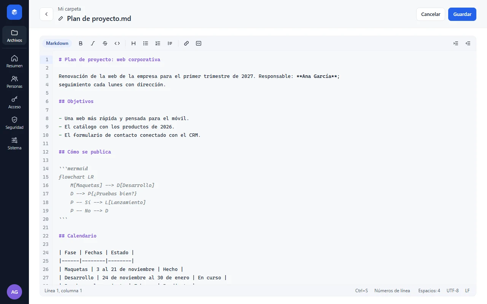

## Favoritos y recientes

- **Favoritos:** pulsa la estrella junto a la ruta para guardar la carpeta en la que estás, o **Añadir a favoritos** en el panel de detalle para un archivo o una carpeta. Salen arriba en el panel izquierdo; pulsa uno para ir a la carpeta o abrir el archivo.
- **Quitar un favorito:** pasa el ratón por encima en la lista y pulsa la **X** que aparece a la derecha (en una pantalla táctil, la X se ve siempre). Se quita al momento, sin recargar la página, y solo de tu lista: el archivo o la carpeta no se tocan. También se quita volviendo a pulsar la estrella o *Quitar de favoritos* en el panel de detalle. Vale también para un favorito cuyo archivo ya no existe.
- Si renombras, mueves o borras algo desde StorageWeb (la web o la unidad de red), sus favoritos lo siguen.
- **Recientes** (en el panel izquierdo): lo último que has abierto, descargado o subido desde la web, con su carpeta. Lo que hacen la unidad de red o la sincronización de VS Code no cuenta.

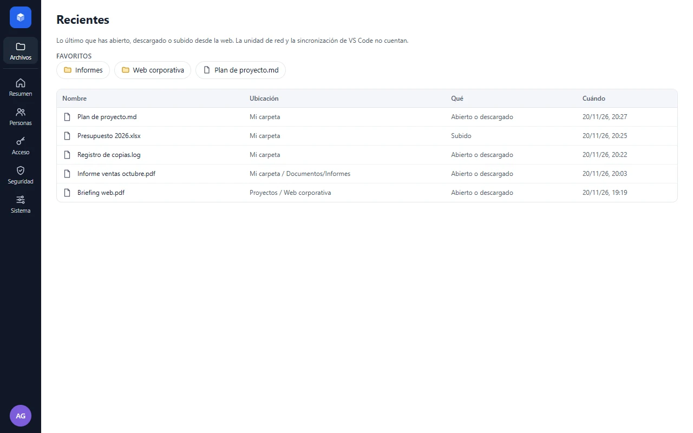

## Seleccionar varios

Marca las casillas de la izquierda, o la de la cabecera para seleccionar todo lo visible. Aparece una barra con **Descargar** (uno o varios; varios o una carpeta, en un ZIP), **Mover a…**, **Copiar a…**, **Renombrar** (un elemento) y **Eliminar** (uno o varios). Pulsa **Esc** o *Quitar selección* para deseleccionar.

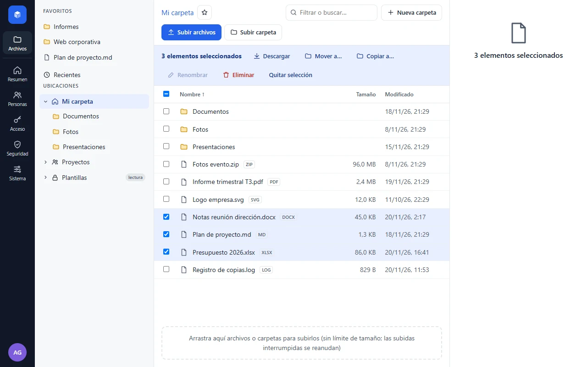

## Subir archivos

- Pulsa **Subir archivos** y elige uno o varios, o **arrástralos** sobre la página.
- Para subir una **carpeta entera**, con sus subcarpetas, pulsa **Subir carpeta** o arrástrala sobre la página. Las carpetas que falten se crean (hace falta el permiso de crear carpetas); las que ya existen se aprovechan. Las carpetas vacías no se suben.
- La barra muestra el progreso total. Puedes **Cancelar** en cualquier momento.
- Los archivos grandes se envían por partes. Si se corta la conexión, la subida se reintenta sola y continúa donde iba. Si cierras la página, vuelve a soltar el **mismo archivo en la misma carpeta** y continuará desde el último punto.
- Si ya existe un archivo con el mismo nombre, no se sobrescribe: el nuevo se guarda como `nombre (1).ext`.
- El texto de la zona de subida indica si hay un tamaño máximo por archivo.

## Descargar, crear carpetas, renombrar y eliminar

- **Descargar:** pulsa el nombre del archivo, o selecciónalo y usa **Descargar**. Las descargas grandes se pueden reanudar con el navegador o con un gestor de descargas.
- **Descargar varios o una carpeta entera:** van en un solo **ZIP**, que se genera mientras se descarga (sin esperas ni límite de tamaño). En cada carpeta, el botón de descargar la baja como ZIP. Lo oculto no va dentro, igual que no se ve en la lista.
- **Nueva carpeta:** el botón de la barra superior abre un pequeño formulario.
- **Renombrar y Eliminar:** desde la barra de selección o el panel de detalle. Eliminar una carpeta borra todo su contenido y no se puede deshacer.

Si no ves alguna de estas opciones, tu rol no tiene ese permiso o la carpeta es de solo lectura.

## Mover y copiar

- **Con la selección:** *Mover a…* o *Copiar a…* y elige la carpeta de destino: cualquiera de las tuyas, también otra compartida.
- **Arrastrando:** suelta los elementos sobre una carpeta de la lista o del árbol de la izquierda para **moverlos**; si mantienes `Ctrl` al soltarlos, se **copian**.

Nunca se sobrescribe nada: si en el destino ya hay algo con el mismo nombre, ese elemento no se mueve y se avisa. Mover dentro de la misma carpeta de StorageWeb necesita el permiso de renombrar; copiar, o mover a otra carpeta de StorageWeb, el de descargar en el origen y el de subir en el destino (mover, además, el de eliminar en el origen).

## Buscar archivos

Escribe en *Filtrar o buscar…*: mientras escribes, filtra la carpeta en la que estás. Pulsa **Intro** para buscar por nombre **en todas tus carpetas**. Da igual mayúsculas, minúsculas y tildes («ano» encuentra «Año 2026»), y con varias palabras busca los nombres que las contienen todas. Los resultados enlazan al archivo y a la carpeta donde está.

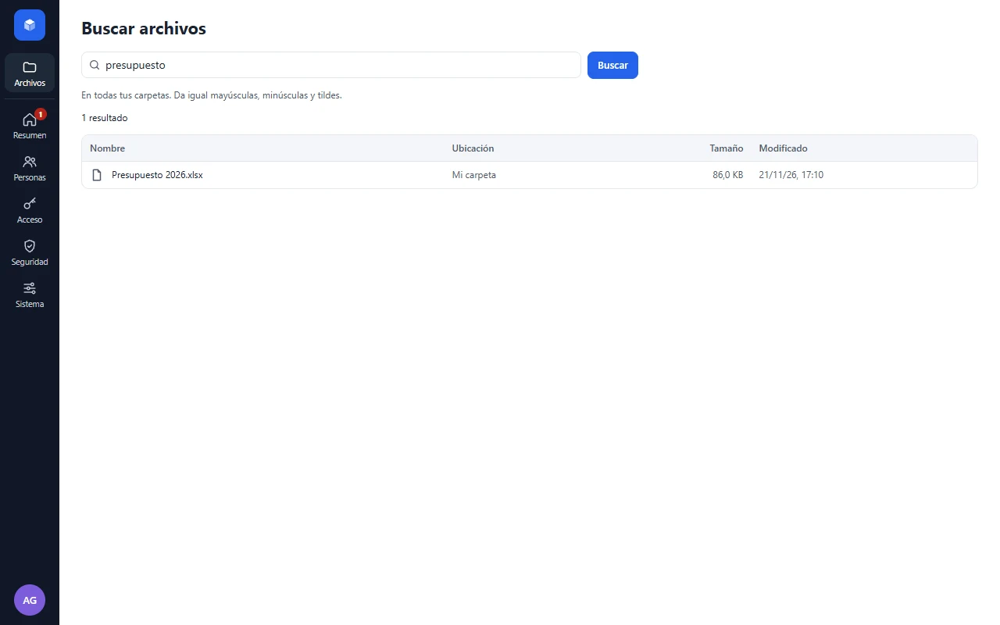

Para no tardar demasiado, la búsqueda se para a los 200 resultados, a los 8 segundos o si recorre demasiadas carpetas (el administrador puede cambiar los tres límites) (sobre todo en almacenamiento remoto: S3, SMB…); entonces lo avisa y conviene afinar las palabras. Con un token de API, `GET /search?q=…` devuelve los resultados en JSON.

En *Mi perfil → Espacio* ves lo mismo para tu carpeta personal.

## Sesiones y tokens de API

En *Mi perfil → Seguridad* ves los dispositivos en los que tienes la sesión abierta y puedes cerrar los demás. Si cambias la contraseña, las otras sesiones se cierran solas.

Si necesitas usar tus archivos desde un script, crea un **token de API** en *Mi perfil → Tokens de API*: elige si solo puede leer o también escribir, y cuándo caduca. Se muestra una sola vez; guárdalo como una contraseña. Ejemplos de uso en la [guía de seguridad](../administracion/seguridad.md#sesiones-y-tokens-de-api).

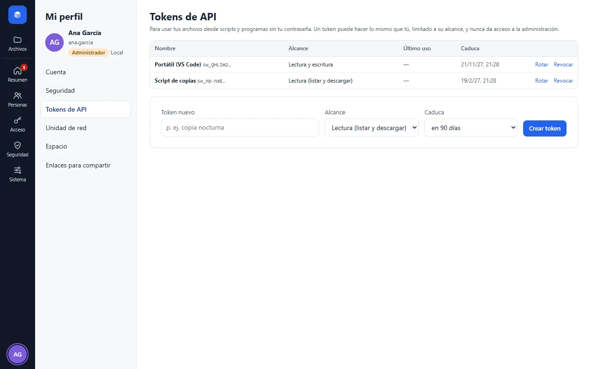

Cada token tiene dos acciones: **Rotar** te da un secreto nuevo con el mismo nombre, alcance y caducidad (contada desde hoy) y anula el anterior en el acto; úsalo si crees que alguien lo ha visto, o para renovarlo antes de que caduque. Lo que lo use (un script, la unidad de red, la extensión de VS Code) necesitará el nuevo. **Revocar** lo anula sin crear otro.

Con un token también puedes conectar tus carpetas como **unidad de red** en Windows, macOS o Linux: ver [Unidad de red](unidad-de-red.md). Y con la [extensión de VS Code](vscode.md) puedes trabajar con tus archivos desde el editor y sincronizar una carpeta del equipo; al **iniciar sesión en el navegador** desde ella, StorageWeb te pregunta si la permites y crea un token llamado «Visual Studio Code (*nombre del equipo*)», que puedes revocar aquí como cualquier otro.

## Cerrar sesión

Pulsa tus iniciales, abajo en la barra de la izquierda, y **Salir**. Si entraste con Microsoft y tu organización lo ha configurado, también se cierra tu sesión de Microsoft.

## Preguntas frecuentes

¿Quién ve mis archivos?
:   En *Mi carpeta*, solo tú desde la web. Los administradores del servidor tienen acceso al disco.

¿Hay papelera?
:   No. Lo eliminado se borra del servidor; pregunta al administrador por las copias de seguridad de los archivos.

¿Por qué no puedo subir a una carpeta compartida?
:   Es de solo lectura o tu rol no tiene permiso de subida.
