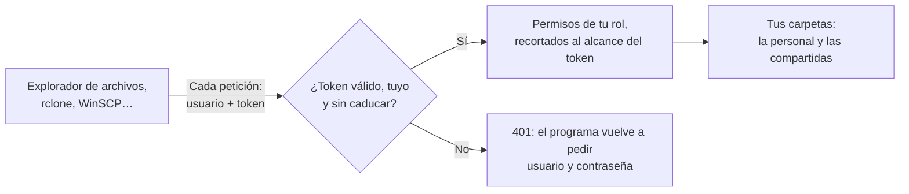

# Unidad de red (WebDAV)

StorageWeb también es un servidor **WebDAV**: tus carpetas (la personal y las compartidas a las que tienes acceso) aparecen como una unidad más en el explorador de archivos, o se pueden usar con programas como rclone, Cyberduck o WinSCP. Valen los mismos permisos que en la web.

| | |
|---|---|
| **Dirección** | `https://<servidor>/dav/` (en *Mi perfil → Unidad de red* está la tuya, lista para copiar) |
| **Usuario** | tu nombre de usuario de StorageWeb |
| **Contraseña** | un **token de API** (*Mi perfil → Tokens de API*). Con alcance *solo lectura* la unidad no deja cambiar nada. Si el administrador lo permite, también tu contraseña (usuarios locales y del sistema) |



!!! tip "¿Por qué un token y no mi contraseña?"
    Los programas guardan la contraseña de la unidad. Un token se puede limitar a lectura, poner con caducidad y revocar desde *Mi perfil* sin cambiar tu contraseña. Además, los usuarios de Microsoft (Entra ID) no tienen contraseña en StorageWeb: para ellos el token es la única forma.

!!! note "Archivos que empiezan por punto"
    La unidad de red muestra siempre los archivos y carpetas que empiezan por punto (`.gitignore`, `.venv`…), aunque la web los oculte (`storage.show_hidden`). Un programa que sincroniza tiene que ver todo lo que hay: si no, creería que se han borrado. Lo que el administrador oculta para todos (`storage.hidden`) no aparece en ningún sitio, tampoco aquí, ni se puede crear.

## Windows

!!! warning "Si no conecta"
    Lo más habitual es usar la contraseña de la cuenta cuando el administrador no la ha admitido: usa un token. Tras varios intentos fallidos con un token erróneo, la unidad se bloquea unos minutos para ese usuario (la web sigue funcionando).

1. *Explorador de archivos → Este equipo → Conectar a unidad de red*.
2. Elige una letra y escribe la dirección: `https://files.empresa.es/dav/`.
3. Marca *Conectar con otras credenciales* e introduce el usuario y el token.

Desde la línea de comandos: `net use Z: https://files.empresa.es/dav/ /user:ana sw_xxxxxxxx /persistent:yes`.

Limitaciones del cliente WebDAV de Windows (servicio *WebClient*):

- Necesita **HTTPS** con un certificado válido: Windows no envía la contraseña por HTTP salvo cambiando el registro (`BasicAuthLevel`), lo que no se recomienda.
- Por defecto no sube archivos de más de **50 MB** (`FileSizeLimitInBytes` en `HKLM\SYSTEM\CurrentControlSet\Services\WebClient\Parameters`; el máximo es 4 GB). Para archivos grandes, usa la web (subida por partes) o rclone.
- Si el servicio *WebClient* está desactivado, actívalo (`services.msc`).

## macOS

*Finder → Ir → Conectarse al servidor* (⌘K) → `https://files.empresa.es/dav/` → usuario y token.

## Linux

- **GNOME / KDE**: en el gestor de archivos, *Otras ubicaciones → Conectar al servidor* → `davs://files.empresa.es/dav/`.
- **Montaje** con `davfs2`: `sudo mount -t davfs https://files.empresa.es/dav/ /mnt/storageweb`.

## rclone (y sincronizar una carpeta del equipo)

```bash
rclone config create storageweb webdav url=https://files.empresa.es/dav/ vendor=other user=ana pass=$(rclone obscure sw_xxxxxxxx)
rclone ls storageweb:home
rclone copy ./informes storageweb:equipo/informes
```

Para **mantener sincronizada** una carpeta del equipo en los dos sentidos, `rclone bisync` (programado cada pocos minutos con el Programador de tareas de Windows, `cron` o un temporizador de systemd):

```bash
rclone bisync C:\Users\ana\StorageWeb storageweb:home --resync   # la primera vez
rclone bisync C:\Users\ana\StorageWeb storageweb:home            # las siguientes
```

Un cliente propio con sincronización al momento y archivos a petición está en la [hoja de ruta](../proyecto/hoja-de-ruta.md).

## Qué se puede hacer

| Operación | Permiso necesario |
|---|---|
| Ver y descargar | Descargar |
| Subir un archivo nuevo, copiar | Subir |
| Guardar cambios en un archivo existente (sobrescribir) | Subir **y** borrar (sobrescribir pierde la versión anterior) |
| Crear carpetas | Crear carpetas |
| Renombrar o mover dentro de la misma carpeta compartida | Renombrar |
| Mover a otra carpeta compartida | Descargar y borrar en el origen, subir en el destino |
| Borrar | Borrar |

En las carpetas de solo lectura, y con un token de solo lectura, solo se puede ver y descargar.

- **Bloqueos simulados:** Windows, macOS y Office piden «bloquear» un archivo antes de editarlo. StorageWeb dice que sí, pero no impide que otra persona lo edite a la vez: el último en guardar gana.
- Por WebDAV, cada archivo puede tener como mucho `server.max_upload_mb` (y `storage.max_file_size_mb`, si está puesto). La web no tiene el primer límite porque sube por partes.
- **Cuotas:** el Explorador de Windows muestra el espacio usado y libre de la unidad según la cuota de tu carpeta (o, sin cuota, el disco del servidor). Lo que no quepa se rechaza con `507 Insufficient Storage` y el motivo; Windows lo muestra como «no hay espacio suficiente».
- Todo queda en la [auditoría](../referencia/auditoria.md) como desde la web (detalle `webdav`).

## Para el administrador

- *Seguridad → API y unidad de red* activa o desactiva el servidor (`security.webdav`) y si se admite la contraseña de la cuenta (`security.webdav_passwords`, desactivado por defecto). Con `security.api_tokens` desactivado y sin contraseñas, nadie puede entrar.
- Los tokens o contraseñas erróneos cuentan para el bloqueo por intentos (con su **propio contador**: una unidad mal configurada, que reintenta sola, no bloquea el inicio de sesión en la web) y para el bloqueo automático de IPs. Usar la contraseña de la cuenta sin estar admitida no cuenta: queda en la auditoría como `webdav:password_not_allowed`, que es lo primero que hay que mirar si alguien no consigue conectar.
- **Por qué se deniega algo:** las respuestas de error llevan la cabecera `X-StorageWeb-Reason` con un código fijo, para que un programa (la extensión de VS Code, un script) diga el motivo en vez de un error genérico. También en la API con token (`Authorization: Bearer`).

    | Código | Respuesta | Qué significa |
    |---|---|---|
    | `account_disabled` | 401 | El token o la contraseña son buenos, pero la cuenta está desactivada |
    | `token_expired` | 401 | El token ha caducado (por su fecha o por `security.api_token_max_days`) |
    | `token_invalid` | 401 | El token no existe (revocado, borrado o mal copiado) |
    | `tokens_disabled` | 401 | El servidor no admite tokens de API (`security.api_tokens`) |
    | `password_not_allowed` | 401 | Se usó la contraseña de la cuenta y no se admite (`security.webdav_passwords`) |
    | `mfa_requires_token` | 401 | La cuenta tiene verificación en dos pasos: solo valen tokens |
    | `throttled` | 401 | Demasiados intentos fallidos: hay que esperar unos minutos |
    | `signed_out` | 401 | (El JavaScript de la web) la sesión ha terminado |
    | `ip_banned` | 403 | La IP está bloqueada |
    | `read_only` | 403 | La carpeta es de solo lectura para esa persona |
    | `token_read_only` | 403 | El token solo permite leer |
    | `no_permission` | 403 | Su rol no permite eso (subir, borrar…) |
    | `too_large` | 413 | Supera el tamaño máximo de archivo (`storage.max_file_size_mb`) |
    | `maintenance` | 503 | Se está restaurando una copia de seguridad: reintentar en un momento (`Retry-After`) |

    Una ruta a la que no se tiene acceso, o que no existe, es un 404 sin motivo (no se dice cuál de las dos). Una descarga larga que se corta a mitad (ver [Desactivar en lugar de eliminar](../administracion/usuarios-y-permisos.md#desactivar-en-lugar-de-eliminar)) cierra la conexión antes de enviar todo el `Content-Length`.
- Detrás de un proxy, el tamaño máximo de petición tiene que ser al menos `server.max_upload_mb`: en nginx, `client_max_body_size`; en Apache, `LimitRequestBody` (desde la 2.4.54 limita a 1 GB por defecto); en Caddy, `request_body { max_size … }`. Ver [HTTPS con nginx, Apache o Caddy](../administracion/https.md). Los tres dejan pasar los métodos de WebDAV (`PROPFIND`, `MOVE`…) sin configurar nada más.
