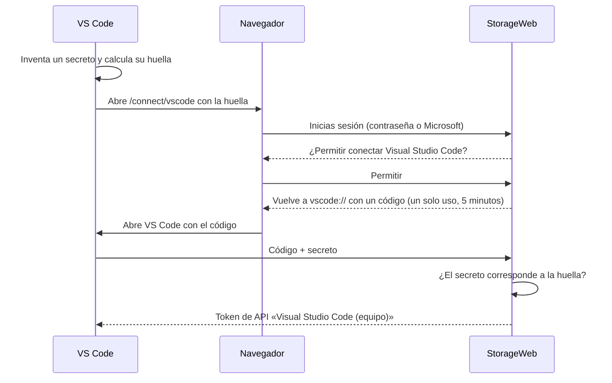
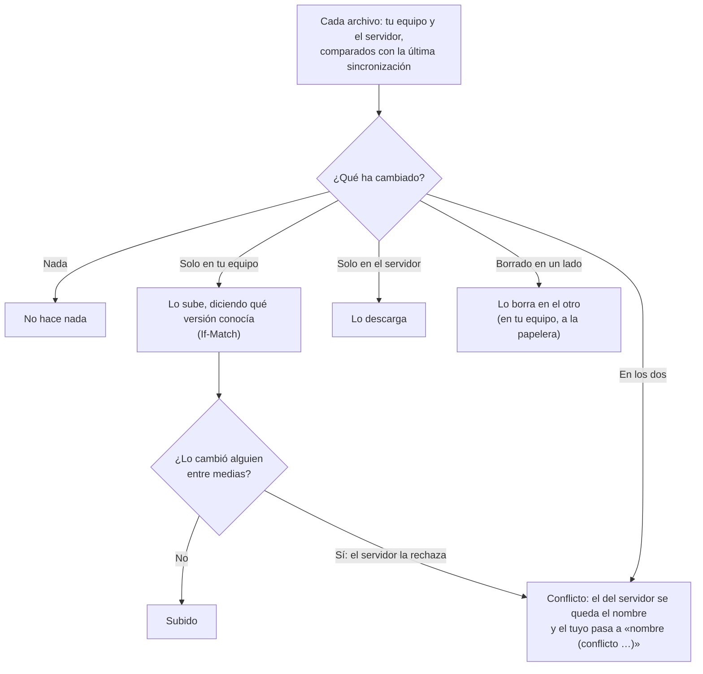

# Extensión de Visual Studio Code

La extensión **StorageWeb** añade a VS Code un panel propio en la barra lateral (como *Extensiones* o *Ejecutar y depurar*) desde el que:

- **Navegas por tus servidores** de StorageWeb (los que quieras, cada uno con su usuario): tu carpeta personal y las compartidas.
- **Abres y guardas archivos directamente en el servidor**, sin copiarlos a tu equipo, y subes, bajas, renombras o borras.
- **Sincronizas** una carpeta de tu equipo con una del servidor, en los dos sentidos: lo que guardas se sube al momento y lo que cambia en el servidor (otra persona, otro equipo, la web) te llega solo.

Está en `clients/vscode/` del repositorio. No hay que compilar nada: es JavaScript sin dependencias.

## Instalarla

Necesita VS Code 1.85 o posterior y que StorageWeb tenga activada la [unidad de red (WebDAV)](unidad-de-red.md), que viene así por defecto. No hay que compilar nada: la extensión está en JavaScript y no tiene dependencias.

### 1. Conseguir el fichero `.vsix`

- **De una versión publicada:** en la *release* de GitHub, el fichero `storageweb-sync-<versión>.vsix` (la extensión tiene su propia versión, distinta de la de StorageWeb).
- **De la última versión en desarrollo:** en GitHub, *Actions → CI →* la última ejecución de la rama principal → artefacto **storageweb-vscode** (es un `.zip` con el `.vsix` dentro).
- **Generarlo** desde el repositorio:
  ```bash
  python tools/build_vsix.py
  ```
  Crea `clients/vscode/dist/storageweb-sync-<versión>.vsix`; con `--install` lo instala además en VS Code (con la orden `code`). También está la tarea de VS Code *StorageWeb: empaquetar la extensión de VS Code* (*Terminal → Ejecutar tarea…*), que pregunta si instalarla al terminar.

### 2. Instalarlo en VS Code

- **Desde VS Code:** *Extensiones* (`Ctrl+Shift+X`) → `⋯` (arriba a la derecha) → **Instalar desde VSIX…** → elige el fichero.
- **Desde la consola:**
  ```bash
  code --install-extension storageweb-sync-0.4.0.vsix
  ```

Si VS Code ya estaba abierto al instalar desde la consola, **recarga la ventana** para que la cargue: `Ctrl+Shift+P` → *Developer: Reload Window* (*Desarrollador: Recargar ventana*), o el botón *Recargar* que aparece junto a la extensión. No hace falta cerrar VS Code. Al instalar desde la interfaz suele activarse sola; si no ves el icono de StorageWeb (una nube con una flecha) en la barra de actividad de la izquierda, recarga igual.

!!! warning "No hagas doble clic en el `.vsix`"
    En Windows, si tienes Visual Studio (el IDE, no VS Code) instalado, el doble clic abre el *Instalador de VSIX* de Visual Studio, que responde «Una o varias extensiones son para Visual Studio Code. Intente instalarlas en Visual Studio Code». El fichero está bien: instálalo con uno de los dos métodos de arriba.

Para **actualizarla**, instala el `.vsix` nuevo de la misma forma y recarga la ventana: sustituye al anterior y conserva la vinculación y el token. Para **quitarla**: *Extensiones* → StorageWeb → *Desinstalar* (no borra nada ni aquí ni en el servidor).

## El panel de StorageWeb

Pulsa el icono de StorageWeb en la barra de actividad (a la izquierda). Tiene dos secciones:

- **Servidores**: los servidores que has añadido y, dentro de cada uno, tu carpeta personal (`home`) y las compartidas a las que tienes acceso, para ir abriendo carpetas.
- **Sincronización**: las carpetas de esta ventana que se sincronizan, con su estado (sincronizado, sincronizando, error o sin token). Con clic derecho: *Sincronizar ahora*, *Abrir en el navegador*, *Ver el registro* y *Desvincular*.

### Añadir un servidor

En el panel, sección *Servidores*, botón **+** (*Añadir servidor…*). Escribe la dirección de StorageWeb (`https://archivos.empresa.es`) y elige cómo entrar:

- **Entrar con tu cuenta de Windows (Microsoft Entra ID)**, la primera opción si tu StorageWeb lo tiene activado: sin navegador y sin escribir nada (ver [Entrar con la cuenta de Windows](#entrar-con-la-cuenta-de-windows)).
- **Iniciar sesión en el navegador** (recomendado si no tienes la anterior). Se abre StorageWeb en tu navegador; entras como siempre (con Microsoft si tu StorageWeb usa Entra ID: en un equipo unido a Entra ID y con `auth.entra.auto_login`, sin escribir nada) y la página pregunta si permites conectar *Visual Studio Code* desde ese equipo, con qué alcance y hasta cuándo. Al pulsar **Permitir**, el navegador vuelve a VS Code (puede preguntar si abrir Visual Studio Code: acepta) y ya está: no hay que copiar nada. Se crea un token llamado «Visual Studio Code (*nombre del equipo*)», que ves y puedes revocar en *Mi perfil → Tokens de API*.
- **Usuario y token de API**, como antes: crea el token en StorageWeb, *Mi perfil → Tokens de API*, con alcance **lectura y escritura** (o **solo lectura** si solo vas a mirar y descargar), y escribe tu usuario y el token.

En todos los casos la extensión comprueba que funcionan antes de guardarlo. *Cambiar el token…* pregunta lo mismo; con la cuenta de Windows o el navegador tienes que entrar con el mismo usuario del servidor (otra cuenta es otro servidor).

Al iniciar sesión en el navegador, VS Code y StorageWeb se pasan el token así (OAuth con PKCE):



!!! note "Iniciar sesión en el navegador"
    Necesita que StorageWeb tenga los tokens de API activados (*Seguridad → API y unidad de red*, vienen así) y un servidor con esta versión o posterior; si no, la extensión lo dice y puedes usar usuario y token. No funciona en VS Code en el navegador (vscode.dev) ni en conexiones remotas. El intercambio es seguro aunque otro programa vea la vuelta a VS Code: el código solo vale una vez, durante 5 minutos, y solo con un secreto que la extensión nunca envía al navegador (PKCE).

### Entrar con la cuenta de Windows

En un equipo **unido a Microsoft Entra ID** (el de la empresa, con la sesión de Windows de tu cuenta del trabajo) y con un StorageWeb que usa Entra ID, la extensión puede entrar **con la cuenta con la que iniciaste sesión en Windows**, sin abrir el navegador:

1. Al añadir el servidor (o en *Cambiar el token…*), elige **Entrar con tu cuenta de Windows (Microsoft Entra ID)**.
2. VS Code pide a Windows (su agente de cuentas, el mismo que usan Office o Teams) un token de Microsoft para StorageWeb. **La primera vez Windows enseña su selector de cuenta**: elige tu cuenta del trabajo. Después ya no pregunta.
3. StorageWeb comprueba ese token y que tu cuenta puede entrar (las mismas reglas que en la web: grupos permitidos, alta automática, cuenta activa) y lo cambia por un token de API para este equipo, «Visual Studio Code (*nombre del equipo*)», que dura 90 días: se ve y se revoca en *Mi perfil → Tokens de API*.

Solo se ofrece con servidores `https://` (o el propio equipo), y la extensión solo pide a Windows el permiso de entrar en StorageWeb, nunca otro. Recuerda qué aplicación de Microsoft pidió cada servidor la primera vez: si luego pide otra, pregunta antes de usar tu cuenta (acéptalo solo si el administrador cambió la aplicación). Añade solo servidores de confianza: uno falso podría, la primera vez, pedir el token de otro StorageWeb.

Cuando el token caduca o se revoca, **Iniciar sesión otra vez** usa directamente la cuenta de Windows: normalmente basta con pulsar el botón.

Si no sale, la extensión dice por qué y ofrece las otras formas de entrar:

- Si cierras el selector de cuenta de Windows (o Windows no puede dar el token), lo avisa y pregunta otra vez sin esta opción.
- Si StorageWeb no deja entrar a esa cuenta, enseña el motivo que da el servidor (por ejemplo, que no está en los grupos permitidos) y ofrece **Entrar con otra cuenta de Windows**, que vuelve a enseñar el selector.

!!! note "Lo tiene que activar el administrador"
    La opción solo aparece si el administrador la ha activado en StorageWeb (*Entrar desde VS Code con la cuenta de Windows*, en la tarjeta de Entra ID: ver [Entra ID](../administracion/entra-id.md#entrar-desde-vs-code-con-la-cuenta-de-windows)) y con un servidor que lo admite; si no, la extensión solo ofrece el navegador y el token. Solo va en VS Code de escritorio, no en VS Code en el navegador (vscode.dev); sin el agente de cuentas de Windows (versiones antiguas de VS Code, otro sistema), VS Code abre el inicio de sesión de Microsoft en el navegador. VS Code usa su propia aplicación de Microsoft, que StorageWeb tiene autorizada: no hay que consentir nada.

Puedes añadir varios: servidores distintos, o el mismo con otra cuenta. Con clic derecho sobre un servidor: *Editar servidor…* (el nombre que se ve o la dirección), *Cambiar el token…*, *Abrir en el navegador* y *Quitar servidor* (borra su token de este equipo; en el servidor no se borra nada). Si el servidor rechaza el token (lo revocaste o caducó), el panel lo dice y ofrece ponerlo otra vez.

### Trabajar con los archivos del servidor

- **Abrir:** clic en un archivo. Se abre en VS Code directamente desde el servidor y, al guardar (`Ctrl+S`), se guarda en el servidor.
- **Clic derecho sobre una carpeta:** *Nueva carpeta…*, *Subir archivos…*, *Subir carpeta…*, *Descargar…* (la carpeta entera), *Renombrar…*, *Borrar*, *Abrir en el navegador*, *Sincronizar con una carpeta local…* y *Añadir al espacio de trabajo*. Subir y crear carpetas también están como botones al pasar el ratón.
- **Clic derecho sobre un archivo:** *Abrir*, *Descargar…*, *Renombrar…*, *Borrar* y *Abrir en el navegador*.
- **Añadir al espacio de trabajo:** la carpeta del servidor aparece en el *Explorador* de VS Code junto a las tuyas, con lo habitual: abrir, guardar, crear, renombrar, arrastrar para copiar… Los archivos no se copian a tu equipo: cada operación va al servidor.

Al guardar **no se pisan cambios ajenos**: si el archivo cambió en el servidor desde que lo abriste, VS Code avisa y te deja comparar o sobrescribir; y si cambia justo mientras se guarda, el servidor rechaza la escritura (`If-Match`) y te pide que lo vuelvas a abrir. Borrar en el servidor **no se puede deshacer** (StorageWeb no tiene papelera): la extensión pregunta antes.

**Lo que cambien otros en el servidor llega solo** a lo que tienes abierto: cada 30 segundos (`storageweb.refreshSeconds`, solo con la ventana de VS Code activa y enseguida al volver a ella) la extensión comprueba los archivos abiertos y las carpetas desplegadas en el *Explorador* (una consulta por cada uno). Si un archivo abierto cambió y no tienes cambios sin guardar, el editor lo recarga; si los tienes, VS Code te avisa al guardar. Las carpetas del *Explorador* muestran lo que se haya creado o borrado. En el panel *Servidores*, pulsa *Actualizar* (el botón de la sección o el de cada carpeta).

## Sincronizar una carpeta

Hay dos formas:

- **Desde el panel:** clic derecho sobre una carpeta del servidor → **Sincronizar con una carpeta local…** y elige la carpeta de tu equipo. Si no está abierta en VS Code, la extensión ofrece abrirla (aquí, en otra ventana o añadiéndola al espacio de trabajo) y la vincula al abrirse.
- **Con la carpeta ya abierta:** en la sección *Sincronización*, el botón de enlace, o `Ctrl+Shift+P` → **StorageWeb: Sincronizar una carpeta de esta ventana…**. Eliges el servidor (o añades uno; si no tiene token en este equipo, pregunta cómo entrar) y navegas hasta la carpeta del servidor (o creas una con *Nueva carpeta aquí…*).

La primera sincronización junta las dos carpetas: sube lo que solo está en tu equipo, baja lo que solo está en el servidor y, si un archivo está en los dos, compara el contenido. Si es igual, no hace nada; si no, guarda las dos versiones (ver *Conflictos*). No borra nada.

El icono de la nube de la barra de estado resume el estado de todas (sincronizado, sincronizando o error). Al pulsarlo aparecen *Sincronizar ahora*, *Abrir en el navegador*, *Ver el registro* y *Desvincular*.

## Cómo sincroniza



- **Al guardar**, crear, renombrar o borrar un archivo, sube o borra solo ese archivo (a los 1,5 s, juntando los cambios seguidos).
- **Cada minuto** (`storageweb.pollSeconds`), una sincronización completa trae lo que cambió en el servidor.
- **Nunca pisa cambios ajenos.** Cada subida dice qué versión del archivo conocía (`If-Match`): si alguien lo cambió en el servidor entre medias, StorageWeb la rechaza y la extensión lo trata como conflicto.
- **Conflictos:** si un archivo cambió aquí y en el servidor, la versión del servidor se queda con el nombre original y la tuya pasa a `nombre (conflicto AAAA-MM-DD HHMM).ext`, que también se sube. Un aviso ofrece **Comparar** las dos con la vista de diferencias de VS Code. Nunca se pierde nada.
- **Borrados:** lo que se borra en tu equipo porque se borró en el servidor va a la **papelera**. Si una sincronización fuera a borrar más de `storageweb.confirmDeletesOver` archivos de golpe (por ejemplo, porque se vació una carpeta por error), pregunta antes; si dices que no, los recupera del lado que todavía los tiene.
- **Sin cuota:** si el servidor rechaza una subida porque no cabe en la cuota de la carpeta, la extensión para (el resto fallaría igual) y lo avisa con el motivo. Libera espacio o pide más cuota y sincroniza de nuevo.
- **Sin acumular:** si una sincronización completa tarda mucho (la primera de una carpeta grande), la siguiente espera al menos el triple de lo que tardó, y nunca se ponen varias en cola. Una pasada larga guarda lo hecho por el camino: si se corta, la siguiente sigue donde iba.
- **Protección contra bucles:** antes de la primera sincronización, la extensión deja un archivo de prueba en la carpeta del servidor y mira si aparece en tu carpeta. Si aparece, tu carpeta contiene el sitio donde el servidor guarda esos archivos (por ejemplo, un StorageWeb de pruebas que guarda sus datos dentro del proyecto que sincronizas): cada subida volvería a aparecer dentro, sin fin. No sincroniza nada y ofrece **excluir esa carpeta** o desvincular.

## Qué no se sincroniza

- **Siempre:** `.git`, `.svn`, `.hg`, `node_modules`, `.venv`, `venv`, `__pycache__`, `.pytest_cache`, `.mypy_cache`, `.ruff_cache`, `.tox`, `*.pyc`, los temporales de Office y del sistema, y `.vscode/settings.json` (donde está la vinculación).
- **Lo que ignora el `.gitignore`** de la raíz de la carpeta (ajuste `storageweb.useGitignore`, activado por defecto).
- **Lo que pongas en `.storagewebignore`**, en la raíz de la carpeta, con el formato de `.gitignore`:
  ```gitignore
  # Comentario
  /.dev/          # esa carpeta, solo en la raíz
  dist/           # cualquier carpeta «dist»
  *.log           # por extensión, en cualquier sitio
  docs/borradores/*.bak
  ```
  Este fichero **también se sincroniza**, así que vale para todos los equipos que usen la carpeta. Las líneas con `!` (excepciones) no se admiten: se ignoran y se avisa en el registro.
- **Lo que pongas en `storageweb.exclude`** (ajustes de VS Code), solo en este equipo: por ejemplo `["dist/**", "**/*.log"]`.
- **Lo que el administrador oculta en el servidor** (`storage.hidden`, ver [Almacenamiento](../administracion/almacenamiento.md#ocultar-archivos-para-todos)): si tienes un archivo así en tu carpeta, el servidor no lo acepta. La extensión lo apunta, **no lo sube ni lo borra de tu equipo**, y lo vuelve a probar una vez al día (por si deja de estar oculto). El registro dice cuántos hay.

Lo más rápido: en el *Explorador*, clic derecho sobre un archivo o carpeta → **No sincronizar**. Lo añade al `.storagewebignore` (creándolo si no existe). En el panel *Sincronización*, clic derecho → **Editar exclusiones (.storagewebignore)** lo abre. Al guardarlo, la sincronización vuelve a empezar con las exclusiones nuevas. Lo que ya estaba en el servidor **se queda allí**: excluir no borra nada, ni aquí ni allí.

## Pausar

En el panel *Sincronización*, el botón de pausa de cada carpeta (o el de arriba, para todas), o el icono de la barra de estado → **Pausar la sincronización**. Para en el acto la pasada que esté en marcha, deja de vigilar tus cambios y de consultar el servidor. La pausa se mantiene aunque cierres o recargues VS Code, hasta que pulses **Reanudar** (o *Sincronizar ahora* sobre esa carpeta). Al reanudar se hace una sincronización completa con lo que haya cambiado en los dos lados mientras tanto.

## Cuando el servidor no deja hacer algo

StorageWeb dice a la extensión por qué deniega algo (cabecera `X-StorageWeb-Reason`), y la extensión lo explica en vez de dar un error genérico. Cada aviso sale **una vez**, no en cada vuelta: se repite solo si cambia, al reanudar o al pulsar *Sincronizar ahora*. El estado de la carpeta (panel *Sincronización* y barra de estado) lo sigue diciendo mientras dure.

| Qué pasa | Qué hace la extensión |
|---|---|
| Tu cuenta está **desactivada** | Para la sincronización y avisa: «Tu cuenta de StorageWeb está desactivada: pregunta a un administrador». |
| El **token ha caducado** o se revocó | Para y ofrece **Iniciar sesión otra vez** (con la cuenta de Windows si el servidor lo admite; si no, en el navegador) o **Cambiar el token…**. |
| El servidor ya no admite tokens, o la cuenta tiene verificación en dos pasos y se usó la contraseña | Para y lo explica. |
| **Demasiados intentos fallidos** | Espera 5 minutos y lo vuelve a intentar sola. |
| La **IP de tu equipo está bloqueada** | Para y avisa: lo tiene que desbloquear un administrador. |
| El servidor está **en mantenimiento** (restaurando una copia) | Sin avisos: el estado lo dice y lo vuelve a intentar en la siguiente vuelta. |
| La **carpeta del servidor ya no existe o ya no tienes acceso** | La sincronización de esa carpeta queda **en pausa** y **no se borra nada** en tu equipo. El aviso ofrece *Sincronizar ahora* (cuando vuelvas a tener acceso) y *Desvincular*. El servidor no distingue los dos casos a propósito. |
| La carpeta es **de solo lectura** para ti, el **token es de solo lectura** o tu **rol no deja subir** | Avisa de que los cambios no se pueden subir y por qué. No intenta el resto de subidas de esa vuelta, pero lo que cambie en el servidor sigue llegando. Lo que modificaste y no se pudo subir **se queda en tu equipo** (en un conflicto, tu versión queda como copia solo aquí). Lo que **borraste** en tu equipo **se vuelve a bajar** del servidor (el aviso lo dice): no queda como borrado pendiente que se haría solo si más adelante te dieran permiso. |
| Un archivo **supera el tamaño máximo** del servidor | Avisa con los nombres, sube lo demás y no lo vuelve a intentar hasta que el archivo cambie. |
| Una **descarga se corta a medias** (p. ej. al desactivar la cuenta o quitar el acceso mientras tanto) | Se trata como un fallo de red: nunca se guarda un archivo incompleto. |

Con los archivos del servidor abiertos directamente (`storageweb://`), al abrir o guardar sale el mismo motivo («No permitido: la carpeta es de solo lectura para ti», «El token de API ha caducado…»). Si el servidor rechaza las credenciales, la cuenta o la IP, la extensión deja de comprobar si esos archivos cambian (seguir preguntando solo sumaría intentos fallidos) y lo avisa una vez; vuelve a comprobarlos al cambiar el token o en cuanto algo funciona otra vez.

## Ajustes

| Ajuste | Por defecto | |
|---|---|---|
| `storageweb.server`, `storageweb.username`, `storageweb.remoteFolder` | | Los pone *Sincronizar*, en los ajustes de la carpeta (`.vscode/settings.json`) |
| `storageweb.autoSync` | `true` | Subir al guardar, crear, renombrar o borrar |
| `storageweb.pollSeconds` | `60` | Segundos entre sincronizaciones completas (mínimo 15) |
| `storageweb.refreshSeconds` | `30` | Segundos entre comprobaciones de los archivos del servidor abiertos (`storageweb://`); `0` = nunca, mínimo 5 |
| `storageweb.exclude` | `[]` | Más patrones que no se sincronizan, solo en este equipo |
| `storageweb.useGitignore` | `true` | No sincronizar lo que ignora el `.gitignore` de la raíz de la carpeta |
| `storageweb.confirmDeletesOver` | `10` | Preguntar antes de borrar más de estos archivos de una vez |

La **lista de servidores** se guarda en este equipo (en los datos de la extensión, no en los ajustes) y el **token** de cada uno en el almacén de secretos de VS Code (el del sistema operativo), nunca en los ajustes ni en el proyecto. *Quitar servidor* o *StorageWeb: Olvidar el token* lo quitan de este equipo; para anularlo del todo, revócalo en *Mi perfil*. Las carpetas que ya sincronizabas con la versión 0.1 aparecen solas en *Servidores*.

## Seguridad

- Usa la unidad de red de StorageWeb (`/dav/`) con los mismos permisos que la web. Con un token de solo lectura, los cambios no se suben.
- Solo funciona en espacios de trabajo de confianza (VS Code pregunta al abrir una carpeta desconocida).
- Lo que sube y baja queda en la [auditoría](../referencia/auditoria.md) con el detalle `webdav`.

## Limitaciones

- Las carpetas vacías no se sincronizan, solo los archivos.
- Abrir archivos del servidor sin sincronizar necesita conexión: sin red no se abren ni se guardan. La búsqueda de VS Code (`Ctrl+Shift+F`) no busca dentro de las carpetas del servidor añadidas al espacio de trabajo.
- El panel no se entera solo de los cambios que hacen otros: *Actualizar*.
- Cada archivo, como mucho `server.max_upload_mb` del servidor.
- La sincronización completa recorre toda la carpeta (una consulta al servidor por cada subcarpeta): con muchos miles de archivos, excluye lo que no haga falta o sube `storageweb.pollSeconds`. No sincronices carpetas enteras de dependencias o compilados.
- Entrar con la cuenta de Windows necesita un equipo unido a Entra ID, VS Code de escritorio y que el administrador lo active; si no, *Iniciar sesión en el navegador* también usa el inicio de sesión de Microsoft.

## Para desarrolladores

```bash
node --test clients/vscode/test/*.test.js      # tests de la extensión (Node 18 o posterior)
python tools/build_vsix.py --install # empaqueta e instala en este VS Code (luego, recargar la ventana)
```

La lógica está en módulos sin VS Code que se prueban con Node:

| Módulo | |
|---|---|
| `src/sync.js` | Motor de sincronización: tres vías, conflictos, comprobación de bucle, cancelar, rutas ocultas en el servidor |
| `src/dav.js` | Cliente WebDAV (el motivo de `X-StorageWeb-Reason` en `DavError.code`; descargas cortadas = error de red) |
| `src/messages.js` | Qué decir según el motivo que da el servidor (lo usan los avisos, los paneles y `storageweb://`) |
| `src/remotefs.js` | Los archivos de un servidor como sistema de archivos |
| `src/servers.js` | Lista de servidores (tokens en el almacén de secretos) |
| `src/connect.js` | Iniciar sesión en el navegador (PKCE, [ADR 0016](../arquitectura/decisiones/0016-conectar-aplicaciones-con-el-navegador.md)) y canjear el token de Microsoft de la cuenta de Windows (`/connect/desktop`) |
| `src/glob.js`, `src/localfs.js` | Exclusiones (`.storagewebignore`, `.gitignore`) y disco local |

`src/provider.js` y `src/views.js` los adaptan a la API de VS Code (`storageweb://` y los paneles) y `src/extension.js` añade comandos, avisos, pausa y la vigilancia de cambios.

Pruebas:
- `test/extension.test.js` carga la extensión con un `vscode` simulado (`test/vscode-mock.js`) y comprueba que cada comando del `package.json` existe.
- `test/robust.test.js` cubre los casos que salieron usándola: archivos que el servidor no lista, bucles, cancelar, exclusiones y archivos ocultos.
- `tests/integration/test_vscode_extension.py` arranca un StorageWeb de verdad (con `storage.hidden`) y ejecuta todo contra él, sin omitir nada:
  - **dos equipos** sincronizando la misma carpeta;
  - los paneles y `storageweb://`;
  - el bucle;
  - iniciar sesión en el navegador, con un «navegador» de prueba (`test/browser.js`).
- Se omite si no hay Node.

Cada cambio que quieras instalar necesita **subir la versión** en `package.json`: VS Code no recarga un `.vsix` reinstalado con la misma versión. No se usa npm: si alguna vez hiciera falta una dependencia, con pnpm.
